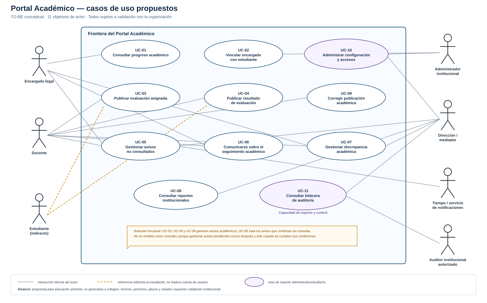

# Portal Académico — Centro Educativo María Montessori

## Actores del MVP

**Alcance:** educación primaria.  
**Nombre anterior:** *Conecta Montessori* fue un nombre provisional; el nombre canónico es **Portal Académico — Centro Educativo María Montessori**.

## 1. Resumen de actores

| Actor | Tipo | Participación en el MVP | Estado de la definición |
|---|---|---|---|
| Persona encargada legal | Humano, primario | Consulta progreso, recibe avisos, se comunica y presenta discrepancias. | Existencia confirmada; permisos y vínculo detallado por validar. |
| Docente | Humano, primario | Registra y publica eventos y resultados, confirma congruencia y atiende consultas. | Rol necesario; procedimiento exacto por validar. |
| Dirección / figura mediadora | Humano, primario | Supervisa comunicación, consulta reportes y atiende escalaciones. | Dirección confirmada como fuente; mediación formal es hipótesis. |
| Administrador institucional | Humano, de apoyo | Gestiona cuentas, roles, catálogos, vínculos y parámetros. | Rol propuesto para operar el sistema. |
| Estudiante | Humano, indirecto | Es sujeto de la información y hoy transporta las hojas. | Intermediación actual confirmada; sin cuenta en el MVP. |
| Servicio programado de avisos | Sistema, secundario | Genera avisos, recordatorios y alertas según reglas configuradas. | Comportamiento propuesto; canal por validar. |
| Proveedor externo de notificación | Sistema externo, secundario y opcional | Transporta un aviso y devuelve el resultado técnico disponible. | Hipótesis; podría ser correo u otro canal aprobado. |

## 2. Fichas de actores

### A-01 — Persona encargada legal

- **Objetivo:** conocer oportunamente el seguimiento académico de los estudiantes que tiene autorizados y poder solicitar aclaraciones con evidencia.
- **Problema que enfrenta:** la recepción de calificaciones depende actualmente de que el estudiante entregue una hoja impresa; se han reportado retrasos u ocultamiento.
- **Responsabilidades en el Portal:** proteger sus credenciales, mantener datos de contacto acordados, consultar publicaciones y utilizar los canales institucionales de comunicación.
- **Acciones permitidas:** seleccionar un estudiante vinculado; consultar perfil, historial y avisos; leer y responder mensajes; abrir y consultar discrepancias.
- **Acciones no permitidas:** consultar estudiantes sin vínculo activo; editar calificaciones; cambiar estados o resoluciones institucionales; administrar usuarios.
- **Datos que utiliza:** identidad y contacto propios, estudiantes vinculados, publicaciones académicas, avisos, mensajes y discrepancias autorizadas.
- **Frecuencia esperada:** asociada con eventos académicos y recordatorios; no cuantificada todavía.
- **Evidencia:** existencia de personas encargadas y quejas confirmada por la Dirección.
- **Preguntas pendientes:** ¿cómo se acredita el vínculo?, ¿puede haber varios encargados?, ¿cómo se manejan restricciones de custodia?, ¿qué canal y horario son aceptables?, ¿qué nivel de conectividad existe?

### A-02 — Docente

- **Objetivo:** registrar y comunicar información académica de manera consistente y eficiente, manteniendo su criterio profesional.
- **Problema que enfrenta:** la propuesta debe evitar convertir cada aviso en una tarea individual y debe mantener congruencia mientras coexistan registros físicos y digitales.
- **Responsabilidades en el Portal:** crear evaluaciones para sus grupos; registrar resultados; confirmar la correspondencia con el medio físico oficial; atender mensajes y discrepancias asignadas; justificar correcciones.
- **Acciones permitidas:** operar únicamente sobre grupos, materias, publicaciones y casos bajo su responsabilidad; consultar el historial necesario para responder.
- **Acciones no permitidas:** acceder a grupos ajenos sin autorización; activar vínculos familiares; borrar versiones publicadas; usar IA para decidir notas o reclamos.
- **Datos que utiliza:** grupos, materias, estudiantes asignados, evaluaciones, resultados, confirmaciones, mensajes y casos.
- **Frecuencia esperada:** por cada evaluación y devolución; volumen real pendiente de levantamiento.
- **Evidencia:** la escuela genera hojas de calificaciones; el flujo docente exacto y su carga todavía son hipótesis por validar.
- **Preguntas pendientes:** ¿quién prepara e imprime las hojas?, ¿qué registra cada docente?, ¿cuántos grupos y estudiantes maneja?, ¿qué constituye el medio físico oficial?, ¿quién puede corregir una nota?

### A-03 — Dirección / figura mediadora

- **Objetivo:** supervisar que la información llegue a las familias, identificar pendientes y asegurar un tratamiento trazable de los casos escalados.
- **Problema que enfrenta:** existen quejas por comunicación tardía, pero falta confirmar los indicadores, el protocolo y la autoridad que interviene.
- **Responsabilidades en el Portal:** aprobar políticas; consultar reportes autorizados; dar seguimiento a avisos pendientes; recibir o reasignar escalaciones; registrar resoluciones cuando corresponda.
- **Acciones permitidas:** consultar agregados y casos institucionales según permisos; configurar o aprobar plazos; asignar responsables; intervenir en escalaciones.
- **Acciones no permitidas:** modificar una calificación fuera del procedimiento autorizado; asumir automáticamente la función pedagógica del docente.
- **Datos que utiliza:** indicadores de rendimiento, estados de comunicación, antigüedad de casos, bitácoras y resoluciones.
- **Frecuencia esperada:** seguimiento periódico y atención por excepción; periodicidad por validar.
- **Evidencia:** Dirección es la fuente del levantamiento. La existencia de una figura mediadora y sus facultades no está confirmada.
- **Preguntas pendientes:** ¿quién media hoy?, ¿qué casos llegan a Dirección?, ¿qué plazos y criterios usa?, ¿qué detalle debe incluir cada reporte?

### A-04 — Administrador institucional

- **Objetivo:** mantener usuarios, permisos y datos maestros correctos para que el acceso sea seguro.
- **Problema que enfrenta:** el Portal requiere una responsabilidad explícita para activar vínculos, roles, periodos, grupos, materias y políticas.
- **Responsabilidades en el Portal:** crear o suspender cuentas; asignar roles; validar relaciones encargado–estudiante; mantener catálogos; configurar recordatorios autorizados.
- **Acciones permitidas:** administrar configuración operativa sin alterar contenido pedagógico ni resolver discrepancias.
- **Acciones no permitidas:** consultar información académica individual salvo permiso institucional separado; editar notas por su función administrativa.
- **Datos que utiliza:** cuentas, roles, vínculos, periodos, grupos, materias y parámetros.
- **Frecuencia esperada:** al inicio de periodos y ante cambios; volumen por validar.
- **Evidencia:** actor propuesto por necesidad operativa, no confirmado todavía por la organización.
- **Preguntas pendientes:** ¿lo asume Dirección, secretaría o soporte?, ¿qué comprobantes exige un vínculo?, ¿quién autoriza cambios de parámetros?

### A-05 — Estudiante

- **Objetivo en el proceso actual:** trasladar la hoja impresa al hogar.
- **Problema asociado:** su papel como intermediario permite retraso u ocultamiento, aun cuando la información ya fue preparada.
- **Participación en el MVP:** es sujeto de la información y recibe físicamente evaluaciones o resultados, pero no opera el Portal.
- **Cuenta en el MVP:** no incluida.
- **Evidencia:** intermediación y casos de retraso u ocultamiento confirmados por la Dirección.
- **Preguntas pendientes:** ¿a partir de qué edad sería apropiado un acceso directo?, ¿la escuela desea mantener alguna responsabilidad de entrega física durante la transición?

### A-06 — Servicio programado de avisos

- **Objetivo:** ejecutar de forma consistente las reglas de aviso, recordatorio y alerta sin trabajo repetitivo del docente.
- **Disparadores:** publicación del primer hito, publicación o corrección del segundo hito y vencimiento de intervalos configurados.
- **Acciones:** crear avisos, solicitar su envío por el canal aprobado, registrar resultados disponibles, generar recordatorios y marcar casos para seguimiento.
- **Restricciones:** no inventa un estado de entrega; no marca un aviso como visto sin consulta autenticada; no duplica publicaciones ante un reintento.
- **Estado:** actor técnico propuesto; intervalos y canal por validar.

### A-07 — Proveedor externo de notificación

- **Objetivo:** transportar un aviso fuera del Portal y devolver el resultado técnico que pueda comprobar.
- **Interacción:** recibe una solicitud de entrega y devuelve identificador, aceptación, fallo o estado desconocido.
- **Restricciones:** una aceptación o entrega técnica no equivale a lectura por la persona encargada.
- **Estado:** actor opcional e hipotético; para el MVP se propone Portal y correo, sujeto a validación de costo, consentimiento y disponibilidad.

## 3. Relaciones y cardinalidades propuestas

Las siguientes relaciones son **supuestos por validar**:

- una persona encargada puede estar vinculada con uno o más estudiantes;
- un estudiante puede tener una o más personas encargadas autorizadas;
- un docente puede atender varios grupos y materias;
- un grupo contiene varios estudiantes y puede tener varios docentes;
- una evaluación pertenece a una materia y un grupo;
- cada resultado pertenece a una evaluación y un estudiante;
- un mensaje o discrepancia pertenece a un estudiante y solo es visible para participantes autorizados.

## 4. Matriz resumida de permisos propuesta

`C` = crear, `R` = consultar, `U` = actualizar mediante transición autorizada, `A` = administrar.

| Recurso | Encargado | Docente | Dirección / mediación | Administrador |
|---|---:|---:|---:|---:|
| Perfil e historial de estudiante | R, con vínculo | R, grupos asignados | R, según responsabilidad | Sin acceso por defecto |
| Evaluación y resultados | R publicados | C/R/U, grupos asignados | R; U solo por procedimiento excepcional | Sin acceso pedagógico |
| Avisos y acuses | R propios | R relacionados | R institucional autorizado | Configura política, sin leer contenido por defecto |
| Mensajes | C/R, hilos autorizados | C/R, hilos autorizados | R/U si interviene | Sin acceso por defecto |
| Discrepancias | C/R propias | R/U asignadas | R/U y escalación | Sin resolución pedagógica |
| Reportes agregados | No | R de sus grupos, por validar | R institucional | Operación técnica, por validar |
| Usuarios, roles y vínculos | No | No | Aprobación, por validar | A |
| Catálogos y parámetros | No | No | Aprobación / A, por validar | A |
| Bitácora | R de acuses propios | R de registros propios | R institucional autorizado | R técnica limitada |

## 5. Diferencia explícita con secundaria

Estas fichas corresponden a una escuela primaria. En un colegio podrían aparecer actores adicionales —estudiante con cuenta, orientación, coordinación académica y múltiples docentes por nivel— y reglas diferentes sobre autonomía y comunicación. Esa variante no debe incorporarse al MVP sin una nueva elicitación.
