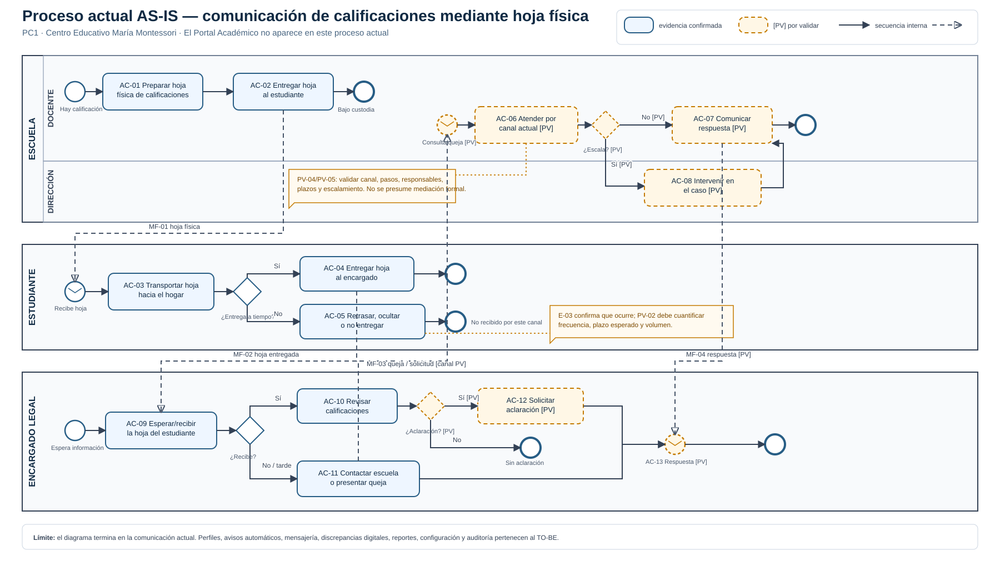

# Portal Académico — PC1 Fase de Inicio

**Curso:** IF-6100 Análisis y Diseño de Sistemas  
**Organización de referencia:** Centro Educativo María Montessori (educación primaria)  
**Integrantes:** Josué Delgado Corrales, Sebastián Cordero Quesada y Alejandro Porras Orozco  
**Versión para revisión:** 16 de septiembre de 2026  
**Estado:** propuesta casi final; datos marcados `[PV]` pendientes de validación institucional

Este documento consolida los artefactos de la PC1 en un único archivo Markdown. Los archivos editables y las exportaciones visuales permanecen disponibles en el mismo paquete.

## Ruta de lectura

`proceso actual (BPMN) → problema → requerimiento funcional → caso de uso → escenario de prueba`

**Cobertura verificada:** 35 RF · 11 UC · 66 flujos alternos · 77 pruebas · 8 observaciones del profesor incorporadas.

---

## 1. Definición del problema, alcance y visión

### Definición del problema y visión

**Curso:** IF-6100 Análisis y Diseño de Sistemas  
**Etapa:** Inicio del Proceso Unificado  
**Alcance del MVP:** educación primaria  
**Nombre canónico:** Portal Académico — Centro Educativo María Montessori  
**Antecedente de nombre:** *Conecta Montessori* fue un nombre provisional anterior y no debe utilizarse como nombre principal en los demás artefactos.

### 1. Criterio de evidencia

Este documento separa lo que la organización ya confirmó de lo que todavía debe validarse. Una afirmación marcada como hipótesis no se presenta como hecho ni se usa para justificar por sí sola una decisión de alcance.

#### 1.1 Evidencia confirmada por la Dirección

- Las calificaciones se comunican mediante hojas impresas.
- El estudiante transporta la hoja desde la escuela hasta el hogar y, por tanto, actúa como intermediario.
- Se han presentado retrasos y ocultamiento de algunas hojas por parte de estudiantes.
- Personas encargadas han formulado quejas por no recibir oportunamente esa información.

#### 1.2 Hipótesis que requieren validación

- La frecuencia y magnitud de los retrasos u omisiones.
- El recorrido exacto de la hoja, incluidas firmas, copias, devoluciones y responsables.
- Los medios actuales para comunicar tareas, observaciones y evaluaciones antes de calificarlas.
- La carga de trabajo que generan las comunicaciones repetidas, llamadas, reuniones o reclamos.
- La existencia de plazos, responsables, estados y una figura mediadora para atender discrepancias.
- Los canales digitales disponibles para las familias y sus condiciones reales de conectividad.

El registro completo de supuestos y su plan de validación se encuentra en `09-supuestos-validaciones.md`.

### 2. Situación actual

En el Centro Educativo María Montessori, las calificaciones se comunican mediante hojas impresas que el estudiante lleva al hogar. Este mecanismo coloca al estudiante entre la institución y la persona encargada en una comunicación académica relevante.

La Dirección ha reportado que algunas hojas llegan tarde o son ocultadas y que personas encargadas han presentado quejas. Con la evidencia disponible todavía no se puede cuantificar cuántos casos ocurren, cuánto tardan ni qué pasos institucionales se siguen después de una queja; esos datos deben levantarse antes de cerrar el análisis.

### 3. Problema por resolver

La institución no dispone de un canal institucional directo y verificable que permita a las personas encargadas conocer oportunamente la información académica que les corresponde. La recepción de las calificaciones depende de que el estudiante entregue la hoja impresa, por lo que un retraso u ocultamiento interrumpe la comunicación aunque el personal docente ya haya generado la información.

Esta interrupción puede retrasar el acompañamiento desde el hogar y origina quejas hacia la institución. También impide comprobar, con la evidencia actualmente disponible, cuándo la información quedó disponible para la familia y cuándo fue consultada. El proyecto no asume todavía que toda comunicación, tarea o reclamo siga el mismo proceso: esos aspectos se modelarán únicamente después de validarlos con la organización.

### 4. Población y contexto del MVP

El MVP se limita al nivel de **educación primaria** del Centro Educativo María Montessori. Sus usuarios humanos previstos son el personal docente, las personas encargadas legalmente vinculadas con cada estudiante, la Dirección o figura institucional que atienda escalaciones, y el personal que administre cuentas y relaciones de acceso.

No se promete una solución común para colegios o secundaria. En esos niveles podrían cambiar la cantidad de docentes por estudiante, la autonomía del estudiante, los roles de orientación y coordinación, y los protocolos de comunicación; una adaptación requeriría un levantamiento independiente.

### 5. Objetivo del MVP

Establecer un medio institucional directo, oportuno y trazable para comunicar el seguimiento académico del estudiantado de primaria a sus personas encargadas, reduciendo la dependencia del estudiante como intermediario y permitiendo detectar comunicaciones que aún no se han completado.

El MVP deberá:

- facilitar acceso independiente a la información de estudiantes previamente vinculados por la institución;
- distinguir la entrega de una evaluación para realizarla de su devolución calificada;
- conservar evidencia de publicación, envío y consulta sin tratar esos estados como equivalentes;
- permitir recordatorios configurables cuando una publicación no ha sido consultada;
- conservar mensajes y discrepancias asociados con el estudiante y el registro académico correspondiente;
- aportar reportes acotados de rendimiento y comunicación a la Dirección;
- reducir trabajo repetitivo mediante registro por grupo, carga tabular y avisos automáticos;
- mantener congruencia entre lo publicado y el medio físico oficial mientras ambos coexistan.

### 6. Visión del sistema

Para el personal docente, la Dirección y las personas encargadas del estudiantado de primaria del Centro Educativo María Montessori que necesitan compartir y consultar el seguimiento académico de forma directa, oportuna y verificable, **Portal Académico** es un sistema de información que centraliza los eventos académicos y la comunicación asociada, facilitando un acompañamiento temprano sin depender del estudiante como intermediario. Mantiene el criterio evaluativo del personal docente y da trazabilidad institucional a publicaciones, consultas y discrepancias.

### 7. Alcance funcional inicial

#### Incluido en el MVP

- Vinculación institucional entre estudiantes y personas encargadas autorizadas.
- Consulta del perfil académico y del historial por periodo y materia.
- Registro eficiente de evaluaciones y resultados por grupo.
- Publicación de dos hitos: evaluación entregada para realizarse y evaluación devuelta con calificación.
- Confirmación docente de congruencia con el medio físico oficial antes de publicar cada hito.
- Avisos automáticos, registro de consulta, recordatorios configurables y alertas de seguimiento.
- Mensajería institucional contextualizada por estudiante.
- Registro, atención, escalamiento y cierre trazable de discrepancias.
- Corrección controlada de registros sin borrar la versión anterior.
- Reportes acotados de rendimiento, consulta de avisos y estado de discrepancias.

#### Fuera del MVP

- Matrícula, cobros y administración financiera.
- Impartición de clases o evaluación en línea.
- Calificación automática.
- Acceso directo del estudiante con cuenta propia.
- Implementación completa para secundaria o colegios.
- Integración con sistemas nacionales del MEP.
- Aplicaciones móviles nativas, SMS o mensajería comercial, salvo que se aprueben posteriormente.
- Decisiones automáticas mediante inteligencia artificial.

### 8. Principios de solución

1. **Acceso con vínculo verificado.** Una persona encargada solo consulta estudiantes cuya relación haya sido validada por la institución.
2. **Eficiencia docente.** Una evaluación se registra una vez para el grupo; las calificaciones se cargan de forma conjunta y los avisos se generan sin redactar un mensaje individual por estudiante.
3. **Dos hitos distintos.** La asignación o entrega de la evaluación y su devolución calificada son eventos diferentes y producen avisos diferentes.
4. **Congruencia físico-digital.** Mientras el medio físico continúe vigente, la publicación requiere confirmación docente de que ambos registros corresponden al mismo evento. El sistema conserva quién confirmó y cuándo; no pretende verificar físicamente un cuaderno.
5. **Trazabilidad, no vigilancia absoluta.** Publicar, enviar, entregar por un proveedor y consultar son estados distintos. El acuse institucional corresponde a la consulta registrada en el Portal.
6. **Intervención humana.** Una discrepancia no cambia automáticamente una calificación y una mediación no sustituye el criterio profesional del docente.
7. **IA futura y supervisada.** Una eventual integración de IA solo podría apoyar resúmenes o detección de pendientes, siempre con revisión humana, privacidad y aprobación institucional; no forma parte del MVP.

### 9. Resultados esperados y medición propuesta

Los siguientes indicadores son **propuestas por validar**, no compromisos confirmados:

- porcentaje de publicaciones consultadas por al menos una persona encargada autorizada;
- tiempo transcurrido entre publicación y primera consulta;
- cantidad de publicaciones pendientes después de los recordatorios configurados;
- tiempo docente requerido para registrar una evaluación y sus resultados por grupo;
- cantidad y antigüedad de discrepancias abiertas, escaladas y cerradas;
- cantidad de correcciones con historial completo y nueva notificación.

Las metas numéricas se definirán con la Dirección después de obtener una línea base del proceso actual.

---

## 2. Proceso actual BPMN y base de trazabilidad

**Proyecto:** Portal Académico  
**Organización de referencia:** Centro Educativo María Montessori (Escuela Bilingüe María Montessori)  
**Fase:** PC1 — Inicio (Inception)  
**Versión de trabajo:** 2026-09-15  
**Estado:** listo para revisión con el profesor; contiene puntos explícitos por validar con la Dirección

### Propósito y regla de modelado

Este documento describe el proceso **AS-IS**, es decir, cómo se comunica actualmente una calificación mediante una hoja física. El BPMN asociado no contiene el Portal Académico, notificaciones automáticas, perfiles, reportes ni otras capacidades futuras.

La separación es deliberada:

- El BPMN representa el problema actual.
- Los problemas y observaciones justifican los requisitos funcionales.
- Los casos de uso representan una propuesta TO-BE conceptual y se muestran en un diagrama separado.
- Ninguna hipótesis aparece presentada como un hecho confirmado.

Archivos relacionados:

- [BPMN 2.0 del proceso actual](diagramas/02-proceso-actual.bpmn)
- [Vista SVG del proceso actual](diagramas/02-proceso-actual.svg)
- [Vista PNG del proceso actual](diagramas/02-proceso-actual.png)
- [Fuente PlantUML del diagrama de casos de uso](diagramas/05-casos-de-uso.puml)
- [Vista SVG del diagrama de casos de uso](diagramas/05-casos-de-uso.svg)
- [Matriz integral de trazabilidad](08-matriz-trazabilidad.md)

### Base de evidencia

| ID | Dato disponible | Estado | Uso permitido |
|---|---|---|---|
| E-01 | La organización de referencia es el Centro Educativo María Montessori y Daisy Quirós Quesada, su directora, aportó la validación del proceso. | Confirmado mediante entrevista del 19 de septiembre de 2026. | Contextualizar el proyecto en una organización concreta. |
| E-02 | Se utilizan hojas tradicionales impresas para comunicar calificaciones. | Confirmado por la fuente aportada por el equipo. | Modelar la hoja física como objeto que viaja de la escuela al hogar. |
| E-03 | El estudiante transporta la hoja; se han presentado casos en los que la retrasa, oculta o no la entrega oportunamente. | Confirmado por la fuente aportada por el equipo. | Modelar la dependencia del estudiante y el camino de no entrega. |
| E-04 | Algunos padres o encargados se han quejado por no recibir la información oportunamente. | Confirmado por la fuente aportada por el equipo. | Modelar el contacto o la queja como respuesta al fallo de entrega. |
| E-05 | El profesor dejó ocho observaciones concretas sobre acceso, perfiles, comunicación, contexto, carga, avisos, doble hito y congruencia. | Confirmado en el foro del curso. | Tratarlas como criterios de revisión y preguntas de levantamiento, no como hechos del proceso actual. |

### Aspectos todavía por validar

| ID | Hipótesis o dato faltante | Pregunta de levantamiento |
|---|---|---|
| PV-01 | Instrumento exacto en el que cada docente registra inicialmente las calificaciones. | ¿Dónde y cómo registra el docente la nota antes de preparar la hoja que recibe el estudiante? |
| PV-02 | Momento, frecuencia, plazo esperado y volumen de hojas tardías o no entregadas. | ¿Cuándo se entregan las hojas, cuánto tiempo tiene el estudiante y cuántos casos tardíos se observan por periodo? |
| PV-03 | Canales actuales para tareas, observaciones y evaluaciones asignadas. | ¿Qué información se anota en cuaderno, agenda, hoja, llamada, reunión u otro canal, y quién la genera? |
| PV-04 | Protocolo real de comunicación docente–encargado. | Cuando un encargado consulta o reclama, ¿por qué canal entra la solicitud, quién responde y qué pasos siguen? |
| PV-05 | Intervención de Dirección, plazos, escalamiento, mediación y registro de resoluciones. | ¿Cuándo pasa un caso a Dirección, existe una figura mediadora y queda alguna evidencia del acuerdo? |
| PV-06 | Acuse, repetición y manejo actual de comunicaciones no recibidas. | ¿Cómo sabe hoy la escuela que el encargado recibió la información y qué hace si no la recibió? |
| PV-07 | Diferencias aplicables entre escuela primaria y colegio. | ¿Qué parte del problema y del proceso cambia por nivel educativo? El alcance inicial será solo la escuela de referencia. |
| PV-08 | Carga administrativa real. | ¿Cuánto tiempo y cuántos contactos/reuniones adicionales genera repetir o aclarar información? |

### Participantes y responsabilidades actuales

| Participante BPMN | Responsabilidad representada | Límites del modelo |
|---|---|---|
| Escuela | Preparar y entregar la hoja física; atender contactos o quejas. | Las responsabilidades de Docente y Dirección posteriores a una queja están marcadas **[PV]** hasta levantar el protocolo real. |
| Estudiante | Transportar la hoja desde la escuela y entregarla —o no entregarla oportunamente— al encargado. | No se presupone que el estudiante sea usuario de un sistema futuro. |
| Encargado legal | Esperar/recibir y revisar la hoja; contactar a la escuela si no llega o si requiere aclaración. | El canal, los plazos y la forma de recibir respuesta están marcados **[PV]**. |

Los participantes se modelan como **pools independientes**. Los flujos internos son `sequenceFlow`; toda interacción entre pools es `messageFlow`. No existe ningún `sequenceFlow` que cruce pools.

### Catálogo de actividades AS-IS

| ID | Pool / responsabilidad | Actividad | Fuente | Estado |
|---|---|---|---|---|
| AC-01 | Escuela / Docente | Preparar la hoja física de calificaciones. | E-02; el instrumento previo es PV-01. | Confirmada al nivel de la hoja; detalle por validar. |
| AC-02 | Escuela / Docente | Entregar la hoja al estudiante. | E-02, E-03. | Confirmada. |
| AC-03 | Estudiante | Transportar la hoja hacia el hogar. | E-03. | Confirmada. |
| AC-04 | Estudiante | Entregar la hoja al encargado. | E-02, E-03. | Camino esperado del proceso. |
| AC-05 | Estudiante | Retrasar, ocultar o no entregar oportunamente la hoja. | E-03. | Excepción confirmada; frecuencia PV-02. |
| AC-06 | Escuela / Docente | Atender la consulta o queja por el canal actual. | E-04; procedimiento PV-04. | Existencia del contacto confirmada; pasos **[PV]**. |
| AC-07 | Escuela / Docente | Comunicar una aclaración o respuesta. | Consecuencia lógica de E-04; PV-04 y PV-05. | **[PV]**. |
| AC-08 | Escuela / Dirección | Intervenir cuando el caso se escala. | PV-05. | **[PV]**; no se afirma que exista mediación formal. |
| AC-09 | Encargado legal | Esperar la entrega que depende del estudiante. | E-02, E-03. | Confirmada como dependencia del canal. |
| AC-10 | Encargado legal | Revisar la hoja recibida. | Propósito de E-02. | Camino esperado; detalle por validar. |
| AC-11 | Encargado legal | Contactar a la escuela o presentar una queja por no recibirla. | E-04. | Confirmada; canal y plazo PV-04/PV-06. |
| AC-12 | Encargado legal | Solicitar una aclaración sobre la información recibida. | PV-04. | **[PV]**. |
| AC-13 | Encargado legal | Recibir la respuesta de la escuela. | PV-04/PV-05. | **[PV]**. |

### Flujos del proceso actual

#### Camino esperado confirmado

1. `AC-01`: el docente prepara la hoja física de calificaciones.
2. `AC-02`: la escuela entrega la hoja al estudiante.
3. `AC-03`: el estudiante la transporta hacia el hogar.
4. Cuando la entrega ocurre oportunamente, `AC-04` transfiere la hoja al encargado.
5. `AC-09` y `AC-10`: el encargado deja de esperar y revisa la información recibida.

#### Excepción confirmada

1. Después de `AC-03`, algunos estudiantes siguen `AC-05`: retrasan, ocultan o no entregan la hoja oportunamente.
2. El encargado no dispone de acceso independiente a esa información por este canal.
3. En algunos casos el encargado realiza `AC-11` y contacta a la escuela o presenta una queja.
4. A partir de ese punto, `AC-06`–`AC-08` y `AC-13` muestran únicamente el espacio del protocolo que debe levantarse; las actividades están rotuladas **[PV]** en los diagramas.

#### Interacciones entre pools

| ID | Origen | Destino | Mensaje u objeto |
|---|---|---|---|
| MF-01 | `AC-02` Escuela | Inicio del pool Estudiante | Hoja física de calificaciones. |
| MF-02 | `AC-04` Estudiante | `AC-09` Encargado | Hoja entregada al hogar. |
| MF-03 | `AC-11` o `AC-12` Encargado | Inicio de atención en Escuela | Queja o solicitud de aclaración; canal por validar. |
| MF-04 | `AC-07` Escuela | `AC-13` Encargado | Respuesta o aclaración; canal y evidencia por validar. |

### Problemas y observaciones que debe atender la propuesta

| ID | Problema / decisión pendiente | Evidencia u origen | Relación con el proceso |
|---|---|---|---|
| P-01 | El encargado no tiene acceso inmediato e independiente; depende de `AC-03`/`AC-04`. | E-03 y observación 1 del profesor. | La no entrega conduce a `AC-05`. |
| P-02 | Debe definirse cómo se valida la relación entre encargado y estudiante y qué perfil puede consultar. | Observación 2 del profesor. | El proceso físico presupone la relación, pero no muestra validación institucional. |
| P-03 | El proceso y protocolo de comunicación padre/encargado–docente no están levantados. | E-04, PV-04/PV-05 y observación 3. | `AC-06`–`AC-08`, `AC-12` y `AC-13` están por validar. |
| P-04 | El contexto debe limitarse a una escuela primaria y no generalizarse a colegios o a toda Costa Rica. | PV-07 y observación 4. | Es una decisión de alcance, no una actividad AS-IS. |
| P-05 | La carga administrativa existe como hipótesis, pero falta medirla. | PV-08 y observación 5. | Se relaciona con `AC-06`–`AC-08` y contactos repetidos. |
| P-06 | No está definido cómo confirmar recepción ni qué hacer ante una comunicación no recibida. | PV-06 y observación 6. | El canal físico falla en `AC-05`; no hay acuse verificable documentado. |
| P-07 | La propuesta debe distinguir dos hitos: evaluación asignada para realizar y devolución calificada. | Observación 7. | PV-03 debe determinar cómo ocurren hoy ambos hitos. |
| P-08 | Debe preservarse congruencia entre lo comunicado en clase/medio físico y lo publicado digitalmente. | Observación 8. | PV-03 y PV-01 deben establecer la fuente autorizada. |

### Frontera con el proceso futuro

El diagrama de casos de uso contiene once capacidades propuestas: consulta, vinculación, publicación en dos etapas, seguimiento de avisos, comunicación, discrepancias, reportes, correcciones, administración y auditoría. Ese diagrama **no corrige ni reemplaza** el BPMN AS-IS. Cada capacidad se mantiene como propuesta sujeta a validación, y su origen se documenta en `08-matriz-trazabilidad.md`.

### Criterio de cierre para presentar al profesor

Antes de convertir este modelo en una línea base aprobada se debe:

1. Recorrer el BPMN con la Dirección y corregir cada actividad **[PV]**.
2. Registrar fuente, fecha y persona que valida el recorrido.
3. Responder PV-01 a PV-08 sin convertir estimaciones en estadísticas institucionales.
4. Confirmar que el alcance es educación primaria en la escuela de referencia.
5. Obtener acuerdo sobre los dos hitos de evaluación y sobre qué medio es la fuente autorizada.
6. Actualizar los RF, UC y pruebas afectados mediante la matriz de trazabilidad.

---

## 3. Requerimientos funcionales

### Requerimientos funcionales del MVP

**Alcance:** educación primaria  
**Convención:** cada requisito expresa una capacidad atómica, un actor o disparador identificable y un criterio observable.  
**Prioridades:** `Debe` = indispensable para el MVP; `Debería` = importante si el tiempo lo permite; `Futuro` = fuera del MVP.

### 1. Acceso y relación encargado–estudiante

#### RF-01 — Autenticar a un usuario

- **Actor y problema:** Usuario registrado; necesita ingresar sin depender de que otra persona habilite cada consulta.
- **Requisito:** El Portal deberá autenticar al usuario mediante credenciales institucionalmente aprobadas.
- **Criterio de aceptación:** con credenciales válidas inicia una sesión asociada a una cuenta; con credenciales inválidas no permite el ingreso.
- **Prioridad:** Debe.
- **Origen:** observaciones 1 y 2 del profesor; mecanismo exacto de autenticación por validar.

#### RF-02 — Aplicar permisos por rol

- **Actor y problema:** Institución; debe impedir que una persona consulte o modifique información fuera de su responsabilidad.
- **Requisito:** El Portal deberá autorizar cada operación según el rol activo del usuario.
- **Criterio de aceptación:** una prueba por rol confirma que únicamente aparecen y se ejecutan las operaciones autorizadas.
- **Prioridad:** Debe.
- **Origen:** protección de datos de menores; regla institucional propuesta.

#### RF-03 — Registrar una relación encargado–estudiante

- **Actor y problema:** Administrador institucional; necesita establecer quién está autorizado para consultar a cada estudiante.
- **Requisito:** El Portal deberá permitir registrar una relación entre una persona encargada y un estudiante, con estado pendiente, activa, suspendida o finalizada.
- **Criterio de aceptación:** el registro conserva ambos participantes, estado, responsable institucional y fecha de cada cambio.
- **Prioridad:** Debe.
- **Origen:** observación 2 del profesor; cardinalidades y documentación exigida por validar.

#### RF-04 — Restringir la consulta al vínculo activo

- **Actor y problema:** Persona encargada; debe consultar únicamente a estudiantes para los que posee autorización vigente.
- **Requisito:** El Portal deberá mostrar información académica solamente cuando exista una relación encargado–estudiante activa.
- **Criterio de aceptación:** una cuenta con vínculo activo consulta al estudiante y una cuenta sin vínculo activo recibe denegación sin exponer datos.
- **Prioridad:** Debe.
- **Origen:** observación 2 del profesor y privacidad.

#### RF-05 — Seleccionar un estudiante vinculado

- **Actor y problema:** Persona encargada con más de un estudiante; necesita cambiar de contexto sin utilizar otra cuenta.
- **Requisito:** El Portal deberá permitir seleccionar uno de los estudiantes asociados activamente con la cuenta.
- **Criterio de aceptación:** al cambiar la selección, toda consulta posterior corresponde únicamente al estudiante elegido.
- **Prioridad:** Debe.
- **Origen:** hipótesis de múltiples vínculos por validar con la Dirección.

#### RF-06 — Consultar el perfil académico

- **Actor y problema:** Persona encargada; necesita reconocer el contexto del estudiante antes de interpretar su progreso.
- **Requisito:** El Portal deberá permitir consultar grado, grupo, periodo, materias y docentes del estudiante seleccionado.
- **Criterio de aceptación:** el perfil recupera esos datos del periodo activo sin incluir información de estudiantes no vinculados.
- **Prioridad:** Debe.
- **Origen:** observación 2 del profesor.

#### RF-07 — Consultar el historial académico

- **Actor y problema:** Persona encargada; necesita revisar el progreso sin solicitar al docente que repita la información.
- **Requisito:** El Portal deberá permitir consultar evaluaciones, resultados y observaciones del estudiante por periodo y materia.
- **Criterio de aceptación:** al indicar periodo y materia devuelve los registros publicados correspondientes y permite reconocer su fecha y estado.
- **Prioridad:** Debe.
- **Origen:** observaciones 1 y 5 del profesor.

### 2. Registro eficiente y dos hitos de evaluación

#### RF-08 — Crear una evaluación para un grupo

- **Actor y problema:** Docente; necesita evitar registrar la misma evaluación de forma individual para cada estudiante.
- **Requisito:** El Portal deberá permitir crear una evaluación una sola vez y asociarla con un grupo y una materia.
- **Criterio de aceptación:** un registro creado queda relacionado con todos los estudiantes activos del grupo sin duplicar la definición de la evaluación.
- **Prioridad:** Debe.
- **Origen:** observación 5 del profesor.

#### RF-09 — Registrar el hito de entrega para realización

- **Actor y problema:** Docente; necesita comunicar que una evaluación fue entregada o asignada para que el estudiantado la realice.
- **Requisito:** El Portal deberá permitir registrar, para una evaluación, la fecha de entrega o asignación, la fecha límite cuando corresponda y una descripción académica breve.
- **Criterio de aceptación:** el hito queda identificado como `entregada para realización` y no contiene todavía una calificación.
- **Prioridad:** Debe.
- **Origen:** observación 7 del profesor; campos definitivos por validar.

#### RF-10 — Confirmar congruencia del primer hito

- **Actor y problema:** Docente; debe evitar publicar una evaluación que no corresponda con lo comunicado mediante el medio físico oficial.
- **Requisito:** El Portal deberá exigir al docente confirmar la correspondencia físico-digital antes de publicar el hito de entrega para realización.
- **Criterio de aceptación:** sin confirmación el hito permanece en borrador; con confirmación conserva usuario y fecha y habilita su publicación.
- **Prioridad:** Debe.
- **Origen:** observación 8 del profesor; significado de “medio físico oficial” por validar.

#### RF-11 — Publicar el primer hito

- **Actor y problema:** Docente; necesita poner la asignación a disposición de las personas encargadas autorizadas.
- **Requisito:** El Portal deberá permitir publicar el hito confirmado de entrega para realización.
- **Criterio de aceptación:** al publicar cambia de borrador a publicado, registra autor y fecha y queda visible para los vínculos activos del grupo.
- **Prioridad:** Debe.
- **Origen:** observaciones 1, 7 y 8 del profesor.

#### RF-12 — Cargar resultados por grupo

- **Actor y problema:** Docente; necesita registrar resultados sin abrir un formulario separado por estudiante.
- **Requisito:** El Portal deberá permitir registrar en una misma operación de trabajo las calificaciones y observaciones individuales de los estudiantes del grupo.
- **Criterio de aceptación:** cada valor queda asociado con un solo estudiante y la evaluación común, y los valores incompletos pueden conservarse como borrador.
- **Prioridad:** Debe.
- **Origen:** observación 5 del profesor.

#### RF-13 — Confirmar congruencia del segundo hito

- **Actor y problema:** Docente; debe evitar publicar una calificación que no corresponda con la evaluación devuelta por el medio físico oficial.
- **Requisito:** El Portal deberá exigir al docente confirmar la correspondencia físico-digital antes de publicar cada resultado.
- **Criterio de aceptación:** un resultado no confirmado permanece en borrador; la confirmación conserva usuario y fecha.
- **Prioridad:** Debe.
- **Origen:** observación 8 del profesor.

#### RF-14 — Publicar el resultado calificado

- **Actor y problema:** Docente; necesita comunicar la devolución calificada como un evento distinto de la asignación.
- **Requisito:** El Portal deberá permitir publicar la calificación y observación confirmadas para cada estudiante.
- **Criterio de aceptación:** el resultado cambia a publicado, queda visible únicamente para usuarios autorizados y mantiene referencia a la evaluación de origen.
- **Prioridad:** Debe.
- **Origen:** observación 7 del profesor.

#### RF-15 — Corregir un resultado con historial

- **Actor y problema:** Docente autorizado; necesita corregir un dato sin borrar la evidencia de lo publicado previamente.
- **Requisito:** El Portal deberá permitir sustituir un resultado publicado únicamente si se registra un motivo de corrección.
- **Criterio de aceptación:** la versión anterior permanece consultable para auditoría y la nueva versión conserva autor, fecha y motivo.
- **Prioridad:** Debería.
- **Origen:** trazabilidad e integridad; procedimiento de autorización por validar.

### 3. Notificaciones, acuse y seguimiento

#### RF-16 — Generar un aviso por el primer hito

- **Actor y problema:** Sistema, a partir de la publicación docente; debe avisar sin exigir mensajes individuales.
- **Requisito:** El Portal deberá generar un aviso para cada persona encargada con vínculo activo cuando se publique una evaluación entregada para realización.
- **Criterio de aceptación:** una publicación genera un aviso distinguible del aviso de resultado para cada destinatario activo, sin acción adicional del docente.
- **Prioridad:** Debe.
- **Origen:** observaciones 5, 6 y 7 del profesor.

#### RF-17 — Generar un aviso por el segundo hito

- **Actor y problema:** Sistema, a partir de la publicación docente; debe comunicar la devolución calificada por separado.
- **Requisito:** El Portal deberá generar un aviso para cada persona encargada con vínculo activo cuando se publique un resultado calificado o una corrección.
- **Criterio de aceptación:** cada publicación o corrección produce un aviso asociado con el resultado y distinto del aviso del primer hito.
- **Prioridad:** Debe.
- **Origen:** observaciones 6 y 7 del profesor.

#### RF-18 — Registrar el estado de un aviso

- **Actor y problema:** Institución; necesita diferenciar creación, envío, entrega técnica, consulta y fallo.
- **Requisito:** El Portal deberá conservar para cada aviso su estado y la fecha y hora de cada transición disponible.
- **Criterio de aceptación:** el historial no usa `enviado`, `entregado`, `visto` y `fallido` como sinónimos y muestra solo estados respaldados por un evento registrado.
- **Prioridad:** Debe.
- **Origen:** observación 6 del profesor.

#### RF-19 — Registrar el acuse de consulta

- **Actor y problema:** Persona encargada e institución; necesitan evidencia de que el contenido fue consultado, no solamente enviado.
- **Requisito:** El Portal deberá registrar usuario, fecha y hora cuando una persona encargada abra el detalle de un aviso.
- **Criterio de aceptación:** la primera apertura cambia el aviso a visto y aperturas posteriores no eliminan el primer acuse.
- **Prioridad:** Debe.
- **Origen:** observación 6 del profesor.

#### RF-20 — Configurar la política de recordatorios

- **Actor y problema:** Dirección o administrador autorizado; necesita ajustar plazos sin modificar el sistema.
- **Requisito:** El Portal deberá permitir configurar el número de recordatorios, el intervalo entre ellos y el momento de alerta institucional.
- **Criterio de aceptación:** una política guardada se aplica a avisos nuevos y conserva quién la modificó y cuándo.
- **Prioridad:** Debe.
- **Origen:** observación 6 del profesor; valores iniciales son supuestos por validar.

#### RF-21 — Generar un recordatorio por falta de consulta

- **Actor y problema:** Sistema programado; debe reiterar un aviso que continúa sin acuse después del plazo configurado.
- **Requisito:** El Portal deberá generar un recordatorio cuando un aviso permanezca no visto al cumplirse el intervalo configurado.
- **Criterio de aceptación:** el recordatorio referencia el aviso original, se genera una sola vez por intervalo y no se genera si ya existe acuse.
- **Prioridad:** Debe.
- **Origen:** observación 6 del profesor.

#### RF-22 — Alertar un caso sin consulta

- **Actor y problema:** Dirección o responsable de seguimiento; necesita identificar a quién contactar después de agotar los recordatorios.
- **Requisito:** El Portal deberá colocar un aviso no visto en seguimiento institucional cuando se alcance el límite configurado.
- **Criterio de aceptación:** el caso aparece con estudiante, destinatario, publicación de origen, intentos y antigüedad, sin modificar la información académica.
- **Prioridad:** Debe.
- **Origen:** observación 6 del profesor; responsable final por validar.

### 4. Comunicación y discrepancias

#### RF-23 — Crear un hilo de comunicación

- **Actor y problema:** Docente o persona encargada; necesita formular una consulta en un contexto institucional y trazable.
- **Requisito:** El Portal deberá permitir crear un hilo asociado con un estudiante, un asunto y participantes autorizados.
- **Criterio de aceptación:** el hilo conserva creador y fecha y no puede incorporar participantes sin vínculo o responsabilidad vigente.
- **Prioridad:** Debe.
- **Origen:** observación 3 del profesor; protocolo actual por validar.

#### RF-24 — Registrar un mensaje en un hilo

- **Actor y problema:** Participante autorizado; necesita responder sin perder el historial de la conversación.
- **Requisito:** El Portal deberá permitir agregar mensajes fechados a un hilo vigente.
- **Criterio de aceptación:** cada mensaje conserva autor, fecha y contenido y no sustituye mensajes anteriores.
- **Prioridad:** Debe.
- **Origen:** observación 3 del profesor.

#### RF-25 — Abrir una discrepancia académica

- **Actor y problema:** Persona encargada; necesita cuestionar formalmente un resultado u observación y conocer su seguimiento.
- **Requisito:** El Portal deberá permitir abrir una discrepancia asociada con un registro académico publicado e indicar su motivo.
- **Criterio de aceptación:** el caso recibe identificador, fecha, solicitante, registro cuestionado y estado inicial `abierta`.
- **Prioridad:** Debe.
- **Origen:** observación 3 del profesor; existencia y forma del protocolo actual por validar.

#### RF-26 — Asignar una discrepancia

- **Actor y problema:** Dirección o regla institucional; necesita establecer quién debe atender cada caso.
- **Requisito:** El Portal deberá permitir asignar una discrepancia a un responsable autorizado.
- **Criterio de aceptación:** el caso conserva responsable actual, fecha de asignación e historial de reasignaciones.
- **Prioridad:** Debe.
- **Origen:** hipótesis de proceso futuro por validar.

#### RF-27 — Actualizar el estado de una discrepancia

- **Actor y problema:** Responsable del caso; necesita reflejar su avance mediante estados institucionalmente definidos.
- **Requisito:** El Portal deberá permitir cambiar el estado de una discrepancia únicamente mediante transiciones autorizadas.
- **Criterio de aceptación:** cada transición conserva estado anterior, estado nuevo, usuario, fecha y comentario cuando la regla lo exija.
- **Prioridad:** Debe.
- **Origen:** hipótesis de proceso futuro; catálogo de estados por validar.

#### RF-28 — Escalar una discrepancia

- **Actor y problema:** Responsable autorizado o regla de plazo; necesita remitir un caso no resuelto a la instancia institucional correspondiente.
- **Requisito:** El Portal deberá permitir escalar una discrepancia y registrar el motivo del escalamiento.
- **Criterio de aceptación:** el caso conserva responsable anterior, nueva instancia, motivo y fecha sin alterar automáticamente la nota cuestionada.
- **Prioridad:** Debe.
- **Origen:** observación 3 del profesor; figura mediadora y plazos por validar.

#### RF-29 — Registrar la resolución de una discrepancia

- **Actor y problema:** Responsable autorizado; necesita dejar evidencia del resultado y cerrar el caso.
- **Requisito:** El Portal deberá permitir registrar una resolución antes de cerrar una discrepancia.
- **Criterio de aceptación:** el cierre conserva texto de resolución, responsable, fecha y referencia a cualquier corrección académica separada.
- **Prioridad:** Debe.
- **Origen:** observación 3 del profesor.

### 5. Reportes, administración y auditoría

#### RF-30 — Consultar rendimiento agregado

- **Actor y problema:** Dirección; necesita identificar tendencias sin revisar estudiante por estudiante.
- **Requisito:** El Portal deberá permitir consultar resultados agregados por periodo, grupo y materia.
- **Criterio de aceptación:** la consulta devuelve conteos y medidas aprobadas para los filtros indicados y restringe el detalle según permisos.
- **Prioridad:** Debería.
- **Origen:** necesidad institucional propuesta; indicadores por validar.

#### RF-31 — Consultar seguimiento de comunicaciones

- **Actor y problema:** Dirección; necesita reconocer avisos pendientes y tiempos de consulta.
- **Requisito:** El Portal deberá permitir consultar publicaciones vistas, no vistas, fallidas y en seguimiento por periodo y grupo.
- **Criterio de aceptación:** los totales pueden rastrearse hasta avisos existentes y respetan los permisos del usuario.
- **Prioridad:** Debe.
- **Origen:** observaciones 5 y 6 del profesor.

#### RF-32 — Consultar estado de discrepancias

- **Actor y problema:** Dirección o figura mediadora; necesita detectar casos abiertos, vencidos y escalados.
- **Requisito:** El Portal deberá permitir consultar discrepancias por estado, responsable y antigüedad.
- **Criterio de aceptación:** cada resultado coincide con los filtros y enlaza con el historial del caso para usuarios autorizados.
- **Prioridad:** Debe.
- **Origen:** observación 3 del profesor.

#### RF-33 — Administrar catálogos académicos

- **Actor y problema:** Administrador institucional; necesita mantener periodos, grados, grupos y materias usados por los registros.
- **Requisito:** El Portal deberá permitir crear, actualizar y desactivar periodos, grados, grupos y materias.
- **Criterio de aceptación:** desactivar un elemento impide usarlo en registros nuevos sin borrar su historial.
- **Prioridad:** Debe.
- **Origen:** soporte mínimo del dominio.

#### RF-34 — Administrar cuentas y roles

- **Actor y problema:** Administrador institucional; necesita controlar quién puede operar el Portal.
- **Requisito:** El Portal deberá permitir crear, activar, suspender y asignar roles a cuentas institucionales.
- **Criterio de aceptación:** cada cambio conserva actor, fecha y estado anterior y surte efecto en el siguiente control de autorización.
- **Prioridad:** Debe.
- **Origen:** seguridad y operación institucional.

#### RF-35 — Consultar la bitácora de una entidad

- **Actor y problema:** Auditor institucional autorizado; necesita reconstruir cambios relevantes sin alterar los registros.
- **Requisito:** El Portal deberá permitir consultar la bitácora de publicaciones, resultados, avisos, vínculos, mensajes y discrepancias.
- **Criterio de aceptación:** la consulta identifica entidad, acción, usuario, fecha y referencia al cambio, y no permite editar la bitácora.
- **Prioridad:** Debe.
- **Origen:** trazabilidad del problema y observaciones 6 y 8 del profesor.

### 6. Funciones futuras fuera del MVP

- **RF-F01 — Apoyo de IA con revisión humana:** una fase futura podrá proponer resúmenes o señalar pendientes, pero ninguna salida se publicará ni afectará calificaciones o discrepancias sin revisión y confirmación humana.
- **RF-F02 — Canales adicionales:** SMS, aplicaciones móviles nativas o mensajería comercial requerirán evaluación de consentimiento, costo, privacidad y disponibilidad.
- **RF-F03 — Adaptación a secundaria:** requerirá un nuevo levantamiento de actores, relaciones, protocolos y autonomía estudiantil.

### 7. Trazabilidad de las observaciones del profesor

| Observación | Respuesta en los requisitos |
|---|---|
| 1. Acceso inmediato e independiente | RF-01, RF-04, RF-07 |
| 2. Perfil y acceso del encargado | RF-03 a RF-06 |
| 3. Comunicación padre/encargado–docente | RF-23 a RF-29 |
| 4. Diferenciar colegios y escuelas | Alcance exclusivo de primaria; RF-F03 para una evolución |
| 5. Carga administrativa | RF-08, RF-12, RF-16, RF-17 y RF-31 |
| 6. Notificación, acuse y reiteración | RF-18 a RF-22 |
| 7. Avisar entrega y devolución calificada | RF-09, RF-11, RF-14, RF-16 y RF-17 |
| 8. Congruencia con lo realizado en clase | RF-10, RF-13, RF-15 y RF-35 |
| Extra. IA | RF-F01, fuera del MVP y siempre con revisión humana |

---

## 4. Requerimientos suplementarios y reglas

### Requerimientos suplementarios, reglas y restricciones

**Alcance:** MVP para educación primaria.  
**Marco de calidad:** FURPS+ y características de ISO/IEC 25010.  
**Nota de validación:** todo umbral numérico marcado como `propuesto` es un supuesto inicial para volver verificable el requisito; debe aprobarse con la institución y el equipo antes de convertirse en compromiso.

### 1. Requerimientos de calidad medibles

| ID | FURPS+ / ISO 25010 | Requerimiento verificable | Método de verificación | Estado del umbral |
|---|---|---|---|---|
| RS-SEC-01 | Funcionalidad / Seguridad | El 100 % de las solicitudes de información académica deberá comprobar sesión, rol y vínculo activo cuando corresponda. | Pruebas positivas y negativas para cada rol y relación. | Criterio obligatorio; matriz de permisos por validar. |
| RS-SEC-02 | Seguridad / Confidencialidad | Una cuenta de encargado no deberá recuperar datos identificables de estudiantes sin vínculo activo, incluso mediante una dirección o identificador manipulado. | Pruebas de autorización horizontal con al menos un estudiante autorizado y otro no autorizado. | Obligatorio. |
| RS-SEC-03 | Seguridad / Trazabilidad | El 100 % de altas, cambios, publicaciones, consultas, correcciones, asignaciones, escalaciones y cierres deberá registrar usuario o proceso, fecha, acción y entidad afectada. | Comparación de una muestra de operaciones contra la bitácora. | Obligatorio; plazo de retención por validar. |
| RS-SEC-04 | Seguridad / Protección de datos | Los datos deberán viajar por un canal cifrado y las credenciales no deberán almacenarse como texto legible. | Revisión de configuración y análisis técnico antes de producción. | Obligatorio; mecanismo técnico se define en diseño. |
| RS-USA-01 | Usabilidad / Adecuación reconocible | Al menos 4 de 5 participantes representativos deberán completar sin ayuda las tareas de consultar una nota, reconocer si un aviso fue visto y abrir una discrepancia. | Prueba moderada con guion y registro de éxito por tarea. | `4 de 5`, propuesto por validar. |
| RS-USA-02 | Usabilidad / Eficiencia de uso | Un docente capacitado deberá crear una evaluación de grupo y dejar listos sus resultados para publicación en un máximo de 5 minutos, excluyendo el tiempo de calificación pedagógica. | Prueba cronometrada con un grupo de datos de ejemplo. | `5 minutos`, propuesto por validar con línea base. |
| RS-USA-03 | Accesibilidad | Las funciones del MVP deberán cumplir WCAG 2.2 nivel AA en navegación por teclado, contraste, foco visible, nombres accesibles y mensajes de error. | Evaluación automática y revisión manual de los flujos críticos. | WCAG 2.2 AA, propuesto como estándar de aceptación. |
| RS-REN-01 | Rendimiento / Comportamiento temporal | El 95 % de las consultas habituales deberá responder en 3 segundos o menos bajo una carga de 200 sesiones concurrentes. | Prueba de carga con datos representativos y medición del percentil 95. | `3 s / 200 sesiones`, propuesto por validar. |
| RS-REN-02 | Rendimiento / Capacidad | La carga de resultados de un grupo de 40 estudiantes deberá guardarse en 5 segundos o menos, sin duplicar resultados. | Prueba de rendimiento con 40 filas válidas y repetición controlada. | `40 / 5 s`, propuesto por validar. |
| RS-CON-01 | Confiabilidad / Disponibilidad | El Portal deberá alcanzar 99,5 % de disponibilidad mensual durante el curso lectivo, excluyendo mantenimiento anunciado. | Cálculo mensual a partir del monitoreo del servicio. | `99,5 %`, propuesto por validar. |
| RS-CON-02 | Confiabilidad / Tolerancia a fallos | Repetir un intento de notificación no deberá duplicar la publicación académica ni crear más de un recordatorio para el mismo intervalo. | Pruebas de reintento e idempotencia con fallos simulados. | Obligatorio. |
| RS-CON-03 | Confiabilidad / Recuperabilidad | La pérdida máxima de datos deberá ser de 24 horas y la restauración del servicio deberá completarse en 4 horas desde que se autorice la recuperación. | Simulacro de respaldo y restauración documentado. | RPO `24 h` y RTO `4 h`, propuestos por validar. |
| RS-INT-01 | Integridad de datos | Una publicación no podrá quedar visible sin periodo, grupo o estudiante, materia, docente responsable, tipo de hito, fecha y confirmación de congruencia. | Pruebas de validación omitiendo cada dato obligatorio. | Campos definitivos por validar. |
| RS-INT-02 | Integridad / No repudio interno | Una corrección no deberá sobrescribir la versión publicada anterior ni su autoría. | Publicar, corregir y reconstruir ambas versiones desde la bitácora. | Obligatorio. |
| RS-MAN-01 | Mantenibilidad / Modificabilidad | Los periodos, grupos, materias, estados habilitados y parámetros de recordatorio deberán modificarse mediante configuración autorizada, sin cambiar código. | Prueba de cambio de parámetro y comprobación de su efecto. | Obligatorio; responsable por validar. |
| RS-COM-01 | Compatibilidad / Interoperabilidad | La integración con un canal externo deberá registrar el identificador del intento y su resultado sin convertir `enviado` en `visto`. | Prueba con proveedor simulado que responde éxito, fallo y estado desconocido. | Canal externo del MVP por validar. |
| RS-PRI-01 | Privacidad / Minimización | Los reportes agregados no deberán exponer información identificable cuando el usuario solo tenga permiso para datos consolidados. | Pruebas por rol y revisión de exportaciones, si se autorizan. | Obligatorio. |
| RS-POR-01 | Portabilidad / Adaptabilidad | Los flujos críticos deberán poder completarse en las dos familias de navegador aprobadas por la institución y en anchos desde 360 hasta 1366 píxeles. | Matriz de pruebas de compatibilidad y revisión responsive. | Navegadores y anchos, propuestos por validar. |

### 2. Reglas de negocio

#### RN-01 — Validación del vínculo

Una relación encargado–estudiante solo puede pasar a activa después de que la institución compruebe la autorización. El documento o procedimiento de comprobación está pendiente de validación.

#### RN-02 — Alcance de la persona encargada

Una persona encargada solo puede consultar información de estudiantes con vínculo activo. La posibilidad de varios encargados por estudiante y varios estudiantes por encargado es un supuesto de modelado que debe confirmarse, incluidas restricciones de custodia.

#### RN-03 — Estudiante sin cuenta en el MVP

El estudiante es la persona sobre la que se registra información y un participante indirecto del proceso actual, pero no tendrá cuenta propia en el MVP. Cualquier cambio requiere ampliación formal del alcance.

#### RN-04 — Borrador no visible

Un registro en borrador no es visible para las personas encargadas y no genera avisos.

#### RN-05 — Congruencia físico-digital

Mientras la institución mantenga un medio físico oficial, el docente debe confirmar que el registro digital corresponde con lo entregado o consignado físicamente antes de publicarlo. Esta confirmación es una declaración trazable; el Portal no puede comprobar por sí mismo el contenido de un cuaderno o documento físico.

#### RN-06 — Dos hitos de evaluación

Cada evaluación puede producir dos hitos independientes:

1. entrega o asignación para que el estudiantado la realice;
2. devolución de la evaluación con su resultado.

Publicar un hito no implica que el otro exista ni permite tratarlos como un solo aviso.

#### RN-07 — Estados de notificación no equivalentes

`Creado`, `enviado`, `entregado por el proveedor` cuando pueda comprobarse, `visto` y `fallido` son estados diferentes. El acuse institucional de lectura corresponde al estado `visto`, originado por la consulta autenticada del detalle.

#### RN-08 — Recordatorios configurables

Los avisos no vistos generan recordatorios según una política institucional configurable. Como punto de conversación se propone un primer recordatorio 48 horas después de la publicación, un segundo 72 horas después del primero y una alerta humana al quinto día hábil; **todos estos plazos son supuestos por validar**.

#### RN-09 — Corrección trazable

Una corrección conserva el valor anterior, nuevo valor, motivo, autor y fecha, y genera un aviso nuevo. El procedimiento para autorizar correcciones está pendiente de validación.

#### RN-10 — Discrepancia sin cambio automático

Abrir, responder o escalar una discrepancia no cambia automáticamente una calificación. Toda modificación académica se ejecuta mediante el proceso de corrección autorizado.

#### RN-11 — Estados de discrepancia

Se propone el catálogo `abierta`, `en revisión docente`, `respondida`, `escalada`, `en mediación`, `resuelta` y `cerrada`. **El catálogo, sus transiciones, responsables y causales son supuestos por validar**.

#### RN-12 — Plazos de discrepancia

Se propone acuse institucional dentro de 1 día hábil, respuesta inicial docente dentro de 3 días hábiles y escalamiento al completar 5 días hábiles sin resolución. **Estos plazos son supuestos por validar** y no describen todavía una política vigente.

#### RN-13 — Criterio profesional y mediación

El personal docente conserva el criterio evaluativo. La Dirección o figura mediadora formaliza la comunicación y verifica el procedimiento, pero no sustituye automáticamente ese criterio.

#### RN-14 — Acceso a reportes

Los reportes individualizados están restringidos a roles con responsabilidad directa. Dirección puede consultar agregados institucionales; indicadores y nivel de desglose deben aprobarse antes del diseño final.

#### RN-15 — Primaria como límite del MVP

El MVP se modela para educación primaria. Secundaria o colegio requiere validar nuevos actores, cantidad de docentes, participación del estudiante y protocolos de comunicación.

#### RN-16 — Inteligencia artificial futura

La IA no forma parte del MVP. Una integración futura solo podrá proponer contenido o señalar patrones; requerirá revisión humana antes de cualquier uso, no podrá calificar ni resolver discrepancias y deberá superar una evaluación de privacidad, sesgo, exactitud y responsabilidad.

### 3. Restricciones y decisiones de alcance

- No se construye un LMS ni se imparten lecciones o evaluaciones en línea.
- No se incluyen matrícula, cobros ni integración nacional con el MEP.
- El Portal no garantiza por sí solo que una familia lea la información; registra y hace visible dónde la comunicación sigue pendiente.
- El medio físico continuará durante la transición hasta que la institución decida lo contrario.
- El canal inicial de aviso todavía no está confirmado. Portal y correo son una propuesta; SMS, WhatsApp y aplicación nativa permanecen fuera del MVP.
- La importación de datos históricos y la migración desde otros sistemas no están incluidas hasta conocer las fuentes reales.
- Las obligaciones legales específicas sobre datos de menores, conservación y consentimiento deben ser revisadas por la institución antes de implementación.

### 4. Verificación antes de aprobar la línea base

1. Confirmar con Dirección cada umbral marcado como propuesto.
2. Probar la matriz completa de permisos y vínculos.
3. Ejecutar los escenarios críticos de dos hitos, congruencia y corrección.
4. Simular avisos no vistos, reintentos, recordatorios y alerta final.
5. Recorrer una discrepancia desde apertura hasta cierre y escalamiento.
6. Realizar prueba breve de usabilidad con personas encargadas y docentes.
7. Revisar privacidad, accesibilidad, respaldo y bitácora antes de una prueba piloto.

---

## 5. Actores y diagrama de casos de uso

### Actores del MVP

**Alcance:** educación primaria.  
**Nombre anterior:** *Conecta Montessori* fue un nombre provisional; el nombre canónico es **Portal Académico — Centro Educativo María Montessori**.

### 1. Resumen de actores

| Actor | Tipo | Participación en el MVP | Estado de la definición |
|---|---|---|---|
| Persona encargada legal | Humano, primario | Consulta progreso, recibe avisos, se comunica y presenta discrepancias. | Existencia confirmada; permisos y vínculo detallado por validar. |
| Docente | Humano, primario | Registra y publica eventos y resultados, confirma congruencia y atiende consultas. | Rol necesario; procedimiento exacto por validar. |
| Dirección / figura mediadora | Humano, primario | Supervisa comunicación, consulta reportes y atiende escalaciones. | Dirección confirmada como fuente; mediación formal es hipótesis. |
| Administrador institucional | Humano, de apoyo | Gestiona cuentas, roles, catálogos, vínculos y parámetros. | Rol propuesto para operar el sistema. |
| Estudiante | Humano, indirecto | Es sujeto de la información y hoy transporta las hojas. | Intermediación actual confirmada; sin cuenta en el MVP. |
| Servicio programado de avisos | Sistema, secundario | Genera avisos, recordatorios y alertas según reglas configuradas. | Comportamiento propuesto; canal por validar. |
| Proveedor externo de notificación | Sistema externo, secundario y opcional | Transporta un aviso y devuelve el resultado técnico disponible. | Hipótesis; podría ser correo u otro canal aprobado. |

### 2. Fichas de actores

#### A-01 — Persona encargada legal

- **Objetivo:** conocer oportunamente el seguimiento académico de los estudiantes que tiene autorizados y poder solicitar aclaraciones con evidencia.
- **Problema que enfrenta:** la recepción de calificaciones depende actualmente de que el estudiante entregue una hoja impresa; se han reportado retrasos u ocultamiento.
- **Responsabilidades en el Portal:** proteger sus credenciales, mantener datos de contacto acordados, consultar publicaciones y utilizar los canales institucionales de comunicación.
- **Acciones permitidas:** seleccionar un estudiante vinculado; consultar perfil, historial y avisos; leer y responder mensajes; abrir y consultar discrepancias.
- **Acciones no permitidas:** consultar estudiantes sin vínculo activo; editar calificaciones; cambiar estados o resoluciones institucionales; administrar usuarios.
- **Datos que utiliza:** identidad y contacto propios, estudiantes vinculados, publicaciones académicas, avisos, mensajes y discrepancias autorizadas.
- **Frecuencia esperada:** asociada con eventos académicos y recordatorios; no cuantificada todavía.
- **Evidencia:** existencia de personas encargadas y quejas confirmada por la Dirección.
- **Preguntas pendientes:** ¿cómo se acredita el vínculo?, ¿puede haber varios encargados?, ¿cómo se manejan restricciones de custodia?, ¿qué canal y horario son aceptables?, ¿qué nivel de conectividad existe?

#### A-02 — Docente

- **Objetivo:** registrar y comunicar información académica de manera consistente y eficiente, manteniendo su criterio profesional.
- **Problema que enfrenta:** la propuesta debe evitar convertir cada aviso en una tarea individual y debe mantener congruencia mientras coexistan registros físicos y digitales.
- **Responsabilidades en el Portal:** crear evaluaciones para sus grupos; registrar resultados; confirmar la correspondencia con el medio físico oficial; atender mensajes y discrepancias asignadas; justificar correcciones.
- **Acciones permitidas:** operar únicamente sobre grupos, materias, publicaciones y casos bajo su responsabilidad; consultar el historial necesario para responder.
- **Acciones no permitidas:** acceder a grupos ajenos sin autorización; activar vínculos familiares; borrar versiones publicadas; usar IA para decidir notas o reclamos.
- **Datos que utiliza:** grupos, materias, estudiantes asignados, evaluaciones, resultados, confirmaciones, mensajes y casos.
- **Frecuencia esperada:** por cada evaluación y devolución; volumen real pendiente de levantamiento.
- **Evidencia:** la escuela genera hojas de calificaciones; el flujo docente exacto y su carga todavía son hipótesis por validar.
- **Preguntas pendientes:** ¿quién prepara e imprime las hojas?, ¿qué registra cada docente?, ¿cuántos grupos y estudiantes maneja?, ¿qué constituye el medio físico oficial?, ¿quién puede corregir una nota?

#### A-03 — Dirección / figura mediadora

- **Objetivo:** supervisar que la información llegue a las familias, identificar pendientes y asegurar un tratamiento trazable de los casos escalados.
- **Problema que enfrenta:** existen quejas por comunicación tardía, pero falta confirmar los indicadores, el protocolo y la autoridad que interviene.
- **Responsabilidades en el Portal:** aprobar políticas; consultar reportes autorizados; dar seguimiento a avisos pendientes; recibir o reasignar escalaciones; registrar resoluciones cuando corresponda.
- **Acciones permitidas:** consultar agregados y casos institucionales según permisos; configurar o aprobar plazos; asignar responsables; intervenir en escalaciones.
- **Acciones no permitidas:** modificar una calificación fuera del procedimiento autorizado; asumir automáticamente la función pedagógica del docente.
- **Datos que utiliza:** indicadores de rendimiento, estados de comunicación, antigüedad de casos, bitácoras y resoluciones.
- **Frecuencia esperada:** seguimiento periódico y atención por excepción; periodicidad por validar.
- **Evidencia:** Dirección es la fuente del levantamiento. La existencia de una figura mediadora y sus facultades no está confirmada.
- **Preguntas pendientes:** ¿quién media hoy?, ¿qué casos llegan a Dirección?, ¿qué plazos y criterios usa?, ¿qué detalle debe incluir cada reporte?

#### A-04 — Administrador institucional

- **Objetivo:** mantener usuarios, permisos y datos maestros correctos para que el acceso sea seguro.
- **Problema que enfrenta:** el Portal requiere una responsabilidad explícita para activar vínculos, roles, periodos, grupos, materias y políticas.
- **Responsabilidades en el Portal:** crear o suspender cuentas; asignar roles; validar relaciones encargado–estudiante; mantener catálogos; configurar recordatorios autorizados.
- **Acciones permitidas:** administrar configuración operativa sin alterar contenido pedagógico ni resolver discrepancias.
- **Acciones no permitidas:** consultar información académica individual salvo permiso institucional separado; editar notas por su función administrativa.
- **Datos que utiliza:** cuentas, roles, vínculos, periodos, grupos, materias y parámetros.
- **Frecuencia esperada:** al inicio de periodos y ante cambios; volumen por validar.
- **Evidencia:** actor propuesto por necesidad operativa, no confirmado todavía por la organización.
- **Preguntas pendientes:** ¿lo asume Dirección, secretaría o soporte?, ¿qué comprobantes exige un vínculo?, ¿quién autoriza cambios de parámetros?

#### A-05 — Estudiante

- **Objetivo en el proceso actual:** trasladar la hoja impresa al hogar.
- **Problema asociado:** su papel como intermediario permite retraso u ocultamiento, aun cuando la información ya fue preparada.
- **Participación en el MVP:** es sujeto de la información y recibe físicamente evaluaciones o resultados, pero no opera el Portal.
- **Cuenta en el MVP:** no incluida.
- **Evidencia:** intermediación y casos de retraso u ocultamiento confirmados por la Dirección.
- **Preguntas pendientes:** ¿a partir de qué edad sería apropiado un acceso directo?, ¿la escuela desea mantener alguna responsabilidad de entrega física durante la transición?

#### A-06 — Servicio programado de avisos

- **Objetivo:** ejecutar de forma consistente las reglas de aviso, recordatorio y alerta sin trabajo repetitivo del docente.
- **Disparadores:** publicación del primer hito, publicación o corrección del segundo hito y vencimiento de intervalos configurados.
- **Acciones:** crear avisos, solicitar su envío por el canal aprobado, registrar resultados disponibles, generar recordatorios y marcar casos para seguimiento.
- **Restricciones:** no inventa un estado de entrega; no marca un aviso como visto sin consulta autenticada; no duplica publicaciones ante un reintento.
- **Estado:** actor técnico propuesto; intervalos y canal por validar.

#### A-07 — Proveedor externo de notificación

- **Objetivo:** transportar un aviso fuera del Portal y devolver el resultado técnico que pueda comprobar.
- **Interacción:** recibe una solicitud de entrega y devuelve identificador, aceptación, fallo o estado desconocido.
- **Restricciones:** una aceptación o entrega técnica no equivale a lectura por la persona encargada.
- **Estado:** actor opcional e hipotético; para el MVP se propone Portal y correo, sujeto a validación de costo, consentimiento y disponibilidad.

### 3. Relaciones y cardinalidades propuestas

Las siguientes relaciones son **supuestos por validar**:

- una persona encargada puede estar vinculada con uno o más estudiantes;
- un estudiante puede tener una o más personas encargadas autorizadas;
- un docente puede atender varios grupos y materias;
- un grupo contiene varios estudiantes y puede tener varios docentes;
- una evaluación pertenece a una materia y un grupo;
- cada resultado pertenece a una evaluación y un estudiante;
- un mensaje o discrepancia pertenece a un estudiante y solo es visible para participantes autorizados.

### 4. Matriz resumida de permisos propuesta

`C` = crear, `R` = consultar, `U` = actualizar mediante transición autorizada, `A` = administrar.

| Recurso | Encargado | Docente | Dirección / mediación | Administrador |
|---|---:|---:|---:|---:|
| Perfil e historial de estudiante | R, con vínculo | R, grupos asignados | R, según responsabilidad | Sin acceso por defecto |
| Evaluación y resultados | R publicados | C/R/U, grupos asignados | R; U solo por procedimiento excepcional | Sin acceso pedagógico |
| Avisos y acuses | R propios | R relacionados | R institucional autorizado | Configura política, sin leer contenido por defecto |
| Mensajes | C/R, hilos autorizados | C/R, hilos autorizados | R/U si interviene | Sin acceso por defecto |
| Discrepancias | C/R propias | R/U asignadas | R/U y escalación | Sin resolución pedagógica |
| Reportes agregados | No | R de sus grupos, por validar | R institucional | Operación técnica, por validar |
| Usuarios, roles y vínculos | No | No | Aprobación, por validar | A |
| Catálogos y parámetros | No | No | Aprobación / A, por validar | A |
| Bitácora | R de acuses propios | R de registros propios | R institucional autorizado | R técnica limitada |

### 5. Diferencia explícita con secundaria

Estas fichas corresponden a una escuela primaria. En un colegio podrían aparecer actores adicionales —estudiante con cuenta, orientación, coordinación académica y múltiples docentes por nivel— y reglas diferentes sobre autonomía y comunicación. Esa variante no debe incorporarse al MVP sin una nueva elicitación.

---

## 6. Casos de uso detallados

### 1. Alcance y convenciones

Este documento especifica once casos de uso del MVP de **Portal Académico** para una institución de educación primaria. Describe comportamiento observable del sistema y evita decisiones de interfaz, infraestructura o implementación.

Convenciones:

- Un registro **publicado** es visible para sus destinatarios; un borrador no lo es.
- El **medio físico oficial** es el cuaderno de comunicaciones, hoja impresa u otro medio que la institución confirme durante la validación del proyecto.
- El **acuse de consulta** acredita que una persona autorizada accedió al aviso o a su detalle; no equivale al envío ni a la entrega técnica del aviso.
- Las autorizaciones se aplican con criterio de mínimo privilegio.
- Las fechas y cantidades marcadas **[PV]** son valores provisionales por validar con la institución.
- Cada flujo alterno identifica el paso exacto del flujo básico que sustituye o interrumpe.

### 2. Actores

| Actor | Responsabilidad relevante |
|---|---|
| Encargado legal | Consulta el progreso de estudiantes autorizados, recibe avisos, se comunica con el docente y presenta discrepancias. |
| Docente | Registra y publica eventos académicos, confirma su correspondencia con el medio físico y atiende comunicaciones y discrepancias. |
| Administrador institucional | Valida relaciones entre encargados y estudiantes y administra su vigencia. |
| Dirección o figura mediadora | Consulta información institucional y resuelve discrepancias escaladas. |
| Tiempo / servicio de notificaciones | Activa recordatorios y controles de vencimiento conforme a los parámetros institucionales. |
| Estudiante | Participante indirecto y sujeto del registro académico; no posee acceso directo en el MVP. |

---

### UC-01 — Consultar progreso académico

#### Propósito

Permitir que un encargado legal consulte, de manera autónoma, el perfil y el historial académico publicado de un estudiante con quien mantiene una relación de acceso vigente.

#### Requisitos relacionados

RF-01, RF-02, RF-04, RF-05, RF-06 y RF-07.

#### Actores

- **Principal:** Encargado legal.
- **Secundarios:** Ninguno.

#### Precondiciones

1. El encargado posee una identidad institucional registrada.
2. El estudiante pertenece a un periodo académico conocido por Portal Académico.
3. Para el flujo básico existe una relación encargado–estudiante activa.

#### Postcondiciones

- **Éxito:** el encargado obtiene únicamente el perfil y los registros publicados que puede consultar; el acceso queda trazado.
- **Garantía mínima:** ningún dato de un estudiante no autorizado queda expuesto; los intentos denegados quedan trazados.

#### Relaciones

- Puede dar origen a UC-06, **Comunicarse sobre un estudiante**.
- Puede dar origen a UC-07, **Gestionar discrepancia académica**, desde un registro elegible.

#### Flujo básico

1. El encargado solicita acceso a Portal Académico con su identidad institucional.
2. Portal Académico valida la identidad, el estado de la cuenta y el rol del encargado.
3. Portal Académico determina las relaciones encargado–estudiante vigentes.
4. Portal Académico pone a disposición únicamente los estudiantes comprendidos por esas relaciones.
5. El encargado especifica un estudiante y un periodo académico autorizados.
6. Portal Académico vuelve a validar la relación vigente para la solicitud concreta.
7. Portal Académico proporciona el perfil académico y los registros publicados del periodo, organizados por materia y tipo de evento.
8. El encargado solicita el detalle de un registro publicado.
9. Portal Académico proporciona el detalle, su estado vigente y la información de trazabilidad visible para el encargado.
10. Portal Académico registra el acceso efectuado.

#### Flujos alternos

**UC-01-A01 — Identidad o cuenta no habilitada (paso 2)**

1. Portal Académico rechaza el acceso sin revelar información académica.
2. Portal Académico registra el intento y su resultado.
3. El caso de uso finaliza.

**UC-01-A02 — Ausencia de relaciones activas (paso 3)**

1. Portal Académico informa que no existen estudiantes habilitados para consulta.
2. Portal Académico no expone perfiles ni registros académicos.
3. Portal Académico registra la consulta sin resultados y el caso de uso finaliza.

**UC-01-A03 — Solicitud de un estudiante no autorizado (paso 6)**

1. Portal Académico deniega la solicitud concreta.
2. Portal Académico no confirma la existencia ni el contenido académico del estudiante solicitado.
3. Portal Académico registra el intento denegado y el caso de uso finaliza.

**UC-01-A04 — Periodo sin registros publicados (paso 7)**

1. Portal Académico informa que el periodo autorizado no contiene registros publicados.
2. Portal Académico conserva el contexto del estudiante y del periodo sin presentar datos de borradores.
3. El flujo continúa en el paso 10.

---
### Prototipo

[Prototipo Stitch — Perfil y progreso académico](prototipos/stitch-1/screen.png)

### Requerimientos especiales

- Mínimo privilegio, vínculo vigente y ausencia de borradores.
- Los mensajes de error deben indicar la corrección posible sin revelar información no autorizada.

### Autor

Josué Delgado Corrales, Sebastián Cordero Quesada y Alejandro Porras Orozco

### UC-02 — Vincular encargado con estudiante

#### Propósito

Establecer o actualizar una relación de acceso verificada y con vigencia definida entre un encargado legal y un estudiante.

#### Requisitos relacionados

RF-01, RF-02 y RF-03.

#### Actores

- **Principal:** Administrador institucional.
- **Secundario:** Encargado legal.

#### Precondiciones

1. El administrador posee una identidad institucional registrada.
2. Existen identidades verificables para el encargado y el estudiante.
3. La institución dispone del respaldo requerido para validar la relación.

#### Postcondiciones

- **Éxito:** la relación queda en el estado autorizado, con alcance y vigencia determinados; el encargado recibe constancia del cambio.
- **Garantía mínima:** ninguna relación queda activa sin validación institucional; las decisiones y sus responsables quedan trazados.

#### Relaciones

- Habilita el acceso descrito en UC-01, UC-06 y UC-07.

#### Flujo básico

1. El administrador solicita registrar una relación encargado–estudiante o actualizar su estado.
2. Portal Académico valida la identidad, el rol y el alcance administrativo del actor.
3. El administrador identifica al encargado, al estudiante, el tipo de relación, el estado autorizado y su periodo de vigencia.
4. Portal Académico verifica ambas identidades y la coherencia de la solicitud con las relaciones existentes.
5. El administrador registra la referencia del respaldo utilizado para verificar la relación.
6. Portal Académico valida que la información de verificación exigida esté completa.
7. Portal Académico establece el estado de la relación con el alcance y vigencia autorizados.
8. Portal Académico comunica al encargado el cambio y su efecto sobre el acceso.
9. Portal Académico registra la actuación administrativa completa.

#### Flujos alternos

**UC-02-A01 — Actor sin atribución administrativa (paso 2)**

1. Portal Académico rechaza la solicitud.
2. Portal Académico registra el intento denegado y el caso de uso finaliza.

**UC-02-A02 — Identidad inexistente o inactiva (paso 4)**

1. Portal Académico identifica la persona o condición institucional que impide la vinculación, sin crear la relación.
2. Portal Académico registra el resultado y el caso de uso finaliza.

**UC-02-A03 — Relación activa equivalente (paso 4)**

1. Portal Académico conserva la relación vigente sin crear un duplicado.
2. Portal Académico comunica al administrador la existencia y vigencia de la relación.
3. Portal Académico registra la actuación y el caso de uso finaliza.

**UC-02-A04 — Restricción o conflicto de autorización (paso 4)**

1. Portal Académico mantiene la solicitud sin acceso activo.
2. El administrador registra el motivo y remite la validación a la autoridad institucional competente.
3. Portal Académico registra el estado pendiente y el caso de uso finaliza.

**UC-02-A05 — Verificación incompleta (paso 6)**

1. Portal Académico no activa la relación.
2. Portal Académico identifica los datos de verificación pendientes.
3. El administrador puede completar la solicitud desde el paso 5 en una actuación posterior.

**UC-02-A06 — Suspensión o finalización de una relación vigente (paso 7)**

1. Portal Académico cambia la relación al estado suspendido o finalizado desde la fecha autorizada.
2. El cambio surte efecto en el siguiente control de acceso.
3. Portal Académico conserva el estado anterior, la fecha, el responsable y el motivo.
4. El flujo continúa en el paso 8.

---
### Prototipo

[Prototipo Stitch — Perfil y progreso académico](prototipos/stitch-1/screen.png)

### Requerimientos especiales

- Validación institucional, vigencia y bitácora de cada cambio.
- Los mensajes de error deben indicar la corrección posible sin revelar información no autorizada.

### Autor

Josué Delgado Corrales, Sebastián Cordero Quesada y Alejandro Porras Orozco

### UC-03 — Publicar evaluación asignada

#### Propósito

Registrar una evaluación asignada a un grupo, confirmar su correspondencia con el medio físico oficial y comunicar su entrega al estudiantado a los encargados autorizados.

#### Requisitos relacionados

RF-01, RF-02, RF-08, RF-09, RF-10, RF-11, RF-16 y RF-18.

#### Actores

- **Principal:** Docente.
- **Secundarios:** Encargado legal y estudiante como participante indirecto.

#### Precondiciones

1. El docente posee una identidad institucional registrada.
2. El grupo, la materia, el periodo y la nómina estudiantil existen.
3. Para el flujo básico el docente está asignado a la materia y al grupo.

#### Postcondiciones

- **Éxito:** existe un evento publicado por cada estudiante activo comprendido; se crea la notificación de primera etapa para cada encargado autorizado y se conserva la trazabilidad.
- **Garantía mínima:** ningún evento se publica sin confirmación físico–digital; un fallo de notificación no elimina ni duplica el evento académico.

#### Relaciones

- Precede normalmente a UC-04, **Publicar resultado académico**.
- Los avisos pendientes quedan sujetos a UC-05, **Gestionar avisos no consultados**.

#### Flujo básico

1. El docente solicita registrar una evaluación asignada para un grupo.
2. Portal Académico valida la identidad, el rol y la asignación del docente al grupo, materia y periodo.
3. El docente proporciona el nombre y tipo de evaluación, las fechas de entrega y vencimiento, las instrucciones y el grupo destinatario.
4. Portal Académico valida los datos, la coherencia de fechas y la nómina activa comprendida.
5. El docente declara la fecha de entrega al estudiantado y confirma la correspondencia con el medio físico oficial.
6. Portal Académico valida la presencia y coherencia de la confirmación físico–digital.
7. El docente autoriza la publicación del evento.
8. Portal Académico publica una instancia del evento para cada estudiante activo comprendido y registra su origen común de grupo.
9. Portal Académico crea la notificación de primera etapa para cada encargado con relación activa y realiza el envío configurado.
10. Portal Académico registra por destinatario el momento, el tipo de notificación y el resultado del intento.
11. Portal Académico proporciona al docente el resultado agregado de la publicación y las incidencias identificadas.

#### Flujos alternos

**UC-03-A01 — Docente sin asignación autorizada (paso 2)**

1. Portal Académico rechaza la operación sin publicar información.
2. Portal Académico registra el intento denegado y el caso de uso finaliza.

**UC-03-A02 — Datos incompletos o fechas incoherentes (paso 4)**

1. Portal Académico identifica los datos que requieren corrección.
2. Portal Académico conserva la información como no publicada.
3. El docente puede reanudar el flujo en el paso 3.

**UC-03-A03 — Nómina con estudiantes inactivos (paso 4)**

1. Portal Académico excluye de la publicación a los estudiantes que no están activos en la fecha del evento.
2. Portal Académico informa al docente las exclusiones y su fundamento.
3. El flujo continúa en el paso 5 con la nómina activa.

**UC-03-A04 — Confirmación físico–digital ausente o incoherente (paso 6)**

1. Portal Académico impide la publicación.
2. Portal Académico mantiene el evento como no publicado e identifica la confirmación pendiente.
3. El docente puede reanudar el flujo en el paso 5.

**UC-03-A05 — Solicitud repetida de publicación (paso 7)**

1. Portal Académico reconoce el evento de grupo previamente publicado.
2. Portal Académico conserva una sola publicación por estudiante y no genera avisos duplicados.
3. Portal Académico proporciona al docente el resultado de la publicación existente y el caso de uso finaliza.

**UC-03-A06 — Estudiante sin encargado activo (paso 9)**

1. Portal Académico conserva el evento académico publicado para el estudiante.
2. Portal Académico registra la ausencia de destinatario y la incorpora al seguimiento institucional.
3. El flujo continúa en el paso 10 para los demás destinatarios.

**UC-03-A07 — Fallo del intento de notificación (paso 10)**

1. Portal Académico conserva la publicación académica.
2. Portal Académico registra el intento como fallido, sin acuse de consulta.
3. Portal Académico deja el aviso disponible para el tratamiento establecido en UC-05.
4. El flujo continúa en el paso 11.

---
### Prototipo

[Prototipo Stitch — Publicar evaluación](prototipos/stitch-2/screen.png)

### Requerimientos especiales

- Confirmación de congruencia con el medio físico y publicación sin duplicados.
- Los mensajes de error deben indicar la corrección posible sin revelar información no autorizada.

### Autor

Josué Delgado Corrales, Sebastián Cordero Quesada y Alejandro Porras Orozco

### UC-04 — Publicar resultado académico

#### Propósito

Publicar los resultados de una evaluación devuelta al estudiantado, confirmar su correspondencia con el medio físico oficial y emitir la notificación de segunda etapa.

#### Requisitos relacionados

RF-01, RF-02, RF-12, RF-13, RF-14, RF-17 y RF-18.

#### Actores

- **Principal:** Docente.
- **Secundarios:** Encargado legal y estudiante como participante indirecto.

#### Precondiciones

1. El docente posee una identidad institucional registrada.
2. La evaluación asignada existe y pertenece a un grupo, materia y periodo conocidos.
3. Para el flujo básico el docente está autorizado y los resultados no han sido publicados previamente.

#### Postcondiciones

- **Éxito:** los resultados seleccionados quedan publicados como primera versión; se crea una notificación de segunda etapa para cada encargado autorizado y se conserva la trazabilidad.
- **Garantía mínima:** ningún valor publicado se sobrescribe; un fallo de notificación no elimina ni duplica el resultado.

#### Relaciones

- Sigue normalmente a UC-03, **Publicar evaluación asignada**.
- Una modificación posterior se tramita mediante UC-09, **Corregir publicación académica**.
- Los avisos pendientes quedan sujetos a UC-05, **Gestionar avisos no consultados**.

#### Flujo básico

1. El docente identifica una evaluación previamente registrada.
2. Portal Académico valida la existencia y estado de la evaluación, la identidad del docente y su asignación al grupo, materia y periodo.
3. El docente proporciona los resultados y observaciones de los estudiantes comprendidos en la publicación.
4. Portal Académico valida la escala, el formato y la integridad de los resultados proporcionados.
5. El docente registra la fecha de devolución al estudiantado y confirma que cada resultado coincide con el medio físico oficial entregado.
6. Portal Académico valida la presencia y coherencia de la confirmación físico–digital.
7. El docente autoriza la publicación de los resultados seleccionados.
8. Portal Académico publica la primera versión inmutable de cada resultado y registra su trazabilidad.
9. Portal Académico crea la notificación de segunda etapa para cada encargado con relación activa y realiza el envío configurado.
10. Portal Académico registra por destinatario el momento, el tipo de notificación y el resultado del intento.
11. Portal Académico proporciona al docente el resultado agregado de la publicación y las incidencias identificadas.

#### Flujos alternos

**UC-04-A01 — Docente sin asignación autorizada (paso 2)**

1. Portal Académico rechaza la operación sin exponer ni publicar resultados.
2. Portal Académico registra el intento denegado y el caso de uso finaliza.

**UC-04-A02 — Evaluación inexistente, anulada o no publicable (paso 2)**

1. Portal Académico impide el registro de resultados para la evaluación indicada.
2. Portal Académico comunica el estado que impide continuar.
3. Portal Académico registra la actuación y el caso de uso finaliza.

**UC-04-A03 — Resultado incompleto o fuera de la escala válida (paso 4)**

1. Portal Académico identifica los resultados que requieren corrección.
2. Portal Académico no publica el conjunto seleccionado.
3. El docente puede reanudar el flujo en el paso 3.

**UC-04-A04 — Confirmación físico–digital ausente o incoherente (paso 6)**

1. Portal Académico impide la publicación de los resultados seleccionados.
2. Portal Académico conserva los datos como no publicados e identifica la confirmación pendiente.
3. El docente puede reanudar el flujo en el paso 5.

**UC-04-A05 — Resultado publicado previamente (paso 7)**

1. Portal Académico impide sobrescribir la versión publicada.
2. Portal Académico conserva íntegra la versión vigente.
3. Portal Académico remite el cambio requerido a UC-09 y el caso de uso finaliza.

**UC-04-A06 — Estudiante sin encargado activo (paso 9)**

1. Portal Académico conserva el resultado académico publicado para el estudiante.
2. Portal Académico registra la ausencia de destinatario y la incorpora al seguimiento institucional.
3. El flujo continúa en el paso 10 para los demás destinatarios.

**UC-04-A07 — Fallo del intento de notificación (paso 10)**

1. Portal Académico conserva el resultado publicado.
2. Portal Académico registra el intento como fallido, sin acuse de consulta.
3. Portal Académico deja el aviso disponible para el tratamiento establecido en UC-05.
4. El flujo continúa en el paso 11.

---
### Prototipo

[Prototipo Stitch — Publicar evaluación](prototipos/stitch-2/screen.png)

### Requerimientos especiales

- Separación entre evaluación asignada y resultado calificado; historial inmutable.
- Los mensajes de error deben indicar la corrección posible sin revelar información no autorizada.

### Autor

Josué Delgado Corrales, Sebastián Cordero Quesada y Alejandro Porras Orozco

### UC-05 — Gestionar avisos no consultados

#### Propósito

Dar seguimiento a las notificaciones académicas sin acuse de consulta, emitir recordatorios controlados y elevar los casos que requieren intervención institucional.

#### Requisitos relacionados

RF-02, RF-18, RF-19, RF-21 y RF-22.

#### Actores

- **Principal:** Tiempo / servicio de notificaciones.
- **Secundarios:** Encargado legal, docente y Dirección.

#### Precondiciones

1. Existe una notificación académica creada por UC-03, UC-04 o UC-09.
2. Portal Académico conserva su estado y sus intentos anteriores.
3. Para el flujo básico existen parámetros institucionales vigentes de recordatorio y escalamiento.

#### Postcondiciones

- **Éxito:** el aviso obtiene acuse de consulta después del recordatorio y no requiere nuevas reiteraciones.
- **Garantía mínima:** cada decisión, intento y resultado queda trazado; el sistema no atribuye un acuse inexistente.

#### Relaciones

- Da seguimiento a las notificaciones originadas por UC-03, UC-04 y UC-09.
- Consume la política de recordatorios administrada mediante UC-10.

#### Flujo básico

1. El actor Tiempo activa la revisión al cumplirse el intervalo de seguimiento configurado.
2. Portal Académico identifica una notificación vigente que carece de acuse de consulta.
3. Portal Académico valida la vigencia de la relación entre el destinatario y el estudiante.
4. Portal Académico determina el intervalo transcurrido, el número de intentos y el límite institucional aplicable.
5. Portal Académico emite el recordatorio que corresponde al ciclo vigente.
6. Portal Académico registra el momento, número de intento y resultado del recordatorio.
7. El encargado accede al aviso o a su detalle mediante una identidad autorizada.
8. Portal Académico registra el acuse de consulta con identidad, fecha y hora.
9. Portal Académico detiene nuevas reiteraciones para ese destinatario y aviso.

#### Flujos alternos

**UC-05-A01 — Aviso consultado antes de la revisión (paso 2)**

1. Portal Académico reconoce el acuse existente.
2. Portal Académico no emite recordatorios ni alertas adicionales.
3. El caso de uso finaliza.

**UC-05-A02 — Relación de acceso inactiva (paso 3)**

1. Portal Académico cancela las reiteraciones dirigidas a esa persona.
2. Portal Académico conserva el historial previo y registra el motivo de la cancelación.
3. Portal Académico incorpora la ausencia de destinatario válido al seguimiento institucional y el caso de uso finaliza.

**UC-05-A03 — Límite de recordatorios alcanzado (paso 4)**

1. Portal Académico no emite un nuevo recordatorio al destinatario.
2. Portal Académico genera una alerta de seguimiento para los roles institucionales autorizados.
3. Portal Académico registra el escalamiento y el caso de uso finaliza.

**UC-05-A04 — Parámetros ausentes o incoherentes (paso 4)**

1. Portal Académico no emite un recordatorio con reglas indeterminadas.
2. Portal Académico registra la incidencia de configuración y la comunica al responsable autorizado.
3. La notificación conserva su estado anterior y el caso de uso finaliza.

**UC-05-A05 — Fallo del recordatorio (paso 6)**

1. Portal Académico registra el intento como fallido y no crea un acuse de consulta.
2. Portal Académico conserva el aviso pendiente para el siguiente tratamiento permitido.
3. El caso de uso finaliza.

**UC-05-A06 — Aviso aún no consultado después del recordatorio (paso 7)**

1. Portal Académico conserva el estado pendiente sin crear un acuse.
2. Portal Académico mantiene el intento en el historial.
3. Un ciclo posterior continúa desde el paso 1 hasta alcanzar consulta o escalamiento.

**UC-05-A07 — Apertura posterior al primer acuse (paso 8)**

1. Portal Académico conserva la identidad, fecha y hora del primer acuse de consulta.
2. Portal Académico no reinicia recordatorios ni elimina la evidencia anterior.
3. El flujo continúa en el paso 9.

**UC-05-A08 — Revisión repetida dentro del mismo intervalo (paso 4)**

1. Portal Académico reconoce el recordatorio ya generado para el intervalo vigente.
2. Portal Académico no crea ni envía un recordatorio duplicado.
3. Portal Académico conserva el aviso pendiente para el siguiente intervalo aplicable y el caso de uso finaliza.

---
### Prototipo

[Prototipo Stitch — Panel institucional de supervisión](prototipos/stitch-4/screen.png)

### Requerimientos especiales

- Recordatorios configurables, límite de reintentos y escalamiento auditable.
- Los mensajes de error deben indicar la corrección posible sin revelar información no autorizada.

### Autor

Josué Delgado Corrales, Sebastián Cordero Quesada y Alejandro Porras Orozco

### UC-06 — Comunicarse sobre un estudiante

#### Propósito

Mantener una comunicación institucional trazable entre un encargado legal y el docente autorizado, vinculada al estudiante y conservada como evidencia.

#### Requisitos relacionados

RF-01, RF-02, RF-04, RF-23 y RF-24.

#### Actores

- **Principales:** Encargado legal o docente.
- **Secundario:** Docente o encargado legal que recibe la comunicación.

#### Precondiciones

1. El iniciador posee una identidad institucional activa.
2. Para el flujo básico existe una relación vigente entre encargado y estudiante y una asignación docente vigente.

#### Postcondiciones

- **Éxito:** el mensaje y la respuesta quedan asociados al estudiante, con autoría, fecha, destinatarios e historial inmutable.
- **Garantía mínima:** ninguna persona ajena a la relación o asignación autorizada accede a la conversación; el historial previo no se sobrescribe.

#### Relaciones

- Puede originarse después de UC-01.
- Una inconformidad formal sobre un registro académico se tramita mediante UC-07, no mediante la modificación de la conversación.

#### Flujo básico

1. El iniciador solicita establecer una comunicación institucional asociada a un estudiante.
2. Portal Académico valida la identidad, la relación encargado–estudiante, la asignación docente y el alcance de ambos participantes.
3. El iniciador proporciona el asunto y el contenido de la comunicación.
4. Portal Académico valida que el contenido sea admisible y que el destinatario continúe autorizado.
5. Portal Académico crea el hilo con el estudiante, asunto, creador, participantes autorizados, fecha y hora.
6. Portal Académico agrega el mensaje inicial al hilo sin sustituir contenido previo.
7. El destinatario solicita consultar el hilo mediante su identidad institucional.
8. Portal Académico vuelve a validar la autorización y proporciona el historial íntegro del hilo.
9. El destinatario proporciona una respuesta asociada a la conversación.
10. Portal Académico agrega la respuesta con autor, fecha y hora sin alterar los mensajes previos.

#### Flujos alternos

**UC-06-A01 — Relación o asignación no autorizada (paso 2)**

1. Portal Académico rechaza el acceso a la comunicación.
2. Portal Académico no confirma contenido ni participantes de conversaciones existentes.
3. Portal Académico registra el intento denegado y el caso de uso finaliza.

**UC-06-A02 — Destinatario dejó de estar autorizado (paso 4)**

1. Portal Académico impide el envío al destinatario inactivo.
2. Portal Académico conserva la comunicación como no enviada e identifica la condición que impide continuar.
3. El caso de uso finaliza.

**UC-06-A03 — Contenido incompleto o no admisible (paso 4)**

1. Portal Académico no registra el contenido como mensaje enviado.
2. Portal Académico identifica el aspecto que requiere corrección.
3. El iniciador puede reanudar el flujo en el paso 3.

**UC-06-A04 — Ausencia de respuesta (paso 9)**

1. Portal Académico conserva la conversación y sus mensajes disponibles para los participantes autorizados.
2. Portal Académico no registra una respuesta inexistente ni altera el mensaje original.
3. La conversación permanece pendiente conforme al protocolo institucional y el caso de uso finaliza.

---
### Prototipo

[Prototipo Stitch — Mensajería institucional](prototipos/stitch-5/screen.png)

### Requerimientos especiales

- Mensajes asociados al estudiante y participantes autorizados.
- Los mensajes de error deben indicar la corrección posible sin revelar información no autorizada.

### Autor

Josué Delgado Corrales, Sebastián Cordero Quesada y Alejandro Porras Orozco

### UC-07 — Gestionar discrepancia académica

#### Propósito

Registrar, atender y resolver formalmente una discrepancia sobre una publicación académica, con estados, plazos, responsables, trazabilidad y mediación institucional.

#### Requisitos relacionados

RF-01, RF-02, RF-04, RF-15, RF-25, RF-26, RF-27, RF-28 y RF-29.

#### Actores

- **Principal inicial:** Encargado legal.
- **Principales de atención:** Docente y Dirección o figura mediadora.

#### Precondiciones

1. El encargado posee una identidad activa y una relación vigente con el estudiante.
2. Existe un registro académico publicado y elegible para discrepancia.
3. Existe un protocolo institucional con responsables y plazos vigentes.

#### Postcondiciones

- **Éxito:** la discrepancia queda resuelta y cerrada con fundamento, participantes, actuaciones y fechas conservados.
- **Garantía mínima:** ninguna discrepancia modifica automáticamente el registro académico; los estados y actuaciones ya emitidos permanecen inmutables.

#### Relaciones

- Puede originarse desde UC-01.
- Puede extenderse con UC-09 cuando una resolución autorizada requiere corregir una publicación.

#### Flujo básico

1. El encargado identifica el registro académico objeto de discrepancia.
2. Portal Académico valida la relación de acceso, la elegibilidad del registro y el plazo de presentación.
3. El encargado proporciona el motivo, la descripción y las referencias de respaldo disponibles.
4. Portal Académico valida la información requerida y la ausencia de una discrepancia abierta equivalente.
5. Portal Académico crea el caso con identificador, estado abierto, fecha, responsable docente y plazo aplicable; luego comunica su apertura a los participantes.
6. El docente examina el registro, el planteamiento y sus antecedentes dentro del plazo establecido.
7. El docente registra una respuesta fundada y una propuesta de resolución que no altera por sí misma el registro académico.
8. Portal Académico comunica la respuesta al encargado y registra el estado como respuesta emitida.
9. El encargado registra su aceptación de la respuesta dentro del plazo aplicable.
10. Portal Académico cierra el caso como resuelto y conserva íntegro el historial.

#### Flujos alternos

**UC-07-A01 — Encargado sin relación autorizada (paso 2)**

1. Portal Académico rechaza la apertura del caso sin exponer el registro académico.
2. Portal Académico registra el intento denegado y el caso de uso finaliza.

**UC-07-A02 — Registro no elegible o plazo de presentación vencido (paso 2)**

1. Portal Académico no crea una discrepancia ordinaria.
2. Portal Académico comunica el fundamento institucional aplicable y conserva trazabilidad de la solicitud.
3. El caso de uso finaliza.

**UC-07-A03 — Información requerida incompleta (paso 4)**

1. Portal Académico no abre todavía el caso formal.
2. Portal Académico identifica la información pendiente.
3. El encargado puede reanudar el flujo en el paso 3 dentro del plazo aplicable.

**UC-07-A04 — Discrepancia abierta equivalente (paso 4)**

1. Portal Académico conserva un único caso abierto.
2. Portal Académico comunica al encargado el identificador y estado del caso existente.
3. Portal Académico registra la actuación y el caso de uso finaliza.

**UC-07-A05 — Docente propone una corrección (paso 7)**

1. El docente registra el fundamento de la corrección propuesta en la discrepancia.
2. Portal Académico invoca UC-09 para crear una nueva versión de la publicación; la versión anterior permanece inmutable.
3. Portal Académico incorpora la referencia de la corrección y su resultado al caso.
4. El flujo continúa en el paso 8.

**UC-07-A06 — Vencimiento del plazo de respuesta docente (paso 6)**

1. El actor Tiempo identifica el vencimiento **[PV: tres días hábiles]**.
2. Portal Académico cambia el estado a escalado y asigna el caso a la figura mediadora autorizada.
3. La figura mediadora examina el historial completo y registra una resolución fundada que mantiene el registro vigente.
4. Portal Académico comunica la resolución, cierra el caso como resuelto por mediación y conserva el historial.

**UC-07-A07 — Rechazo de la respuesta y ratificación en mediación (paso 9)**

1. El encargado registra su disconformidad y fundamento dentro del plazo aplicable.
2. Portal Académico cambia el estado a escalado y asigna el caso a la figura mediadora autorizada.
3. La figura mediadora examina el historial y registra una resolución fundada que ratifica el registro vigente.
4. Portal Académico comunica la resolución, cierra el caso como resuelto por mediación y conserva el historial.

**UC-07-A08 — Rechazo de la respuesta y corrección ordenada en mediación (paso 9)**

1. El encargado registra su disconformidad y fundamento dentro del plazo aplicable.
2. Portal Académico cambia el estado a escalado y asigna el caso a la figura mediadora autorizada.
3. La figura mediadora examina el historial y registra una resolución fundada que requiere una corrección.
4. El docente autorizado ejecuta UC-09; la versión anterior permanece inmutable.
5. Portal Académico incorpora el resultado de la corrección al caso, comunica la resolución y cierra el caso como resuelto por mediación.

---
### Prototipo

[Prototipo Stitch — Presentar discrepancia académica](prototipos/stitch-3/screen.png)

### Requerimientos especiales

- Plazo configurable; participan docente, Comité de Evaluación y Dirección; no cambia notas automáticamente.
- Los mensajes de error deben indicar la corrección posible sin revelar información no autorizada.

### Autor

Josué Delgado Corrales, Sebastián Cordero Quesada y Alejandro Porras Orozco

### UC-08 — Consultar reportes de seguimiento

#### Propósito

Permitir que Dirección consulte información consolidada de rendimiento y seguimiento escuela–hogar dentro de su ámbito autorizado.

#### Requisitos relacionados

RF-01, RF-02, RF-30, RF-31 y RF-32.

#### Actores

- **Principal:** Dirección.
- **Secundarios:** Ninguno.

#### Precondiciones

1. El actor posee una identidad institucional activa.
2. Existen periodos, grupos y materias conocidos por Portal Académico.
3. Para el flujo básico el actor cuenta con atribución para el ámbito solicitado.

#### Postcondiciones

- **Éxito:** Dirección obtiene datos consolidados y, únicamente dentro de su alcance, el detalle necesario para el seguimiento; la consulta queda trazada.
- **Garantía mínima:** no se revelan datos fuera del ámbito autorizado y los datos no publicados quedan excluidos.

#### Relaciones

- Utiliza los eventos y estados generados por UC-03, UC-04, UC-05, UC-06 y UC-07.

#### Flujo básico

1. Dirección solicita un reporte institucional de seguimiento.
2. Portal Académico valida la identidad, el rol y el ámbito institucional autorizado.
3. Dirección especifica periodo, grupo, materia y dimensiones requeridas entre rendimiento, consulta de avisos, comunicación y discrepancias.
4. Portal Académico valida la existencia, coherencia y alcance de los criterios.
5. Portal Académico consolida únicamente registros publicados y estados vigentes comprendidos por la autorización.
6. Portal Académico proporciona los resultados con sus definiciones, filtros y fecha de corte.
7. Dirección solicita el detalle autorizado de un resultado agregado que requiere seguimiento.
8. Portal Académico vuelve a validar el alcance para las personas y registros comprendidos por el detalle.
9. Portal Académico proporciona el detalle permitido y registra la consulta.

#### Flujos alternos

**UC-08-A01 — Actor o ámbito no autorizado (paso 2)**

1. Portal Académico rechaza la consulta sin exponer resultados agregados ni individuales.
2. Portal Académico registra el intento denegado y el caso de uso finaliza.

**UC-08-A02 — Criterios inexistentes o incoherentes (paso 4)**

1. Portal Académico no genera resultados con criterios inválidos.
2. Portal Académico identifica los criterios que requieren corrección.
3. Dirección puede reanudar el flujo en el paso 3.

**UC-08-A03 — Ámbito válido sin datos publicados (paso 5)**

1. Portal Académico proporciona un resultado sin datos e identifica los criterios y la fecha de corte aplicados.
2. Portal Académico no incorpora borradores ni datos de otros ámbitos.
3. El flujo continúa en el paso 9 para registrar la consulta.

**UC-08-A04 — Solicitud de detalle fuera del alcance (paso 8)**

1. Portal Académico deniega únicamente el detalle no autorizado.
2. Portal Académico conserva disponible el resultado agregado autorizado.
3. Portal Académico registra el intento y el caso de uso finaliza.

---
### Prototipo

[Prototipo Stitch — Panel institucional de supervisión](prototipos/stitch-4/screen.png)

### Requerimientos especiales

- Reportes agregados y detalle limitado por ámbito autorizado.
- Los mensajes de error deben indicar la corrección posible sin revelar información no autorizada.

### Autor

Josué Delgado Corrales, Sebastián Cordero Quesada y Alejandro Porras Orozco

### UC-09 — Corregir publicación académica

#### Propósito

Corregir una publicación académica mediante una nueva versión, conservar inmutable la versión anterior, restablecer la congruencia físico–digital y comunicar el cambio a los encargados autorizados.

#### Requisitos relacionados

RF-01, RF-02, RF-13, RF-15, RF-17 y RF-18.

#### Actores

- **Principal:** Docente autorizado.
- **Secundarios:** Encargado legal y Dirección o figura mediadora cuando la corrección procede de UC-07.

#### Precondiciones

1. Existe una publicación académica vigente.
2. El docente posee una identidad institucional activa.
3. Para el flujo básico el docente conserva atribución sobre el grupo, materia y periodo o posee una autorización formal equivalente.

#### Postcondiciones

- **Éxito:** existe una nueva versión vigente vinculada a la anterior; ambas permanecen trazables y los encargados autorizados reciben un aviso de corrección adicional a las dos etapas ordinarias.
- **Garantía mínima:** la versión previa nunca se elimina ni se sobrescribe; ninguna corrección se publica sin motivo y confirmación físico–digital.

#### Relaciones

- Extiende UC-04 para cambios posteriores a la primera publicación.
- Puede ser invocado por UC-07 como consecuencia de una resolución.
- Los avisos pendientes quedan sujetos a UC-05.

#### Flujo básico

1. El docente identifica la publicación académica que requiere corrección.
2. Portal Académico valida la identidad, la atribución del docente y la versión vigente del registro.
3. El docente proporciona el valor corregido, el motivo, la referencia de autorización aplicable y la fecha efectiva.
4. Portal Académico valida el formato, la existencia de un cambio efectivo, el motivo y la confirmación de que la corrección coincide con el medio físico oficial.
5. Portal Académico crea una nueva versión vinculada a la anterior y conserva la versión previa inmutable.
6. Portal Académico establece la nueva versión como vigente y registra autoría, fecha, motivo y relación entre versiones.
7. Portal Académico crea un aviso de corrección para cada encargado con relación activa y realiza el envío configurado.
8. Portal Académico registra por destinatario el momento, el tipo de aviso y el resultado del intento.
9. Portal Académico incorpora la referencia de la corrección a cualquier discrepancia relacionada y proporciona al docente el resultado agregado.

#### Flujos alternos

**UC-09-A01 — Docente sin atribución autorizada (paso 2)**

1. Portal Académico rechaza la corrección sin exponer información adicional ni alterar versiones.
2. Portal Académico registra el intento denegado y el caso de uso finaliza.

**UC-09-A02 — Versión vigente diferente de la examinada por el docente (paso 2)**

1. Portal Académico no aplica la corrección sobre una versión desactualizada.
2. Portal Académico conserva todas las versiones existentes sin cambio.
3. Portal Académico comunica la necesidad de examinar la versión vigente y el caso de uso finaliza.

**UC-09-A03 — Dato inválido, motivo ausente o valor sin cambio efectivo (paso 4)**

1. Portal Académico no crea una nueva versión.
2. Portal Académico identifica el dato que requiere corrección o la ausencia de cambio efectivo.
3. El docente puede reanudar el flujo en el paso 3.

**UC-09-A04 — Confirmación físico–digital ausente o incoherente (paso 4)**

1. Portal Académico impide publicar la corrección.
2. Portal Académico conserva la versión vigente y mantiene la propuesta como no publicada.
3. El docente puede reanudar el flujo en el paso 3 después de regularizar el medio físico oficial.

**UC-09-A05 — Estudiante sin encargado activo (paso 7)**

1. Portal Académico conserva la nueva versión vigente y su historial.
2. Portal Académico registra la ausencia de destinatario y la incorpora al seguimiento institucional.
3. El flujo continúa en el paso 8 para los demás destinatarios.

**UC-09-A06 — Fallo del intento de aviso de corrección (paso 8)**

1. Portal Académico conserva la nueva versión y la versión previa.
2. Portal Académico registra el intento como fallido, sin acuse de consulta.
3. Portal Académico deja el aviso disponible para el tratamiento establecido en UC-05.
4. El flujo continúa en el paso 9.

---
### Prototipo

[Prototipo Stitch — Publicar evaluación y resultado](prototipos/stitch-2/screen.png)

### Requerimientos especiales

- Corrección versionada sin sobrescribir ni eliminar el resultado anterior.
- Los mensajes de error deben indicar la corrección posible sin revelar información no autorizada.

### Autor

Josué Delgado Corrales, Sebastián Cordero Quesada y Alejandro Porras Orozco

### UC-10 — Administrar configuración y accesos

#### Propósito

Mantener los catálogos académicos, las cuentas y roles institucionales y la política de recordatorios, conservando el historial y aplicando mínimo privilegio.

#### Requisitos relacionados

RF-01, RF-02, RF-20, RF-33 y RF-34.

#### Actores

- **Principal:** Administrador institucional.
- **Secundario:** Dirección como autoridad de la política institucional.

#### Precondiciones

1. El administrador posee una identidad institucional registrada.
2. Para el flujo básico la cuenta tiene atribución administrativa vigente sobre el tipo de configuración solicitado.
3. La institución ha definido los catálogos, roles y límites de política que puede aprobar.

#### Postcondiciones

- **Éxito:** el cambio autorizado queda vigente desde la fecha aplicable, con estado anterior, estado nuevo, actor y momento conservados.
- **Garantía mínima:** ningún catálogo con historia se elimina, ninguna cuenta obtiene privilegios no autorizados y una política inválida no afecta los avisos.

#### Relaciones

- Proporciona los catálogos, cuentas y roles utilizados por UC-01 a UC-09.
- La política de recordatorios configurada es consumida por UC-05.
- Las actuaciones administrativas pueden consultarse mediante UC-11.

#### Flujo básico

1. El administrador solicita efectuar un cambio de configuración institucional.
2. Portal Académico valida la identidad, el rol y el alcance administrativo del actor.
3. El administrador identifica el tipo de cambio, el elemento afectado, los datos propuestos y su fecha de vigencia.
4. Portal Académico valida que el tipo de cambio sea admitido y que los datos requeridos estén completos.
5. Portal Académico valida las reglas institucionales aplicables al catálogo, cuenta, rol o política de recordatorios indicados.
6. Portal Académico aplica el cambio autorizado sin eliminar referencias históricas.
7. Portal Académico conserva el estado anterior, el estado nuevo, el actor, la fecha y el fundamento aplicable.
8. Portal Académico proporciona el resultado y la vigencia efectiva del cambio.

#### Flujos alternos

**UC-10-A01 — Actor sin atribución administrativa (paso 2)**

1. Portal Académico rechaza la operación sin exponer configuración protegida.
2. Portal Académico registra el intento denegado y el caso de uso finaliza.

**UC-10-A02 — Tipo de cambio no admitido o datos incompletos (paso 4)**

1. Portal Académico no aplica modificación alguna.
2. Portal Académico identifica el tipo o los datos que requieren corrección.
3. El administrador puede reanudar el flujo en el paso 3.

**UC-10-A03 — Desactivación de un elemento de catálogo con historia (paso 6)**

1. Portal Académico cambia el elemento académico a estado inactivo desde la fecha autorizada.
2. Portal Académico impide utilizarlo en registros nuevos.
3. Portal Académico conserva los registros históricos que lo referencian.
4. El flujo continúa en el paso 7.

**UC-10-A04 — Suspensión de cuenta o cambio de roles (paso 6)**

1. Portal Académico aplica el nuevo estado o conjunto de roles autorizado.
2. El nuevo alcance surte efecto en el siguiente control de autorización.
3. Portal Académico conserva el estado y los roles anteriores para trazabilidad.
4. El flujo continúa en el paso 7.

**UC-10-A05 — Asignación de privilegio no autorizada (paso 5)**

1. Portal Académico rechaza la asignación de rol o alcance solicitado.
2. Portal Académico conserva sin cambios la cuenta y sus roles vigentes.
3. Portal Académico registra el intento y el caso de uso finaliza.

**UC-10-A06 — Política de recordatorios incoherente (paso 5)**

1. Portal Académico rechaza la política propuesta.
2. Portal Académico conserva vigente la política anterior.
3. Portal Académico identifica los valores que incumplen las reglas institucionales y el caso de uso finaliza.

---
### Prototipo

[Prototipo Stitch — Panel institucional de supervisión](prototipos/stitch-4/screen.png)

### Requerimientos especiales

- Solo administración autorizada; configuración con historial de cambios.
- Los mensajes de error deben indicar la corrección posible sin revelar información no autorizada.

### Autor

Josué Delgado Corrales, Sebastián Cordero Quesada y Alejandro Porras Orozco

### UC-11 — Consultar bitácora de auditoría

#### Propósito

Permitir que una persona con atribución de auditoría reconstruya las actuaciones sobre una entidad sin modificar la bitácora ni ampliar su acceso a información protegida.

#### Requisitos relacionados

RF-01, RF-02 y RF-35.

#### Actores

- **Principal:** Auditor institucional autorizado.
- **Secundario:** Dirección, únicamente cuando posee el permiso de auditoría correspondiente.

#### Precondiciones

1. El actor posee una identidad institucional activa.
2. Existen actuaciones registradas por Portal Académico.
3. Para el flujo básico el actor posee permiso de auditoría sobre el tipo de entidad y ámbito solicitados.

#### Postcondiciones

- **Éxito:** el actor obtiene una secuencia de actuaciones autorizadas con entidad, acción, usuario, fecha y referencia al cambio; la consulta queda registrada.
- **Garantía mínima:** la bitácora permanece inmutable y no se revela el detalle de entidades fuera del alcance del actor.

#### Relaciones

- Consulta actuaciones originadas en UC-01 a UC-10.

#### Flujo básico

1. El actor solicita consultar la bitácora de auditoría.
2. Portal Académico valida la identidad, el permiso de auditoría y el ámbito institucional del actor.
3. El actor especifica el tipo e identificador de entidad, intervalo de fechas y filtros de acción o usuario requeridos.
4. Portal Académico valida la coherencia de los criterios y su pertenencia al ámbito autorizado.
5. Portal Académico obtiene las actuaciones registradas que cumplen los criterios autorizados.
6. Portal Académico proporciona las actuaciones en orden temporal, con entidad, acción, usuario, fecha y referencia al cambio, además de los filtros aplicados.
7. El actor solicita el detalle de una referencia incluida en el resultado.
8. Portal Académico valida el permiso sobre la entidad subyacente y proporciona el detalle permitido en modo de consulta.
9. Portal Académico registra la consulta de auditoría efectuada.

#### Flujos alternos

**UC-11-A01 — Actor sin permiso de auditoría (paso 2)**

1. Portal Académico rechaza la consulta sin revelar la existencia o contenido de actuaciones protegidas.
2. Portal Académico registra el intento denegado y el caso de uso finaliza.

**UC-11-A02 — Filtros incompletos o incoherentes (paso 4)**

1. Portal Académico no ejecuta una consulta con criterios inválidos.
2. Portal Académico identifica los criterios que requieren corrección.
3. El actor puede reanudar el flujo en el paso 3.

**UC-11-A03 — Entidad fuera del ámbito autorizado (paso 4)**

1. Portal Académico deniega la consulta para la entidad indicada.
2. Portal Académico no confirma contenido ni actuaciones de la entidad protegida.
3. Portal Académico registra el intento y el caso de uso finaliza.

**UC-11-A04 — Consulta válida sin actuaciones (paso 5)**

1. Portal Académico proporciona un resultado vacío con los filtros y el intervalo aplicados.
2. Portal Académico no incorpora actuaciones de otras entidades o ámbitos.
3. El flujo continúa en el paso 9.

**UC-11-A05 — Detalle subyacente fuera del permiso (paso 8)**

1. Portal Académico conserva visible únicamente la información de auditoría permitida.
2. Portal Académico deniega el detalle protegido sin ampliar el alcance del actor.
3. Portal Académico registra la solicitud denegada y el caso de uso finaliza.

**UC-11-A06 — Solicitud de modificar o eliminar la bitácora (paso 7)**

1. Portal Académico rechaza la operación de cambio.
2. Portal Académico conserva inalteradas todas las actuaciones registradas.
3. Portal Académico registra el intento denegado y el caso de uso finaliza.

---

### 3. Valores provisionales por validar

| Identificador | Valor provisional |
|---|---|
| PV-01 | Primer recordatorio de aviso no consultado: 48 horas después del aviso inicial. |
| PV-02 | Segundo recordatorio: 72 horas después del primer recordatorio. |
| PV-03 | Límite ordinario: dos recordatorios antes de elevar una alerta institucional. |
| PV-04 | Plazo para presentar una discrepancia: diez días hábiles desde la publicación cuestionada. |
| PV-05 | Plazo de respuesta docente a una discrepancia: tres días hábiles. |
| PV-06 | Canales iniciales de aviso: aviso dentro de Portal Académico y correo institucional; deben validarse disponibilidad, consentimiento y costo. |

Estos valores no constituyen reglas definitivas hasta su validación con Dirección y personal docente.

---
### Prototipo

[Prototipo Stitch — Panel institucional de supervisión](prototipos/stitch-4/screen.png)

### Requerimientos especiales

- Bitácora de solo consulta; no permite modificar ni eliminar actuaciones.
- Los mensajes de error deben indicar la corrección posible sin revelar información no autorizada.

### Autor

Josué Delgado Corrales, Sebastián Cordero Quesada y Alejandro Porras Orozco

## 7. Guion de pruebas

### 1. Objetivo

Este guion verifica el flujo básico y **todos los flujos alternos** de los once casos definidos en `06-casos-de-uso-detallados.md`: 11 flujos principales y 66 alternos, para un total de 77 pruebas. Las pruebas expresan resultados de negocio observables; no prescriben interfaz ni diseño interno.

Cada prueba debe comprobar también:

- mínimo privilegio y ausencia de exposición de datos no autorizados;
- trazabilidad de actor, acción, fecha y resultado;
- diferenciación entre aviso enviado, entregado cuando sea comprobable, consultado y fallido;
- conservación inmutable de publicaciones, mensajes y actuaciones previas;
- correspondencia entre la publicación académica y el medio físico oficial;
- independencia entre el resultado académico y el resultado de su notificación.

### 2. Datos base y valores provisionales

Los identificadores siguientes representan datos ficticios de prueba.

| Dato | Valor de referencia |
|---|---|
| Institución | Escuela Primaria de Prueba |
| Periodo | II periodo 2026 |
| Grupo y materia | 4-A, Matemática |
| Docente autorizado | DOC-01, asignado a 4-A Matemática |
| Docente no asignado | DOC-99 |
| Administrador | ADM-01 |
| Dirección / mediación | DIR-01 |
| Encargado autorizado | ENC-01, relación activa con EST-01 |
| Encargado sin relación | ENC-99 |
| Estudiante activo | EST-01 |
| Segundo estudiante activo vinculado | EST-04 |
| Estudiante sin encargado activo | EST-02 |
| Estudiante retirado | EST-03 |
| Evaluación | EVA-01, asignada el 10-09-2026 y devuelta el 15-09-2026 |
| Escala de calificación | 0 a 100 **[PV-T01: por validar con la escuela]** |
| Medio físico | Cuaderno de comunicaciones **[PV-T02: confirmar el medio oficial real]** |

Valores de tiempo adoptados únicamente para las pruebas:

- Primer recordatorio: 48 horas, **[PV-01]**.
- Segundo recordatorio: 72 horas después del primero, **[PV-02]**.
- Escalamiento después de dos recordatorios, **[PV-03]**.
- Plazo de presentación de discrepancia: diez días hábiles, **[PV-04]**.
- Plazo de respuesta docente: tres días hábiles, **[PV-05]**.
- Portal Académico y correo institucional como canales iniciales, **[PV-06]**.

Todos los valores **[PV]** requieren validación antes de ejecutar una aceptación definitiva.

### 3. Pruebas de UC-01 — Consultar progreso académico

**Requisitos verificados:** RF-01, RF-02, RF-04, RF-05, RF-06 y RF-07.

| ID | Cobertura | Precondiciones | Datos y pasos resumidos | Resultado esperado |
|---|---|---|---|---|
| TP-UC01-FB | Flujo básico | ENC-01 activo; relaciones vigentes con EST-01 y EST-04; existen publicaciones del II periodo. | Solicitar acceso como ENC-01; cambiar el contexto de EST-04 a EST-01; indicar periodo y materia; consultar una evaluación publicada. | La selección deja toda consulta en el contexto de EST-01; se proporciona solo su perfil e historial autorizado, incluido el detalle vigente; el acceso queda trazado. |
| TP-UC01-A01 | UC-01-A01, paso 2 | Cuenta ENC-01 inactiva o credencial inválida. | Solicitar acceso con la identidad no habilitada. | El acceso se rechaza sin datos académicos; el intento y resultado quedan trazados. |
| TP-UC01-A02 | UC-01-A02, paso 3 | Encargado activo sin relaciones vigentes. | Solicitar acceso y consulta de estudiantes. | Se informa ausencia de estudiantes habilitados; no se revelan perfiles ni borradores; la consulta queda trazada. |
| TP-UC01-A03 | UC-01-A03, paso 6 | ENC-01 relacionado solo con EST-01; existe EST-02. | Solicitar directamente información de EST-02. | La solicitud se deniega sin confirmar información académica de EST-02; el intento queda trazado. |
| TP-UC01-A04 | UC-01-A04, paso 7 | Relación ENC-01–EST-01 vigente; periodo autorizado sin publicaciones. | Consultar EST-01 en el periodo sin publicaciones. | Se entrega un resultado vacío con estudiante y periodo correctos; no aparecen borradores; el acceso queda trazado. |

### 4. Pruebas de UC-02 — Vincular encargado con estudiante

**Requisitos verificados:** RF-01, RF-02 y RF-03.

| ID | Cobertura | Precondiciones | Datos y pasos resumidos | Resultado esperado |
|---|---|---|---|---|
| TP-UC02-FB | Flujo básico | ADM-01 autorizado; ENC-01 y EST-01 activos; respaldo institucional completo; no existe relación equivalente. | Registrar tipo de relación, vigencia y referencia del respaldo; solicitar activación. | Se crea una relación activa con alcance y vigencia definidos; ENC-01 recibe constancia; toda la actuación queda trazada. |
| TP-UC02-A01 | UC-02-A01, paso 2 | Usuario activo sin rol administrativo. | Solicitar la vinculación ENC-01–EST-01. | La solicitud se rechaza; no se crea ni modifica una relación; el intento queda trazado. |
| TP-UC02-A02 | UC-02-A02, paso 4 | ADM-01 autorizado; encargado inexistente o EST-03 institucionalmente inactivo. | Proporcionar las identidades y solicitar vinculación. | Se identifica la condición que impide continuar; no se crea relación y la actuación queda trazada. |
| TP-UC02-A03 | UC-02-A03, paso 4 | Ya existe una relación activa ENC-01–EST-01 con el mismo alcance. | Repetir la solicitud equivalente. | Se conserva una única relación, se comunica su vigencia y no se duplica el acceso. |
| TP-UC02-A04 | UC-02-A04, paso 4 | Existe una restricción institucional documentada sobre la autorización. | Solicitar vinculación con la relación restringida. | La relación no se activa; la solicitud queda pendiente de autoridad competente con motivo y responsable trazados. |
| TP-UC02-A05 | UC-02-A05, paso 6 | Identidades activas; falta la referencia del respaldo requerido. | Solicitar activación con verificación incompleta. | No se activa la relación; se identifican los datos pendientes y se conserva la solicitud para continuación posterior. |
| TP-UC02-A06 | UC-02-A06, paso 7 | Relación ENC-01–EST-01 activa; ADM-01 posee respaldo para suspenderla o finalizarla. | Solicitar el cambio de estado con fecha y motivo autorizados. | El nuevo estado rige en el siguiente control de acceso; se conserva el estado anterior, responsable, fecha y motivo; ENC-01 recibe constancia. |

### 5. Pruebas de UC-03 — Publicar evaluación asignada

**Requisitos verificados:** RF-01, RF-02, RF-08, RF-09, RF-10, RF-11, RF-16 y RF-18.

| ID | Cobertura | Precondiciones | Datos y pasos resumidos | Resultado esperado |
|---|---|---|---|---|
| TP-UC03-FB | Flujo básico | DOC-01 asignado a 4-A; EST-01 activo; ENC-01 vinculado; evaluación aún no publicada. | Registrar EVA-01, fechas e instrucciones; confirmar entrega al estudiantado y correspondencia con el medio físico; autorizar publicación. | Se publica una definición común y una instancia por estudiante activo, identificada como entregada para realización y todavía sin calificación; se genera únicamente la notificación de primera etapa; quedan estados, incidencias y trazabilidad. |
| TP-UC03-A01 | UC-03-A01, paso 2 | DOC-99 activo pero no asignado a 4-A Matemática. | Solicitar publicación de EVA-01 para 4-A. | La operación se rechaza; no se publica ningún evento ni aviso y el intento queda trazado. |
| TP-UC03-A02 | UC-03-A02, paso 4 | DOC-01 autorizado; fecha de vencimiento anterior a la entrega o falta un dato requerido. | Proporcionar EVA-01 con datos incoherentes; solicitar continuación. | Se identifican los datos por corregir; el evento permanece no publicado y no se generan avisos. |
| TP-UC03-A03 | UC-03-A03, paso 4 | Nómina de 4-A contiene EST-01 activo y EST-03 retirado antes del evento. | Registrar y publicar EVA-01 para el grupo. | EST-03 queda excluido con fundamento comunicado; la publicación continúa para estudiantes activos y la exclusión queda trazada. |
| TP-UC03-A04 | UC-03-A04, paso 6 | Datos académicos válidos; falta confirmación de registro o entrega en el medio físico. | Solicitar publicación sin la confirmación físico–digital. | La publicación se bloquea; el evento permanece no publicado; no se crean avisos y se identifica la confirmación pendiente. |
| TP-UC03-A05 | UC-03-A05, paso 7 | EVA-01 y sus avisos de primera etapa ya fueron publicados. | Repetir la autorización de publicación con el mismo origen de grupo. | Se conserva una instancia por estudiante y una notificación de primera etapa por destinatario; no aparecen duplicados. |
| TP-UC03-A06 | UC-03-A06, paso 9 | EST-01 tiene ENC-01; EST-02 no tiene encargado activo; ambos están en 4-A. | Publicar EVA-01 para el grupo con confirmación físico–digital válida. | Ambos eventos académicos quedan publicados; ENC-01 recibe aviso; EST-02 queda reportado sin destinatario para seguimiento institucional. |
| TP-UC03-A07 | UC-03-A07, paso 10 | Evento válido y publicado; el intento de aviso a ENC-01 produce fallo controlado. | Ejecutar la publicación y registrar el resultado fallido del aviso. | El evento permanece publicado; el aviso queda fallido, sin acuse; queda disponible para UC-05 y no se duplica la evaluación. |

### 6. Pruebas de UC-04 — Publicar resultado académico

**Requisitos verificados:** RF-01, RF-02, RF-12, RF-13, RF-14, RF-17 y RF-18.

| ID | Cobertura | Precondiciones | Datos y pasos resumidos | Resultado esperado |
|---|---|---|---|---|
| TP-UC04-FB | Flujo básico | EVA-01 existe; DOC-01 autorizado; resultados inéditos; devolución física confirmable. | Registrar EST-01 = 85 **[PV-T01]**, observación y fecha de devolución; confirmar correspondencia física; autorizar publicación. | Se crea la primera versión inmutable del resultado y la notificación de segunda etapa; la notificación de asignación permanece diferenciada; todo queda trazado. |
| TP-UC04-A01 | UC-04-A01, paso 2 | DOC-99 no está asignado al grupo. | Solicitar publicación de resultados de EVA-01. | La operación se rechaza sin exponer ni modificar resultados; el intento queda trazado. |
| TP-UC04-A02 | UC-04-A02, paso 2 | Evaluación inexistente o EVA-01 marcada como anulada. | Solicitar registro de resultados. | No se admiten resultados ni avisos; se comunica el estado que impide continuar y queda trazabilidad. |
| TP-UC04-A03 | UC-04-A03, paso 4 | DOC-01 autorizado; escala provisional 0–100. | Proporcionar resultado 120 o dejar un resultado requerido incompleto. | No se publica el conjunto seleccionado; los valores de trabajo permanecen en borrador, se identifica cada valor por corregir y no se generan avisos. |
| TP-UC04-A04 | UC-04-A04, paso 6 | Resultados válidos; falta confirmación de devolución o de coincidencia con el medio físico. | Solicitar publicación de resultados. | Los datos permanecen no publicados; no se genera segunda notificación; se identifica la confirmación pendiente. |
| TP-UC04-A05 | UC-04-A05, paso 7 | EST-01 ya posee una versión publicada para EVA-01. | Intentar publicar un valor diferente mediante UC-04. | No se sobrescribe el valor vigente; se conserva la versión existente y el cambio se remite a UC-09. |
| TP-UC04-A06 | UC-04-A06, paso 9 | EST-02 tiene resultado válido y carece de encargado activo. | Publicar el resultado con confirmación físico–digital válida. | El resultado queda publicado; no se inventa destinatario; la ausencia se incorpora al seguimiento institucional. |
| TP-UC04-A07 | UC-04-A07, paso 10 | Resultado publicado; el intento de segunda notificación falla. | Registrar el resultado fallido del aviso. | El resultado permanece publicado; la notificación queda fallida y sin acuse; queda disponible para UC-05. |

### 7. Pruebas de UC-05 — Gestionar avisos no consultados

**Requisitos verificados:** RF-02, RF-18, RF-19, RF-21 y RF-22. Este caso consume la política creada mediante RF-20 en UC-10, pero no la administra.

| ID | Cobertura | Precondiciones | Datos y pasos resumidos | Resultado esperado |
|---|---|---|---|---|
| TP-UC05-FB | Flujo básico | Aviso vigente a ENC-01 sin acuse; relación activa; han transcurrido 48 horas **[PV-01]**; cero recordatorios previos. | Activar revisión temporal; emitir primer recordatorio; registrar intento; ENC-01 consulta el aviso. | Se registra el recordatorio y luego un acuse con identidad, fecha y hora; cesan nuevas reiteraciones para ese aviso y destinatario. |
| TP-UC05-A01 | UC-05-A01, paso 2 | Aviso con acuse registrado antes del ciclo temporal. | Activar revisión al cumplirse el intervalo. | No se emite recordatorio ni alerta; el acuse previo permanece inmutable. |
| TP-UC05-A02 | UC-05-A02, paso 3 | Aviso pendiente; la relación ENC-01–EST-01 terminó antes del ciclo. | Activar revisión temporal. | Se cancelan reiteraciones para ENC-01; se conserva el historial; la falta de destinatario válido pasa a seguimiento institucional. |
| TP-UC05-A03 | UC-05-A03, paso 4 | Aviso sin acuse; constan dos recordatorios **[PV-03]** y venció el intervalo aplicable. | Activar un nuevo ciclo de revisión. | No se emite tercer recordatorio; la alerta autorizada identifica estudiante, destinatario, publicación de origen, intentos y antigüedad; queda trazado el escalamiento. |
| TP-UC05-A04 | UC-05-A04, paso 4 | Aviso pendiente; no existe intervalo vigente o los límites se contradicen. | Activar revisión temporal. | No se emite recordatorio; se registra y comunica la incidencia al responsable autorizado; el aviso conserva su estado. |
| TP-UC05-A05 | UC-05-A05, paso 6 | Aviso elegible para recordatorio; el intento produce fallo controlado. | Activar revisión y registrar el fallo. | El intento queda fallido, sin acuse; el aviso continúa pendiente para el siguiente tratamiento permitido. |
| TP-UC05-A06 | UC-05-A06, paso 7 | Primer recordatorio emitido correctamente; ENC-01 no consulta durante las siguientes 72 horas **[PV-02]**. | Cerrar el ciclo sin consulta y activar el ciclo posterior. | No se crea acuse; el primer intento permanece en historial; el segundo ciclo emite el recordatorio correspondiente o escala al alcanzar el límite. |
| TP-UC05-A07 | UC-05-A07, paso 8 | Un aviso ya posee primer acuse de ENC-01 con fecha y hora. | ENC-01 vuelve a consultar el mismo aviso. | Se conserva intacto el primer acuse; no se reinician recordatorios ni se elimina evidencia anterior. |
| TP-UC05-A08 | UC-05-A08, paso 4 | Ya se generó el recordatorio del intervalo vigente; el aviso continúa sin acuse. | Activar otra revisión dentro del mismo intervalo. | No se crea ni envía otro recordatorio; existe un solo intento para el intervalo y el aviso queda pendiente del siguiente. |

### 8. Pruebas de UC-06 — Comunicarse sobre un estudiante

**Requisitos verificados:** RF-01, RF-02, RF-04, RF-23 y RF-24.

| ID | Cobertura | Precondiciones | Datos y pasos resumidos | Resultado esperado |
|---|---|---|---|---|
| TP-UC06-FB | Flujo básico | ENC-01 relacionado con EST-01; DOC-01 asignado y ambos activos. | ENC-01 registra un mensaje sobre EST-01; DOC-01 lo consulta y responde. | Mensaje, consulta y respuesta quedan vinculados a EST-01 con autor, destinatario y fecha; el contenido previo permanece inmutable. |
| TP-UC06-A01 | UC-06-A01, paso 2 | ENC-99 carece de relación con EST-01 o DOC-99 carece de asignación. | Solicitar acceso o envío en una conversación sobre EST-01. | Se rechaza el acceso sin confirmar contenido ni participantes; el intento queda trazado. |
| TP-UC06-A02 | UC-06-A02, paso 4 | La relación era válida al iniciar; el destinatario dejó de estar autorizado antes del envío. | Proporcionar el mensaje y solicitar su envío. | El mensaje no se envía; se conserva como no enviado y se comunica la condición de autorización. |
| TP-UC06-A03 | UC-06-A03, paso 4 | Participantes autorizados. | Proporcionar asunto vacío o contenido que incumple las reglas institucionales **[PV: reglas por validar]**. | No se registra un mensaje enviado; se identifica la corrección requerida y no se notifica al destinatario. |
| TP-UC06-A04 | UC-06-A04, paso 9 | Mensaje enviado y consultado por DOC-01; no existe respuesta. | Finalizar el periodo de atención previsto sin registrar respuesta. | La conversación conserva mensaje y evidencia de consulta; no aparece una respuesta ficticia ni se altera el original; queda pendiente según protocolo. |

### 9. Pruebas de UC-07 — Gestionar discrepancia académica

**Requisitos verificados:** RF-01, RF-02, RF-04, RF-15, RF-25, RF-26, RF-27, RF-28 y RF-29.

| ID | Cobertura | Precondiciones | Datos y pasos resumidos | Resultado esperado |
|---|---|---|---|---|
| TP-UC07-FB | Flujo básico | ENC-01 autorizado; resultado de EVA-01 publicado hace menos de diez días hábiles **[PV-04]**; no existe caso equivalente. | ENC-01 presenta motivo y respaldo; DOC-01 responde dentro de tres días hábiles **[PV-05]** sin alterar la nota; ENC-01 acepta. | Se crea un identificador y plazo; quedan apertura, respuesta y aceptación; el caso cierra resuelto y el resultado académico no cambia. |
| TP-UC07-A01 | UC-07-A01, paso 2 | ENC-99 sin relación con EST-01. | Intentar abrir discrepancia sobre el resultado de EVA-01 de EST-01. | La apertura se rechaza sin exponer el registro; el intento queda trazado. |
| TP-UC07-A02 | UC-07-A02, paso 2 | Registro no elegible o publicación con antigüedad mayor a diez días hábiles **[PV-04]**. | Solicitar apertura ordinaria. | No se crea caso ordinario; se comunica el fundamento aplicable y se conserva trazabilidad de la solicitud. |
| TP-UC07-A03 | UC-07-A03, paso 4 | ENC-01 autorizado; faltan motivo o descripción requeridos. | Solicitar apertura con información incompleta. | El caso formal todavía no se abre; se identifican datos pendientes; no se altera el registro académico. |
| TP-UC07-A04 | UC-07-A04, paso 4 | Ya existe una discrepancia abierta de ENC-01 sobre el mismo registro y motivo. | Repetir la solicitud equivalente. | Se conserva un único caso; se proporciona su identificador y estado; no se duplican plazos ni notificaciones. |
| TP-UC07-A05 | UC-07-A05, paso 7 | Caso abierto; DOC-01 concluye que el resultado publicado requiere corrección. | Registrar fundamento; ejecutar UC-09; continuar la respuesta de la discrepancia. | UC-09 crea una nueva versión; la anterior permanece; el caso referencia ambas y continúa desde la respuesta emitida. |
| TP-UC07-A06 | UC-07-A06, paso 6 | Caso abierto; transcurren tres días hábiles **[PV-05]** sin respuesta docente. | Activar control de vencimiento; asignar DIR-01; DIR-01 registra resolución que mantiene el resultado. | El caso pasa a escalado, la mediación y su fundamento quedan trazados, se comunica la resolución y se cierra sin cambio automático de nota. |
| TP-UC07-A07 | UC-07-A07, paso 9 | DOC-01 emitió respuesta; ENC-01 registra rechazo fundado dentro del plazo. | Escalar a DIR-01; registrar mediación que ratifica el resultado. | El caso queda resuelto por mediación; la ratificación se comunica; el resultado permanece y todo el historial se conserva. |
| TP-UC07-A08 | UC-07-A08, paso 9 | DOC-01 emitió respuesta; ENC-01 la rechaza; DIR-01 determina una corrección fundada. | Escalar; registrar resolución; DOC-01 ejecuta UC-09; asociar la nueva versión y cerrar. | La versión anterior permanece inmutable, la nueva queda vigente, el caso referencia la corrección y cierra resuelto por mediación. |

### 10. Pruebas de UC-08 — Consultar reportes de seguimiento

**Requisitos verificados:** RF-01, RF-02, RF-30, RF-31 y RF-32.

| ID | Cobertura | Precondiciones | Datos y pasos resumidos | Resultado esperado |
|---|---|---|---|---|
| TP-UC08-FB | Flujo básico | DIR-01 autorizado para 4-A; existen resultados publicados, estados de avisos y casos del II periodo. | Solicitar rendimiento, consulta de avisos, comunicación y discrepancias de 4-A; pedir detalle autorizado de un indicador. | Se proporcionan agregados con filtros, definiciones y fecha de corte y solo el detalle permitido; la consulta queda trazada. |
| TP-UC08-A01 | UC-08-A01, paso 2 | Usuario sin rol de Dirección o DIR-01 fuera del ámbito solicitado. | Solicitar reporte de un grupo no autorizado. | Se rechaza la consulta sin revelar agregados ni detalles; el intento queda trazado. |
| TP-UC08-A02 | UC-08-A02, paso 4 | DIR-01 autorizado. | Solicitar periodo inexistente o criterios contradictorios. | No se generan resultados; se identifican los criterios por corregir y no se mezclan ámbitos. |
| TP-UC08-A03 | UC-08-A03, paso 5 | Ámbito y criterios válidos; no existen publicaciones en el periodo. | Solicitar reporte. | Se proporciona resultado vacío con criterios y fecha de corte; no aparecen borradores ni datos de otros ámbitos; la consulta queda trazada. |
| TP-UC08-A04 | UC-08-A04, paso 8 | DIR-01 posee acceso agregado a 4-A pero no al detalle individual solicitado. | Obtener agregado permitido y solicitar detalle fuera del alcance. | El detalle se deniega; el agregado autorizado permanece disponible; el intento queda trazado sin exposición individual. |

### 11. Pruebas de UC-09 — Corregir publicación académica

**Requisitos verificados:** RF-01, RF-02, RF-13, RF-15, RF-17 y RF-18.

| ID | Cobertura | Precondiciones | Datos y pasos resumidos | Resultado esperado |
|---|---|---|---|---|
| TP-UC09-FB | Flujo básico | Resultado vigente v1 de EST-01 = 85; DOC-01 autorizado; corrección física documentada. | Proporcionar valor 88, motivo y referencia; confirmar correspondencia con medio físico; autorizar corrección. | Se crea v2 = 88 vinculada a v1; v1 permanece inmutable; v2 queda vigente; se genera un aviso de corrección adicional y queda trazabilidad completa. |
| TP-UC09-A01 | UC-09-A01, paso 2 | DOC-99 no tiene atribución sobre 4-A. | Intentar corregir el resultado de EST-01. | La corrección se rechaza; ninguna versión cambia y el intento queda trazado. |
| TP-UC09-A02 | UC-09-A02, paso 2 | DOC-01 examinó v1; otra actuación autorizada creó v2 antes de su solicitud. | Intentar aplicar una corrección basada en v1. | No se crea una versión sobre el estado desactualizado; v1 y v2 permanecen; se exige examinar la versión vigente. |
| TP-UC09-A03 | UC-09-A03, paso 4 | DOC-01 autorizado; resultado vigente = 85. | Proporcionar 120 **[PV-T01]**, omitir motivo o volver a proporcionar 85. | No se crea una versión; se identifica el dato inválido, motivo ausente o falta de cambio efectivo. |
| TP-UC09-A04 | UC-09-A04, paso 4 | Corrección propuesta válida; falta confirmación de su reflejo en el medio físico oficial. | Solicitar publicación de la corrección. | La versión vigente se conserva; la propuesta permanece no publicada; no se genera aviso de corrección. |
| TP-UC09-A05 | UC-09-A05, paso 7 | Corrección válida para EST-02, que carece de encargado activo. | Publicar la nueva versión con confirmación físico–digital válida. | La nueva versión queda vigente y la previa permanece; no se inventa destinatario; la ausencia pasa a seguimiento institucional. |
| TP-UC09-A06 | UC-09-A06, paso 8 | Corrección publicada; el intento de aviso produce fallo controlado. | Registrar el resultado fallido del aviso. | Ambas versiones permanecen; el aviso queda fallido y sin acuse; queda disponible para UC-05 y no se repite la corrección. |

### 12. Pruebas de UC-10 — Administrar configuración y accesos

**Requisitos verificados:** RF-01, RF-02, RF-20, RF-33 y RF-34.

| ID | Cobertura | Precondiciones | Datos y pasos resumidos | Resultado esperado |
|---|---|---|---|---|
| TP-UC10-FB | Flujo básico | ADM-01 activo y autorizado; catálogos y política base conocidos. | En ejecuciones independientes, crear y luego actualizar un elemento académico válido; crear o activar una cuenta y asignar un rol permitido; guardar dos recordatorios a 48 y 72 horas con alerta posterior **[PV-01 a PV-03]**. | Cada cambio queda vigente con actor, fecha, estado anterior y nuevo; el catálogo actualizado puede usarse, la cuenta recibe solo el rol permitido y la política se aplica a avisos nuevos. |
| TP-UC10-A01 | UC-10-A01, paso 2 | Usuario activo sin atribución administrativa. | Solicitar un cambio de catálogo, cuenta o política. | La operación se rechaza sin exponer configuración protegida; nada cambia y el intento queda trazado. |
| TP-UC10-A02 | UC-10-A02, paso 4 | ADM-01 autorizado. | Solicitar un tipo de cambio no admitido o dejar incompleto un dato obligatorio. | No se modifica la configuración; se identifican los datos por corregir y puede iniciarse una nueva solicitud válida. |
| TP-UC10-A03 | UC-10-A03, paso 6 | Una materia activa aparece en publicaciones históricas. | Solicitar su desactivación desde una fecha autorizada. | La materia queda inactiva para registros nuevos y continúa visible en todas las publicaciones históricas; el cambio queda trazado. |
| TP-UC10-A04 | UC-10-A04, paso 6 | Existe una cuenta activa con un rol autorizado. | Suspender la cuenta o sustituir su rol por otro permitido. | El nuevo estado o rol se aplica en el siguiente control de autorización; se conserva el estado anterior y no se altera su historial de actuaciones. |
| TP-UC10-A05 | UC-10-A05, paso 5 | ADM-01 carece de atribución para conceder el rol de auditor o ampliar el ámbito solicitado. | Intentar asignar el privilegio superior. | La asignación se rechaza; cuenta y roles vigentes permanecen; el intento queda trazado. |
| TP-UC10-A06 | UC-10-A06, paso 5 | Existe una política válida vigente. | Proponer intervalo negativo, cero recordatorios con alerta posterior contradictoria o un orden temporal incoherente. | La propuesta se rechaza; la política anterior continúa vigente y se identifican los valores por corregir. |

### 13. Pruebas de UC-11 — Consultar bitácora de auditoría

**Requisitos verificados:** RF-01, RF-02 y RF-35.

| ID | Cobertura | Precondiciones | Datos y pasos resumidos | Resultado esperado |
|---|---|---|---|---|
| TP-UC11-FB | Flujo básico | Auditor autorizado para 4-A; existen actuaciones sobre publicaciones, resultados, avisos, vínculos, mensajes y discrepancias. | Repetir la consulta por cada tipo de entidad con identificador, intervalo, acción y usuario; solicitar una referencia subyacente autorizada. | Para cada tipo se proporciona la secuencia temporal con entidad, acción, usuario, fecha y referencia; el detalle permitido es de solo consulta y cada consulta queda registrada. |
| TP-UC11-A01 | UC-11-A01, paso 2 | Usuario autenticado sin permiso de auditoría. | Solicitar la bitácora de EVA-01. | La consulta se rechaza sin revelar existencia ni contenido de actuaciones; el intento queda trazado. |
| TP-UC11-A02 | UC-11-A02, paso 4 | Auditor autorizado. | Proporcionar un intervalo invertido o filtros incompletos. | No se ejecuta la consulta inválida; se identifican los criterios por corregir y no se mezclan otros ámbitos. |
| TP-UC11-A03 | UC-11-A03, paso 4 | Auditor autorizado únicamente para 4-A. | Solicitar una entidad perteneciente a otro ámbito. | La consulta se deniega sin confirmar actuaciones de la entidad protegida; el intento queda trazado. |
| TP-UC11-A04 | UC-11-A04, paso 5 | Auditor autorizado; filtros válidos sin coincidencias. | Consultar una entidad e intervalo sin actuaciones. | Se proporciona resultado vacío con filtros e intervalo aplicados; no aparecen actuaciones de otras entidades; la consulta queda trazada. |
| TP-UC11-A05 | UC-11-A05, paso 8 | El auditor puede ver una referencia de auditoría, pero carece de permiso sobre el detalle académico subyacente. | Solicitar el detalle protegido desde el resultado permitido. | La información de auditoría autorizada permanece; el detalle se deniega y no se amplía el alcance del actor. |
| TP-UC11-A06 | UC-11-A06, paso 7 | Auditor autorizado para consulta. | Solicitar modificar o eliminar una actuación de la bitácora. | La operación se rechaza; toda la bitácora permanece inalterada y el intento queda trazado. |

### 14. Matriz de cobertura de flujos

| Caso de uso | Flujo básico | Flujos alternos definidos | Pruebas correspondientes | Cobertura |
|---|---:|---:|---:|---|
| UC-01 | 1 | 4 | TP-UC01-FB y TP-UC01-A01…A04 | Completa |
| UC-02 | 1 | 6 | TP-UC02-FB y TP-UC02-A01…A06 | Completa |
| UC-03 | 1 | 7 | TP-UC03-FB y TP-UC03-A01…A07 | Completa |
| UC-04 | 1 | 7 | TP-UC04-FB y TP-UC04-A01…A07 | Completa |
| UC-05 | 1 | 8 | TP-UC05-FB y TP-UC05-A01…A08 | Completa |
| UC-06 | 1 | 4 | TP-UC06-FB y TP-UC06-A01…A04 | Completa |
| UC-07 | 1 | 8 | TP-UC07-FB y TP-UC07-A01…A08 | Completa |
| UC-08 | 1 | 4 | TP-UC08-FB y TP-UC08-A01…A04 | Completa |
| UC-09 | 1 | 6 | TP-UC09-FB y TP-UC09-A01…A06 | Completa |
| UC-10 | 1 | 6 | TP-UC10-FB y TP-UC10-A01…A06 | Completa |
| UC-11 | 1 | 6 | TP-UC11-FB y TP-UC11-A01…A06 | Completa |
| **Total** | **11** | **66** | **77 pruebas** | **Completa** |

### 15. Criterios de cierre de la prueba

Un caso puede considerarse aceptado únicamente cuando:

1. su flujo básico y todos sus alternos obtienen el resultado esperado;
2. no se produce exposición de información fuera del mínimo privilegio;
3. las actuaciones relevantes aparecen en la trazabilidad;
4. no se sobrescribe historia publicada;
5. las publicaciones académicas exigen congruencia físico–digital;
6. los dos hitos ordinarios de una evaluación producen avisos diferenciados;
7. ningún fallo de aviso elimina o duplica el evento académico;
8. ninguna discrepancia modifica una calificación sin UC-09 y una actuación autorizada;
9. los valores **[PV]** utilizados han sido validados o sustituidos por los acordados con la institución.

---

## 8. Matriz integral de trazabilidad

**Cadena exigida:** `BPMN actual → problema → requisito funcional → caso de uso → prueba`  
**Catálogo fuente:** `03-requerimientos-funcionales.md`  
**Convención de pruebas:** `TP-UCxx-FB` para flujo básico y `TP-UCxx-Ayy` para alternos  
**Versión:** 2026-09-15  
**Estado:** propuesta para revisión; no equivale a aprobación de la organización

### Convenciones

- `AC-xx`: actividad del proceso AS-IS.
- `P-xx`: problema o decisión pendiente asociado con las observaciones del profesor.
- `PV-xx`: punto de levantamiento pendiente.
- `RF-xx`: requisito funcional atómico del catálogo vigente.
- `UC-xx`: caso de uso propuesto.

Un RF puede originarse en una carencia sin que exista una actividad AS-IS equivalente. La matriz lo indica expresamente; no introduce el sistema futuro en el BPMN.

### Catálogo vigente de RF-01 a RF-35

| ID | Nombre exacto resumido | Prioridad |
|---|---|---|
| RF-01 | Autenticar a un usuario | Debe |
| RF-02 | Aplicar permisos por rol | Debe |
| RF-03 | Registrar una relación encargado–estudiante | Debe |
| RF-04 | Restringir la consulta al vínculo activo | Debe |
| RF-05 | Seleccionar un estudiante vinculado | Debe |
| RF-06 | Consultar el perfil académico | Debe |
| RF-07 | Consultar el historial académico | Debe |
| RF-08 | Crear una evaluación para un grupo | Debe |
| RF-09 | Registrar el hito de entrega para realización | Debe |
| RF-10 | Confirmar congruencia del primer hito | Debe |
| RF-11 | Publicar el primer hito | Debe |
| RF-12 | Cargar resultados por grupo | Debe |
| RF-13 | Confirmar congruencia del segundo hito | Debe |
| RF-14 | Publicar el resultado calificado | Debe |
| RF-15 | Corregir un resultado con historial | Debería |
| RF-16 | Generar un aviso por el primer hito | Debe |
| RF-17 | Generar un aviso por el segundo hito | Debe |
| RF-18 | Registrar el estado de un aviso | Debe |
| RF-19 | Registrar el acuse de consulta | Debe |
| RF-20 | Configurar la política de recordatorios | Debe |
| RF-21 | Generar un recordatorio por falta de consulta | Debe |
| RF-22 | Alertar un caso sin consulta | Debe |
| RF-23 | Crear un hilo de comunicación | Debe |
| RF-24 | Registrar un mensaje en un hilo | Debe |
| RF-25 | Abrir una discrepancia académica | Debe |
| RF-26 | Asignar una discrepancia | Debe |
| RF-27 | Actualizar el estado de una discrepancia | Debe |
| RF-28 | Escalar una discrepancia | Debe |
| RF-29 | Registrar la resolución de una discrepancia | Debe |
| RF-30 | Consultar rendimiento agregado | Debería |
| RF-31 | Consultar seguimiento de comunicaciones | Debe |
| RF-32 | Consultar estado de discrepancias | Debe |
| RF-33 | Administrar catálogos académicos | Debe |
| RF-34 | Administrar cuentas y roles | Debe |
| RF-35 | Consultar la bitácora de una entidad | Debe |

### Matriz BPMN → problema → RF → UC → prueba

| Origen BPMN AS-IS | Problema | RF | UC trazado | Prueba(s) de referencia | Fundamento y cautela |
|---|---|---|---|---|---|
| `AC-09`, excepción `AC-05` | P-01 | RF-01 | UC-01, UC-02, UC-03, UC-04, UC-06, UC-07, UC-08, UC-09, UC-10, UC-11 | `TP-UC01-A01` y pruebas de acceso de cada UC | El mecanismo exacto de autenticación está por validar. |
| `AC-04`, `AC-09`; sin control digital AS-IS | P-02 | RF-02 | UC-01 a UC-11 | `TP-UC01-A01`, `TP-UC02-A01` y pruebas de autorización por UC | Los permisos son una regla propuesta, no comportamiento actual. |
| Relación implícita en `AC-04`/`AC-09` | P-02 | RF-03 | UC-02 | `TP-UC02-FB`, `TP-UC02-A05` | Documentos, cardinalidades y autoridad de validación siguen pendientes. |
| `AC-09`, `AC-10` | P-02 | RF-04 | UC-01, UC-06, UC-07 | `TP-UC01-FB`, `TP-UC01-A03`, `TP-UC06-A01`, `TP-UC07-A01` | Una cuenta sin vínculo activo no debe exponer datos. |
| `AC-09`; hipótesis de varios vínculos | P-02 | RF-05 | UC-01 | `TP-UC01-FB`, `TP-UC01-A02` | La existencia de varios estudiantes por cuenta debe validarse. |
| `AC-10`; contexto de la hoja | P-02 | RF-06 | UC-01 | `TP-UC01-FB`, `TP-UC01-A04` | El perfil debe proceder de datos académicos autorizados. |
| `AC-10`; hojas separadas y fallo `AC-05` | P-01, P-05 | RF-07 | UC-01 | `TP-UC01-FB`, `TP-UC01-A04` | Los periodos disponibles deben acordarse. |
| `AC-01`; PV-08 | P-05, P-07 | RF-08 | UC-03 | `TP-UC03-FB`, `TP-UC03-A03` | Crear una vez por grupo busca evitar repetición; debe probarse con docentes. |
| PV-03; actividad actual insuficientemente levantada | P-07 | RF-09 | UC-03 | `TP-UC03-FB`, `TP-UC03-A02` | Debe levantarse cómo se asigna hoy una evaluación para realizar. |
| `AC-01`, `AC-02`; PV-01/PV-03 | P-08 | RF-10 | UC-03 | `TP-UC03-A04` | “Medio físico oficial” y responsable de confirmar están por definir. |
| PV-03; publicación inexistente AS-IS | P-01, P-07, P-08 | RF-11 | UC-03 | `TP-UC03-FB`, `TP-UC03-A04`, `TP-UC03-A05` | Solo un hito confirmado puede publicarse y no debe duplicarse. |
| `AC-01`; PV-08 | P-05, P-07 | RF-12 | UC-04 | `TP-UC04-FB`, `TP-UC04-A03` | La carga grupal conserva un resultado por estudiante y permite borradores. |
| `AC-01`, `AC-02`; PV-01/PV-03 | P-08 | RF-13 | UC-04, UC-09 | `TP-UC04-A04`, `TP-UC09-A01` | La congruencia se valida antes de publicar o corregir. |
| `AC-01`, `AC-02` | P-01, P-07 | RF-14 | UC-04 | `TP-UC04-FB`, `TP-UC04-A05` | La devolución calificada es distinta de la asignación. |
| Corrección actual no levantada; posible resultado de `AC-06`–`AC-08` | P-03, P-08 | RF-15 | UC-07, UC-09 | `TP-UC07-FB`, `TP-UC09-FB`, `TP-UC09-A01`, `TP-UC09-A02` | Debe conservar versión previa, autor, fecha y motivo. |
| `AC-02`→`AC-05`; sin aviso automático AS-IS | P-01, P-05, P-06, P-07 | RF-16 | UC-03 | `TP-UC03-FB`, `TP-UC03-A06`, `TP-UC03-A07` | El primer hito genera avisos sin mensajes individuales del docente. |
| `AC-02`→`AC-05`; corrección no levantada | P-01, P-05, P-06, P-07 | RF-17 | UC-04, UC-09 | `TP-UC04-FB`, `TP-UC04-A06`, `TP-UC04-A07`, `TP-UC09-FB` | Resultado y corrección generan aviso de segunda etapa. |
| `AC-02`, `AC-05`, `AC-09`; PV-06 | P-06 | RF-18 | UC-03, UC-04, UC-05, UC-09 | `TP-UC03-A07`, `TP-UC04-A07`, `TP-UC05-FB`, `TP-UC05-A05` | Enviado, entrega técnica, visto y fallido no son sinónimos. |
| `AC-09`, `AC-10`; sin acuse verificable | P-06 | RF-19 | UC-05 | `TP-UC05-FB`, `TP-UC05-A01` | Consultar prueba apertura, no comprensión o aceptación. |
| PV-06; sin política AS-IS | P-06 | RF-20 | UC-10 | `TP-UC10-FB`, `TP-UC10-A01` | Número, intervalo y umbral requieren decisión de Dirección. |
| Excepción `AC-05`, contacto `AC-11` | P-06 | RF-21 | UC-05 | `TP-UC05-FB`, `TP-UC05-A01`, `TP-UC05-A06` | El recordatorio referencia el aviso original y cesa con el acuse. |
| `AC-05`, `AC-11`; PV-06/PV-08 | P-05, P-06 | RF-22 | UC-05 | `TP-UC05-A02`, `TP-UC05-A03` | Responsable final y contacto posterior están por validar. |
| `AC-11`, `AC-12`; PV-04 | P-03 | RF-23 | UC-06 | `TP-UC06-FB`, `TP-UC06-A01` | Solo participantes autorizados pueden integrar el hilo. |
| `AC-06`, `AC-07`, `AC-13`; PV-04 | P-03 | RF-24 | UC-06 | `TP-UC06-FB`, `TP-UC06-A02`, `TP-UC06-A04` | El protocolo institucional sigue pendiente. |
| `AC-11`, `AC-12`; PV-04/PV-05 | P-03 | RF-25 | UC-07 | `TP-UC07-FB`, `TP-UC07-A02`, `TP-UC07-A03` | La discrepancia señala una publicación y un motivo. |
| `AC-06`, `AC-08`; PV-05 | P-03 | RF-26 | UC-07 | `TP-UC07-FB`, `TP-UC07-A01` | Quién asigna y atiende debe decidirlo la institución. |
| `AC-06`–`AC-08`; PV-05 | P-03 | RF-27 | UC-07 | `TP-UC07-FB`, `TP-UC07-A05`, `TP-UC07-A06`, `TP-UC07-A07`, `TP-UC07-A08` | Catálogo y transiciones son hipótesis de solución. |
| `AC-08`; PV-05 | P-03 | RF-28 | UC-07 | `TP-UC07-A06`, `TP-UC07-A07`, `TP-UC07-A08` | No se afirma mediación formal o plazo actual. |
| `AC-07`, `AC-13`; PV-05 | P-03 | RF-29 | UC-07 | `TP-UC07-FB`, `TP-UC07-A06`, `TP-UC07-A07`, `TP-UC07-A08` | Resolver no modifica automáticamente la calificación. |
| Información de `AC-01`; consolidación no confirmada | P-05 | RF-30 | UC-08 | `TP-UC08-FB`, `TP-UC08-A01` | Indicadores, granularidad y privacidad requieren aprobación. |
| `AC-05`, `AC-11`; PV-06/PV-08 | P-05, P-06 | RF-31 | UC-08 | `TP-UC08-FB`, `TP-UC08-A01` | Los totales deben rastrearse a avisos existentes. |
| `AC-06`–`AC-08`; PV-05 | P-03 | RF-32 | UC-08 | `TP-UC08-FB`, `TP-UC08-A01` | Vencimiento depende de plazos no fijados. |
| `AC-01` y PV-01/PV-03 implican contexto académico | P-02, P-07 | RF-33 | UC-10 | `TP-UC10-FB`, `TP-UC10-A02` | Desactivar catálogos no debe borrar historia. |
| Sin actividad AS-IS equivalente; soporte a P-01/P-02 | P-01, P-02 | RF-34 | UC-10 | `TP-UC10-FB`, `TP-UC10-A01` | La gestión de cuentas y roles queda separada de la vinculación. |
| En AS-IS no hay bitácora consolidada confirmada | P-03, P-06, P-08 | RF-35 | UC-11 | `TP-UC11-FB`, `TP-UC11-A01` | Retención y alcance del auditor están por validar. |

### Cobertura directa por caso de uso

| UC | Nombre | Actores asociados | RF cubiertos directamente | Pruebas |
|---|---|---|---|---|
| UC-01 | Consultar progreso académico | Encargado legal | RF-01, RF-02, RF-04, RF-05, RF-06, RF-07 | `TP-UC01-FB`, `TP-UC01-A01`–`TP-UC01-A04` |
| UC-02 | Vincular encargado con estudiante | Administrador institucional | RF-01, RF-02, RF-03 | `TP-UC02-FB`, `TP-UC02-A01`–`TP-UC02-A06` |
| UC-03 | Publicar evaluación asignada | Docente; Estudiante indirecto | RF-01, RF-02, RF-08, RF-09, RF-10, RF-11, RF-16, RF-18 | `TP-UC03-FB`, `TP-UC03-A01`–`TP-UC03-A07` |
| UC-04 | Publicar resultado de evaluación | Docente; Estudiante indirecto | RF-01, RF-02, RF-12, RF-13, RF-14, RF-17, RF-18 | `TP-UC04-FB`, `TP-UC04-A01`–`TP-UC04-A07` |
| UC-05 | Gestionar avisos no consultados | Tiempo/servicio de notificaciones; Encargado legal; Docente; Dirección/mediador | RF-02, RF-18, RF-19, RF-21, RF-22 | `TP-UC05-FB`, `TP-UC05-A01`–`TP-UC05-A08` |
| UC-06 | Comunicarse sobre el seguimiento académico | Encargado legal; Docente | RF-01, RF-02, RF-04, RF-23, RF-24 | `TP-UC06-FB`, `TP-UC06-A01`–`TP-UC06-A04` |
| UC-07 | Gestionar discrepancia académica | Encargado legal; Docente; Dirección/mediador | RF-01, RF-02, RF-04, RF-15, RF-25, RF-26, RF-27, RF-28, RF-29 | `TP-UC07-FB`, `TP-UC07-A01`–`TP-UC07-A08` |
| UC-08 | Consultar reportes institucionales | Dirección/mediador | RF-01, RF-02, RF-30, RF-31, RF-32 | `TP-UC08-FB`, `TP-UC08-A01`–`TP-UC08-A04` |
| UC-09 | Corregir publicación académica | Docente | RF-01, RF-02, RF-13, RF-15, RF-17, RF-18 | `TP-UC09-FB`, `TP-UC09-A01`–`TP-UC09-A06` |
| UC-10 | Administrar configuración y accesos | Administrador institucional; Dirección | RF-01, RF-02, RF-20, RF-33, RF-34 | `TP-UC10-FB`, `TP-UC10-A01`–`TP-UC10-A06` |
| UC-11 | Consultar bitácora de auditoría | Auditor institucional autorizado; Dirección según permiso | RF-01, RF-02, RF-35 | `TP-UC11-FB`, `TP-UC11-A01`–`TP-UC11-A06` |

Los RF-33, RF-34 y RF-35 son capacidades de soporte con objetivos propios; por eso se representan en UC-10 y UC-11, no como precondiciones ocultas de los nueve casos de negocio.

### Trazabilidad de las ocho observaciones del profesor

| Observación | Problema / BPMN | RF exactos | UC | Pruebas de referencia | Acción pendiente |
|---|---|---|---|---|---|
| OBS-PROF-01 — acceso inmediato e independiente | P-01; `AC-09`, fallo `AC-05` | RF-01, RF-04, RF-07 | UC-01 | `TP-UC01-FB`, `TP-UC01-A01` | Confirmar disponibilidad y restricciones institucionales. |
| OBS-PROF-02 — perfil y acceso del encargado | P-02; relación implícita en `AC-04`/`AC-09` | RF-03, RF-04, RF-05, RF-06 | UC-01, UC-02 | `TP-UC02-FB`, `TP-UC02-A05`, `TP-UC01-A02`, `TP-UC01-A03` | Definir autoridad, documentos y cardinalidades. |
| OBS-PROF-03 — comunicación encargado–docente | P-03; `AC-06`–`AC-08`, `AC-11`–`AC-13` **[PV]** | RF-23 a RF-29 | UC-06, UC-07 | `TP-UC06-FB`, `TP-UC06-A01`, `TP-UC07-FB` y alternos | Levantar PV-04/PV-05 y no afirmar mediación actual. |
| OBS-PROF-04 — diferenciar colegios y escuelas | P-04; decisión de alcance | Sin RF del MVP; RF-F03 queda futuro | Transversal | Validación de alcance, no prueba funcional | Mantener ejemplos en primaria y escuela de referencia. |
| OBS-PROF-05 — carga administrativa | P-05; `AC-06`–`AC-08`; PV-08 | RF-08, RF-12, RF-16, RF-17, RF-31 | UC-03, UC-04, UC-08 | `TP-UC03-FB`, `TP-UC04-FB`, `TP-UC08-FB` | Medir tareas, tiempo y volumen antes de afirmar reducción. |
| OBS-PROF-06 — notificación, acuse y reiteración | P-06; `AC-02`→`AC-05`, `AC-09`; PV-06 | RF-18 a RF-22 | UC-03, UC-04, UC-05, UC-09, UC-10 | `TP-UC05-FB`, `TP-UC05-A01`, `TP-UC05-A03`, `TP-UC10-FB` | Definir canal, política, estados y responsable. |
| OBS-PROF-07 — avisar asignación y devolución | P-07; PV-03 y `AC-01`/`AC-02` parciales | RF-09, RF-11, RF-14, RF-16, RF-17 | UC-03, UC-04 | `TP-UC03-FB`, `TP-UC04-FB` | Levantar ambos hitos actuales. |
| OBS-PROF-08 — congruencia con clase/cuaderno | P-08; `AC-01`, `AC-02`; PV-01/PV-03 | RF-10, RF-13, RF-15, RF-35 | UC-03, UC-04, UC-07, UC-09, UC-11 | `TP-UC03-A04`, `TP-UC04-A04`, `TP-UC09-FB`, `TP-UC11-FB` | Definir fuente autorizada, corrección y permiso de auditoría. |

### Controles de consistencia

- Los RF-01 a RF-35 aparecen en la matriz y cada uno se relaciona con al menos un UC.
- Los once UC tienen actor, RF y prueba de referencia.
- Los IDs de prueba usan exclusivamente `-FB` y `-Ayy`, conforme a `07-guion-pruebas.md`.
- Las ocho observaciones tienen origen, RF, UC/prueba cuando corresponde y acción pendiente.
- No se inventan tiempos, cantidad de recordatorios, canales, métricas ni figura mediadora.

---

## 9. Supuestos y plan de validación

### Supuestos, evidencia y plan de validación

**Alcance del MVP:** educación primaria.  
**Nombre canónico:** Portal Académico — Centro Educativo María Montessori.  
**Nota histórica:** *Conecta Montessori* fue el nombre provisional anterior.

### 1. Registro de evidencia confirmada

| ID | Evidencia confirmada | Fuente disponible | Uso permitido en el análisis | Evidencia adicional necesaria |
|---|---|---|---|---|
| EC-01 | Las calificaciones se comunican mediante hojas impresas. | Dirección del Centro Educativo María Montessori. | Describir el medio actual y modelar al menos ese flujo. | Precisar formato, responsable, periodicidad y conservación. |
| EC-02 | El estudiante transporta la hoja al hogar y actúa como intermediario. | Dirección. | Identificar el punto de dependencia del proceso actual. | Levantar el proceso paso a paso y sus variantes. |
| EC-03 | Algunas hojas se retrasan o son ocultadas. | Dirección. | Sustentar el riesgo de comunicación tardía o incompleta. | Cuantificar frecuencia, demora y grupos afectados. |
| EC-04 | Personas encargadas han presentado quejas. | Dirección. | Sustentar la afectación a familias y a la institución. | Documentar un ejemplo anonimizado y el tratamiento recibido. |

Antes de la entrega formal debe registrarse la fecha de la entrevista, el cargo de la persona informante y la forma autorizada de citar la fuente. No se deben incorporar datos personales de menores.

### 2. Supuestos e hipótesis por validar

| ID | Supuesto o hipótesis | Motivo de inclusión | Cómo validarlo | Prioridad |
|---|---|---|---|---|
| SV-01 | Las tareas, evaluaciones antes de calificarse y observaciones se comunican por medios separados. | Aparece en formulaciones anteriores, pero no está dentro de los cuatro hechos confirmados. | Entrevista y muestra anonimizada de los medios usados. | Alta. |
| SV-02 | No existe un protocolo institucional uniforme para mensajes y discrepancias. | Se requiere para justificar el flujo propuesto. | Solicitar reglamento, formatos, estados, responsables y ejemplos. | Alta. |
| SV-03 | No existe una figura mediadora formal. | La versión anterior lo afirmaba sin evidencia suficiente. | Preguntar quién atiende, escala y cierra hoy una queja. | Alta. |
| SV-04 | Repetir avisos, llamadas o reuniones genera una carga administrativa relevante. | Responde a la observación 5 del profesor. | Medir durante una semana cantidad, duración y responsable de contactos. | Alta. |
| SV-05 | El acceso de la persona encargada debe estar disponible fuera del horario escolar. | Responde al acceso independiente; el horario real no fue confirmado. | Entrevista o encuesta breve a familias y Dirección. | Media. |
| SV-06 | Un encargado puede tener varios estudiantes y un estudiante varios encargados. | Modelo usual, pero puede verse afectado por custodia y autorizaciones. | Revisar expedientes y política institucional sin copiar datos sensibles. | Alta. |
| SV-07 | El estudiante no necesita una cuenta propia en el MVP. | Mantiene el alcance en primaria y enfocado en escuela–hogar. | Confirmar con Dirección y docentes. | Media. |
| SV-08 | El “medio físico oficial” es el cuaderno de comunicaciones o la hoja entregada en clase. | La observación 8 exige congruencia, pero “cuaderno” es ambiguo. | Identificar cada soporte físico, responsable y momento de uso. | Alta. |
| SV-09 | Portal y correo son canales suficientes para el MVP. | Permiten un alcance controlado; conectividad y correos válidos no están confirmados. | Encuesta de acceso y prueba piloto de contacto. | Alta. |
| SV-10 | Dirección o una coordinación puede asumir la mediación. | Se necesita un receptor para escalaciones. | Validar autoridad, suplencias y límites de decisión. | Alta. |
| SV-11 | La creación por grupo y carga tabular reducen la carga docente. | Responde a la observación 5 sin prometer una reducción no medida. | Prototipo y prueba cronometrada contra el proceso actual. | Alta. |
| SV-12 | Los reportes útiles incluyen rendimiento por grupo/materia, avisos no vistos, tiempo de consulta y casos vencidos. | Conjunto mínimo propuesto para Dirección. | Taller de priorización con Dirección. | Media. |
| SV-13 | Secundaria requiere actores y protocolos diferentes. | Justifica limitar el MVP a primaria. | No requiere validación para este alcance; sí antes de una expansión. | Baja para MVP. |
| SV-14 | La IA podría apoyar resúmenes o detección de pendientes. | Observación extra del profesor. | Evaluación futura de utilidad, privacidad, sesgo, exactitud y responsabilidad. | Fuera del MVP. |

### 3. Parámetros temporales propuestos

Ninguno de estos valores describe una política vigente. Son **supuestos explícitos por validar** para poder discutir y probar el flujo:

| Parámetro | Valor propuesto | Pregunta de validación |
|---|---:|---|
| Primer recordatorio de aviso no visto | 48 horas después de publicar | ¿Se cuentan horas naturales o hábiles y existen tipos de aviso urgentes? |
| Segundo recordatorio | 72 horas después del primer recordatorio | ¿Cuántos intentos son aceptables y por qué canal? |
| Alerta para seguimiento humano | Al quinto día hábil sin consulta | ¿Quién recibe la alerta y qué acción realiza? |
| Acuse institucional de una discrepancia | Dentro de 1 día hábil | ¿El acuse es automático o de una persona responsable? |
| Respuesta inicial docente | Dentro de 3 días hábiles | ¿Qué ocurre con ausencias, vacaciones o fines de periodo? |
| Escalamiento por falta de resolución | Al completar 5 días hábiles | ¿Se escala por tiempo, por solicitud o por tipo de caso? |
| Retención de bitácora | 5 años | ¿Qué obligación institucional o legal define el plazo real? |
| Disponibilidad mensual | 99,5 % | ¿Qué ventanas de mantenimiento y calendario lectivo aplican? |
| Respuesta de consultas habituales | Percentil 95 de 3 segundos | ¿Qué conectividad y cantidad de usuarios concurrentes son realistas? |

Los plazos deberán quedar configurables si la institución aprueba que varíen por periodo o tipo de comunicación.

### 4. Guion de validación con la organización

#### 4.1 Proceso actual y evidencia

1. ¿Quién prepara, revisa, imprime y entrega la hoja de calificaciones?
2. ¿Qué recibe el estudiante y qué debe devolver firmado, si algo?
3. ¿Cómo sabe hoy la escuela si la persona encargada recibió la información?
4. ¿Con qué frecuencia una hoja llega tarde, no llega o debe entregarse de nuevo?
5. ¿Puede describirse un reclamo real anonimizado desde su inicio hasta su cierre?
6. ¿Qué otros medios se usan para tareas, evaluaciones, observaciones y cambios?

#### 4.2 Perfil y acceso del encargado

7. ¿Qué documento o aprobación demuestra que una persona puede consultar a un estudiante?
8. ¿Puede un estudiante tener varios encargados y un encargado varios estudiantes?
9. ¿Cómo se tratan separaciones, custodia, restricciones o cambios de contacto?
10. ¿Qué porcentaje de familias dispone de correo, teléfono inteligente y conexión habitual?
11. ¿Necesitan consultar fuera del horario escolar?

#### 4.3 Comunicación y discrepancias

12. ¿Qué temas puede resolver el docente por mensaje y cuáles requieren reunión?
13. ¿Qué canal se usa actualmente y qué evidencia queda?
14. ¿Quién recibe una discrepancia, qué estados recorre y qué plazo existe?
15. ¿Cuándo interviene Dirección u otra figura y qué autoridad tiene?
16. ¿Qué información debe conservarse y durante cuánto tiempo?

#### 4.4 Carga administrativa y dos hitos

17. ¿Cuántos grupos, estudiantes, materias y evaluaciones gestiona cada docente?
18. ¿Cuánto tarda hoy en preparar, entregar y volver a comunicar una evaluación?
19. ¿La escuela desea avisar tanto la entrega para realización como la devolución calificada?
20. ¿Qué datos mínimos necesita cada uno de esos hitos?
21. ¿Una carga por grupo y una tabla de resultados representan correctamente el trabajo docente?

#### 4.5 Congruencia físico-digital

22. ¿Cuál es el medio físico oficial: hoja, cuaderno de comunicaciones, cuaderno de materia u otro?
23. ¿Qué evento ocurre primero: registro digital, entrega física o ambos?
24. ¿Quién confirma que ambos coinciden y cómo se corrige una diferencia?
25. ¿Durante cuánto tiempo deben coexistir papel y Portal?

#### 4.6 Avisos, acuse y reportes

26. ¿Qué significa para la institución `enviado`, `entregado` y `visto`?
27. ¿Cuándo y cuántas veces debe recordarse un aviso no visto?
28. ¿Quién actúa después del último recordatorio?
29. ¿Qué reportes tomaría una decisión real de Dirección y con qué frecuencia?
30. ¿Qué indicadores deben evitarse porque podrían interpretarse incorrectamente?

#### 4.7 Inteligencia artificial futura

31. ¿Existe un problema concreto que justifique IA después del MVP?
32. ¿Qué datos podría procesar, quién revisaría la salida y quién respondería por un error?
33. ¿Qué usos se prohíben expresamente? Se propone prohibir calificación y resolución autónomas.

### 5. Evidencias que deben solicitarse

- Una hoja de calificaciones anonimizada.
- Un esquema o fotografía anonimizada del medio físico oficial, si la institución lo autoriza.
- El procedimiento escrito de comunicación o reclamos, si existe.
- Un ejemplo anonimizado de queja y su seguimiento.
- Datos agregados sobre grupos, estudiantes, evaluaciones y contactos, sin nombres.
- Política de custodia, autorización de encargados y conservación de registros, si existe.
- Lista de canales disponibles y limitaciones conocidas de conectividad.

### 6. Criterio de cierre de validación

Un supuesto puede cambiar a `confirmado`, `rechazado` o `modificado` únicamente cuando se registra:

1. fuente y cargo de quien responde;
2. fecha y técnica de levantamiento;
3. respuesta o evidencia obtenida;
4. artefactos afectados;
5. decisión y responsable de aprobarla.

Las afirmaciones rechazadas deben retirarse del problema, requisitos, BPMN y casos de uso; las modificadas deben actualizarse en todos esos artefactos para conservar trazabilidad.

### 7. Registro inicial de decisiones

| Decisión | Estado | Justificación |
|---|---|---|
| Usar **Portal Académico — Centro Educativo María Montessori** como nombre canónico. | Acordada para estos artefactos. | Evita alternar con el nombre provisional *Conecta Montessori*. |
| Limitar el MVP a educación primaria. | Acordada para el análisis. | Responde a la diferencia entre escuela y colegio y controla el alcance. |
| Mantener IA fuera del MVP. | Acordada para el análisis. | No existe todavía evidencia, caso de uso ni controles aprobados. |
| Mantener el medio físico durante la transición. | Supuesto por validar. | Permite responder a la congruencia solicitada sin afirmar que la escuela eliminará el papel. |
| Proponer Portal y correo como canales iniciales. | Supuesto por validar. | Reduce integraciones, pero depende de conectividad, consentimiento y datos de contacto. |

---

## Apéndice A. Checklist de la rúbrica

| Criterio | Peso | Evidencia del paquete | Estado |
|---|---:|---|---|
| Problema y visión | 10 % | `01-problema-vision.md` | Completo; faltan validar datos cuantitativos. |
| BPMN del proceso actual | 15 % | `02-proceso-actual-y-trazabilidad.md`, `.bpmn` y `.svg` | Completo como AS-IS; revisar con Dirección. |
| Trazabilidad BPMN–RF | 10 % | `02-proceso-actual-y-trazabilidad.md` y `08-matriz-trazabilidad.md` | Completo. |
| Requerimientos funcionales | 10 % | `03-requerimientos-funcionales.md` | Completo; parámetros institucionales marcados por validar. |
| Requerimientos suplementarios | 5 % | `04-requerimientos-suplementarios.md` | Completo y medible; metas propuestas por validar. |
| Diagrama de casos de uso | 5 % | `diagramas/05-casos-de-uso.svg` y fuente `.puml` | Completo. |
| Actores | 5 % | `05-actores.md` | Completo. |
| Detalle de casos de uso | 25 % | `06-casos-de-uso-detallados.md` | Completo para once casos, incluidos dos casos administrativos de soporte. |
| Escenarios de prueba | 10 % | `07-guion-pruebas.md` | Completo para flujo principal y alternos documentados. |
| Formato y enlaces | 5 % | `00-README.md`, enlaces relativos y paquete final | Pendiente de verificación final y compresión. |

### Controles antes de entregar

- [ ] Incorporar las respuestas de la Dirección a las preguntas de validación.
- [ ] Confirmar con el profesor la fecha oficial de entrega. La tarea visible indica lunes 21 de septiembre de 2026 a las 5:00 p. m.; una captura anterior mostraba otra fecha.
- [ ] Abrir el archivo `.bpmn` en una herramienta compatible y confirmar que mantiene la disposición prevista.
- [ ] Abrir todos los enlaces relativos desde `00-README.md`.
- [ ] Revisar que ningún requisito use “rápido”, “fácil”, “adecuado” o términos similares sin criterio medible.
- [ ] Confirmar que cada flujo alterno tenga al menos un escenario de prueba.
- [ ] Confirmar que la matriz cubra las ocho observaciones del profesor.
- [ ] Sustituir en todos los archivos cualquier nombre provisional que quede sin explicación.
- [ ] Comprimir la carpeta sin cambiar su estructura interna.
- [ ] Realizar la entrega en Mediación Virtual únicamente después de la revisión del grupo.

---

## Apéndice B. Declaración de uso de IA

El equipo utilizó **OpenAI Codex** como apoyo para recuperar y revisar artefactos elaborados en tareas anteriores, organizar la retroalimentación del profesor, contrastar el avance con el enunciado y los materiales de IF-6100, y preparar borradores de documentación, diagramas y material de exposición.

Las decisiones de alcance, los supuestos sobre la organización y los parámetros operativos requieren revisión del equipo y validación con la Dirección del Centro Educativo María Montessori. La herramienta no sustituyó la fuente organizacional ni tomó decisiones académicas o institucionales. Antes de entregar, el equipo debe comprobar la precisión de todos los artefactos y asumir responsabilidad por su contenido.

Esta declaración es un borrador. Debe conservarse, ajustarse o retirarse según la política de transparencia indicada por el profesor para el Proyecto Práctico.

---

## Anexo: validación complementaria

La entrevista de **Daisy Quirós Quesada, directora del Centro Educativo María Montessori**, se documenta en [13-validacion-entrevista-daisy.md](13-validacion-entrevista-daisy.md). Las pruebas Gherkin se entregan en la carpeta [features](features/) y los prototipos de Stitch en [prototipos](prototipos/README.md).
