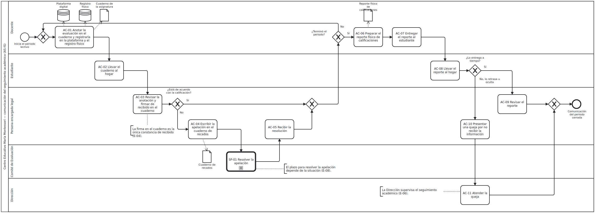
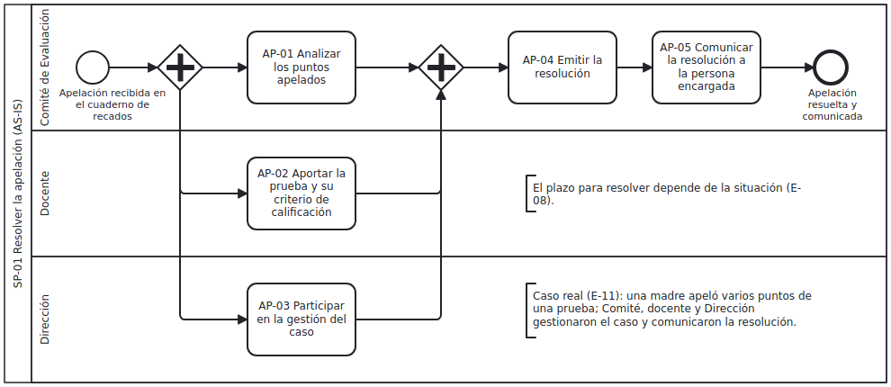

# Proceso actual (BPMN) y trazabilidad hacia los RF

El modelo describe cómo trabaja **hoy** el Centro Educativo María Montessori para comunicar el seguimiento académico de primaria. No contiene el Portal Académico. Cada actividad cita la evidencia que la respalda (ver [problema y visión](../problema-y-vision.md#evidencia)); no quedan actividades marcadas como «por validar».

## Diagramas

| Diagrama | Fuente editable (bpmn.io) | Imagen |
|---|---|---|
| Comunicar el seguimiento académico (principal) | [seguimiento-academico-actual.bpmn](seguimiento-academico-actual.bpmn) | [PNG](seguimiento-academico-actual.png) |
| SP-01 Resolver la apelación (subproceso) | [resolver-apelacion-actual.bpmn](resolver-apelacion-actual.bpmn) | [PNG](resolver-apelacion-actual.png) |

## Lectura del modelo

- **Participantes:** Docente, Estudiante, Persona encargada legal, Comité de Evaluación y Dirección, como carriles de un mismo pool del centro educativo. Son los mismos actores del [diagrama de casos de uso](../../03-casos-de-uso/actores.md) y del [diagrama de contexto](../diagrama-de-contexto.md); el estudiante participa en el proceso actual, pero no usa el Portal.
- **Medios confirmados:** plataforma digital y registro físico (E-01), cuaderno de la asignatura (E-02, E-04), reporte físico de calificaciones (E-03, E-12) y cuaderno de recados (E-07). Aparecen como almacenes y objetos de datos.
- **Camino principal:** la docente anota y registra cada evaluación diaria; el estudiante lleva el cuaderno; la persona encargada revisa y firma. La compuerta «¿Terminó el periodo?» repite ese ciclo; al cierre del periodo, la docente prepara el reporte físico y el estudiante lo lleva al hogar.
- **Excepciones con evidencia:** si la persona encargada no está de acuerdo con una calificación, apela por el cuaderno de recados y el Comité resuelve (SP-01, E-07, E-11). Si el estudiante retrasa u oculta el reporte (E-13), la persona encargada se queja (E-14) y la Dirección atiende la queja.
- **Cierres:** cada compuerta exclusiva de decisión tiene su compuerta de unión. El proceso termina en un único evento de fin: *Comunicación del periodo cerrada*. El subproceso termina en *Apelación resuelta y comunicada*.
- **Criterios de modelado:** la queja la atiende la Dirección porque es quien supervisa el seguimiento (E-06). En el subproceso, el Comité, la docente y la Dirección aportan en paralelo porque los tres participan en la apelación (E-11). El plazo (E-08) aparece como anotación, porque depende de la situación. El diagrama no contiene marcas de pendiente ni de confirmación.

### Resolución de las marcas [PV] del PC1

| Actividad del PC1 | Qué pasó |
|---|---|
| AC-01 Preparar la hoja (instrumento previo [PV]) | Resuelto con E-01 y E-02: cuaderno de asignatura, plataforma y registro físico (AC-01 y AC-06). |
| AC-06 Atender la consulta o queja [PV] | Resuelto con E-06 y E-14: ahora AC-11, a cargo de la Dirección, que supervisa el seguimiento. |
| AC-07 Comunicar una aclaración [PV] | Se retiró: no hay evidencia de una respuesta separada de la atención de la queja. |
| AC-08 Intervención de Dirección al escalar [PV] | Resuelto con E-07 y E-11: la Dirección participa en SP-01 junto al Comité. |
| AC-12 Solicitar aclaración [PV] | Se retiró del proceso actual; la comunicación ordinaria por el cuaderno de recados queda cubierta por AC-04 y por CU-06 en el sistema propuesto. |
| AC-13 Recibir respuesta [PV] | Resuelto con E-11: ahora AC-05, la persona encargada recibe la resolución. |

## Actividades, evidencia y requerimientos

| Actividad | Responsable | Descripción | Evidencia | Problema | RF que la atienden |
|---|---|---|---|---|---|
| AC-01 | Docente | Anotar la evaluación en el cuaderno y registrarla en la plataforma y en el registro físico | E-01, E-02 | P-01, P-02 | [RF-03](../../02-requerimientos/funcionales/RF-03-consultar-evaluaciones-y-calificaciones.md), [RF-04](../../02-requerimientos/funcionales/RF-04-registrar-evaluacion-asignada.md), [RF-05](../../02-requerimientos/funcionales/RF-05-confirmar-congruencia-con-el-cuaderno.md), [RF-06](../../02-requerimientos/funcionales/RF-06-publicar-evaluacion-asignada.md), [RF-07](../../02-requerimientos/funcionales/RF-07-registrar-calificaciones-del-grupo.md) |
| AC-02 | Estudiante | Llevar el cuaderno al hogar | E-02, E-04, E-12 | P-01, P-02 | [RF-01](../../02-requerimientos/funcionales/RF-01-vincular-encargado-con-estudiante.md), [RF-02](../../02-requerimientos/funcionales/RF-02-consultar-perfil-del-estudiante.md), [RF-06](../../02-requerimientos/funcionales/RF-06-publicar-evaluacion-asignada.md), [RF-10](../../02-requerimientos/funcionales/RF-10-avisar-publicacion-de-evaluacion.md) |
| AC-03 | Persona encargada legal | Revisar la anotación y firmar de recibido en el cuaderno | E-02, E-04 | P-03 | [RF-12](../../02-requerimientos/funcionales/RF-12-registrar-acuse-de-consulta.md), [RF-13](../../02-requerimientos/funcionales/RF-13-recordar-avisos-no-consultados.md) |
| AC-04 | Persona encargada legal | Escribir la apelación en el cuaderno de recados | E-07 | P-01, P-04 | [RF-14](../../02-requerimientos/funcionales/RF-14-intercambiar-mensajes.md), [RF-17](../../02-requerimientos/funcionales/RF-17-presentar-apelacion.md) |
| SP-01 | Comité de Evaluación (con docente y Dirección) | Resolver la apelación (subproceso) | E-07, E-08, E-11 | P-04, P-05 | [RF-09](../../02-requerimientos/funcionales/RF-09-corregir-calificacion-con-historial.md), [RF-18](../../02-requerimientos/funcionales/RF-18-asignar-apelacion-al-comite.md), [RF-19](../../02-requerimientos/funcionales/RF-19-registrar-aportes-de-docente-y-direccion.md), [RF-20](../../02-requerimientos/funcionales/RF-20-registrar-resolucion-de-apelacion.md), [RF-21](../../02-requerimientos/funcionales/RF-21-controlar-estado-y-plazo-de-apelacion.md), [RF-22](../../02-requerimientos/funcionales/RF-22-configurar-plazos-y-recordatorios.md), [RF-24](../../02-requerimientos/funcionales/RF-24-consultar-estado-del-seguimiento.md) |
| AC-05 | Persona encargada legal | Recibir la resolución | E-11 | P-04 | [RF-20](../../02-requerimientos/funcionales/RF-20-registrar-resolucion-de-apelacion.md) |
| AC-06 | Docente | Preparar el reporte físico de calificaciones | E-03, E-12 | P-01, P-02 | [RF-03](../../02-requerimientos/funcionales/RF-03-consultar-evaluaciones-y-calificaciones.md), [RF-08](../../02-requerimientos/funcionales/RF-08-publicar-calificacion.md) |
| AC-07 | Docente | Entregar el reporte al estudiante | E-12 | P-01, P-02 | [RF-08](../../02-requerimientos/funcionales/RF-08-publicar-calificacion.md) |
| AC-08 | Estudiante | Llevar el reporte al hogar | E-12 | P-01, P-02, P-03, P-05 | [RF-01](../../02-requerimientos/funcionales/RF-01-vincular-encargado-con-estudiante.md), [RF-02](../../02-requerimientos/funcionales/RF-02-consultar-perfil-del-estudiante.md), [RF-08](../../02-requerimientos/funcionales/RF-08-publicar-calificacion.md), [RF-11](../../02-requerimientos/funcionales/RF-11-avisar-publicacion-de-calificacion.md), [RF-13](../../02-requerimientos/funcionales/RF-13-recordar-avisos-no-consultados.md), [RF-23](../../02-requerimientos/funcionales/RF-23-alertar-avisos-sin-consulta.md) |
| AC-09 | Persona encargada legal | Revisar el reporte | E-03 | P-01 | [RF-03](../../02-requerimientos/funcionales/RF-03-consultar-evaluaciones-y-calificaciones.md) |
| AC-10 | Persona encargada legal | Presentar una queja por no recibir la información | E-14 | P-02 | [RF-15](../../02-requerimientos/funcionales/RF-15-presentar-queja-por-informacion-no-recibida.md) |
| AC-11 | Dirección | Atender la queja | E-06, E-14 | P-02, P-03, P-05 | [RF-16](../../02-requerimientos/funcionales/RF-16-atender-queja-por-informacion-no-recibida.md), [RF-23](../../02-requerimientos/funcionales/RF-23-alertar-avisos-sin-consulta.md), [RF-24](../../02-requerimientos/funcionales/RF-24-consultar-estado-del-seguimiento.md), [RF-25](../../02-requerimientos/funcionales/RF-25-consultar-registro-de-consultas.md) |

Todos los RF tienen al menos una actividad de origen; la lista completa RF → CU → prueba está en [trazabilidad-rf-cu.md](../../02-requerimientos/trazabilidad-rf-cu.md).
