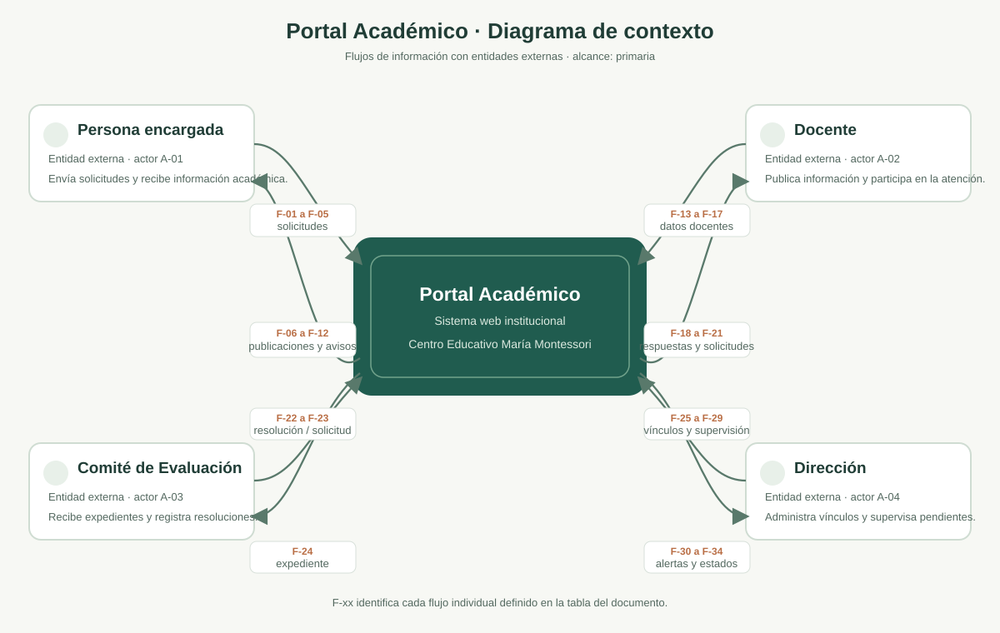

# Diagrama de contexto

El sistema se representa como **una sola caja negra** y se muestran únicamente las cuatro entidades externas y los datos que intercambian. Los módulos, pantallas, tablas, servicios y participantes internos quedan fuera de este diagrama. El archivo SVG es la fuente editable y la imagen publicada.

El PC2 contenía una colaboración BPMN con numerosos flujos. Se conserva en `historial/` como antecedente, no como diagrama de contexto vigente. La tabla siguiente mantiene la definición individual y trazable de cada flujo F-xx; el gráfico agrupa visualmente esos datos por entidad para que se pueda leer.

## Correspondencia de las entidades externas

| Entidad externa | Actor de casos de uso | Relación con el Portal |
|---|---|---|
| Persona encargada legal | [A-01](../03-casos-de-uso/actores.md#a-01--persona-encargada-legal) | Envía criterios, mensajes, apelaciones, quejas y acuses; recibe publicaciones, respuestas y avisos. |
| Docente | [A-02](../03-casos-de-uso/actores.md#a-02--docente) | Envía evaluaciones, calificaciones y respuestas; recibe mensajes, expedientes y solicitudes. |
| Comité de Evaluación | [A-03](../03-casos-de-uso/actores.md#a-03--comité-de-evaluación) | Envía resoluciones y solicitudes de información; recibe el expediente de una apelación. |
| Dirección | [A-04](../03-casos-de-uso/actores.md#a-04--dirección) | Envía vínculos, plazos, observaciones y criterios; recibe alertas y estados de seguimiento. |

**Quiénes no aparecen y por qué:**

- **Estudiante:** participa en el BPMN porque hoy lleva el cuaderno y el reporte, pero no intercambia datos con el Portal (no tiene cuenta en el MVP).
- **Tiempo (servicio programado):** es un disparador interno del sistema, no una entidad externa.
- **Plataforma digital actual de la escuela:** existe (E-01), pero la integración está fuera del MVP, así que no intercambia datos con el Portal.

No aparece ninguna entidad nueva respecto de los actores definidos para el Portal.

## Flujos de datos

| ID | Origen | Destino | Dato | CU que lo produce o consume |
|---|---|---|---|---|
| F-01 | Persona encargada | Portal | Criterios de consulta (estudiante y periodo) | [CU-01](../03-casos-de-uso/CU-01-consultar-progreso-academico.md) |
| F-02 | Persona encargada | Portal | Mensaje sobre el estudiante | [CU-06](../03-casos-de-uso/CU-06-comunicarse-sobre-un-estudiante.md) |
| F-03 | Persona encargada | Portal | Apelación con puntos, motivo y respaldo | [CU-07](../03-casos-de-uso/CU-07-gestionar-apelacion-de-calificacion.md) |
| F-04 | Persona encargada | Portal | Queja por información no recibida | [CU-12](../03-casos-de-uso/CU-12-presentar-queja-por-informacion-no-recibida.md) |
| F-05 | Persona encargada | Portal | Acuse de consulta de un aviso | [CU-05](../03-casos-de-uso/CU-05-dar-seguimiento-a-avisos-no-consultados.md) |
| F-06 | Portal | Persona encargada | Perfil, evaluaciones y calificaciones publicadas | [CU-01](../03-casos-de-uso/CU-01-consultar-progreso-academico.md) |
| F-07 | Portal | Persona encargada | Aviso de evaluación asignada | [CU-03](../03-casos-de-uso/CU-03-publicar-evaluacion-asignada.md) |
| F-08 | Portal | Persona encargada | Aviso de calificación o de corrección | [CU-04](../03-casos-de-uso/CU-04-publicar-calificacion.md), [CU-09](../03-casos-de-uso/CU-09-corregir-calificacion-publicada.md) |
| F-09 | Portal | Persona encargada | Recordatorio de aviso pendiente | [CU-05](../03-casos-de-uso/CU-05-dar-seguimiento-a-avisos-no-consultados.md) |
| F-10 | Portal | Persona encargada | Respuesta de la docente | [CU-06](../03-casos-de-uso/CU-06-comunicarse-sobre-un-estudiante.md) |
| F-11 | Portal | Persona encargada | Resolución de la apelación | [CU-14](../03-casos-de-uso/CU-14-registrar-resolucion-de-apelacion.md), [CU-15](../03-casos-de-uso/CU-15-consultar-resolucion-de-apelacion.md) |
| F-12 | Portal | Persona encargada | Respuesta a la queja | [CU-12](../03-casos-de-uso/CU-12-presentar-queja-por-informacion-no-recibida.md) |
| F-13 | Docente | Portal | Evaluación asignada con confirmación del cuaderno | [CU-03](../03-casos-de-uso/CU-03-publicar-evaluacion-asignada.md) |
| F-14 | Docente | Portal | Calificaciones del grupo con confirmación del cuaderno | [CU-04](../03-casos-de-uso/CU-04-publicar-calificacion.md) |
| F-15 | Docente | Portal | Corrección de calificación con motivo | [CU-09](../03-casos-de-uso/CU-09-corregir-calificacion-publicada.md) |
| F-16 | Docente | Portal | Respuesta al mensaje | [CU-06](../03-casos-de-uso/CU-06-comunicarse-sobre-un-estudiante.md) |
| F-17 | Docente | Portal | Prueba y criterio de calificación | [CU-13](../03-casos-de-uso/CU-13-aportar-informacion-a-apelacion.md) |
| F-18 | Portal | Docente | Mensaje de la persona encargada | [CU-06](../03-casos-de-uso/CU-06-comunicarse-sobre-un-estudiante.md) |
| F-19 | Portal | Docente | Aviso de apelación | [CU-07](../03-casos-de-uso/CU-07-gestionar-apelacion-de-calificacion.md) |
| F-20 | Portal | Docente | Solicitud de publicar información faltante | [CU-12](../03-casos-de-uso/CU-12-presentar-queja-por-informacion-no-recibida.md) |
| F-21 | Portal | Docente | Resumen de la publicación (incluidos y sin destinatario) | [CU-03](../03-casos-de-uso/CU-03-publicar-evaluacion-asignada.md), [CU-04](../03-casos-de-uso/CU-04-publicar-calificacion.md) |
| F-22 | Comité de Evaluación | Portal | Resolución de la apelación | [CU-14](../03-casos-de-uso/CU-14-registrar-resolucion-de-apelacion.md) |
| F-23 | Comité de Evaluación | Portal | Solicitud de información adicional | [CU-13](../03-casos-de-uso/CU-13-aportar-informacion-a-apelacion.md) |
| F-24 | Portal | Comité de Evaluación | Expediente de la apelación | [CU-07](../03-casos-de-uso/CU-07-gestionar-apelacion-de-calificacion.md), [CU-13](../03-casos-de-uso/CU-13-aportar-informacion-a-apelacion.md), [CU-14](../03-casos-de-uso/CU-14-registrar-resolucion-de-apelacion.md) |
| F-25 | Dirección | Portal | Vínculo persona encargada–estudiante con respaldo | [CU-02](../03-casos-de-uso/CU-02-vincular-encargado-con-estudiante.md) |
| F-26 | Dirección | Portal | Plazos y política de recordatorios | [CU-10](../03-casos-de-uso/CU-10-configurar-plazos-y-recordatorios.md) |
| F-27 | Dirección | Portal | Observaciones de la apelación | [CU-13](../03-casos-de-uso/CU-13-aportar-informacion-a-apelacion.md) |
| F-28 | Dirección | Portal | Hallazgo y respuesta de la queja | [CU-12](../03-casos-de-uso/CU-12-presentar-queja-por-informacion-no-recibida.md) |
| F-29 | Dirección | Portal | Criterios de supervisión (periodo y grupo) | [CU-08](../03-casos-de-uso/CU-08-supervisar-seguimiento-academico.md) |
| F-30 | Portal | Dirección | Alerta de aviso sin consulta o estudiante sin destinatario | [CU-05](../03-casos-de-uso/CU-05-dar-seguimiento-a-avisos-no-consultados.md) |
| F-31 | Portal | Dirección | Estado del seguimiento (avisos, quejas y apelaciones) | [CU-08](../03-casos-de-uso/CU-08-supervisar-seguimiento-academico.md) |
| F-32 | Portal | Dirección | Registro de consultas | [CU-08](../03-casos-de-uso/CU-08-supervisar-seguimiento-academico.md), [CU-12](../03-casos-de-uso/CU-12-presentar-queja-por-informacion-no-recibida.md) |
| F-33 | Portal | Dirección | Aviso de queja registrada | [CU-12](../03-casos-de-uso/CU-12-presentar-queja-por-informacion-no-recibida.md) |
| F-34 | Portal | Dirección | Aviso de apelación o de plazo vencido | [CU-07](../03-casos-de-uso/CU-07-gestionar-apelacion-de-calificacion.md), [CU-08](../03-casos-de-uso/CU-08-supervisar-seguimiento-academico.md) |
