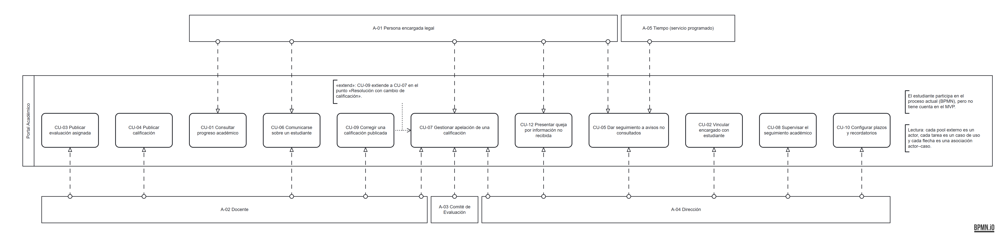

# Actores

Los actores coinciden con los participantes del [proceso actual](../01-inicio/bpmn/trazabilidad-bpmn-rf.md) y con las entidades externas del [diagrama de contexto](../01-inicio/diagrama-de-contexto.md). Cada uno cita la evidencia que confirma su papel ([E-xx](../01-inicio/problema-y-vision.md#evidencia)).

Fuente editable en [bpmn.io](https://bpmn.io/): [diagrama-casos-de-uso.bpmn](diagrama-casos-de-uso.bpmn). Está dibujado en notación BPMN: cada pool externo es un actor, cada tarea es un caso de uso y cada flecha es una asociación actor–caso. La relación «extend» se muestra como una asociación con flecha y su nota.

## Resumen

| ID | Actor | Tipo | Casos de uso | Evidencia |
|---|---|---|---|---|
| A-01 | Persona encargada legal | Humano, principal | CU-01, CU-05, CU-06, CU-07, CU-12 | E-04, E-07, E-12, E-14 |
| A-02 | Docente | Humano, principal | CU-03, CU-04, CU-06, CU-07, CU-09 | E-02, E-11 |
| A-03 | Comité de Evaluación | Humano (órgano colegiado), principal en apelaciones | CU-07 | E-07, E-11 |
| A-04 | Dirección | Humano, principal en supervisión | CU-02, CU-05, CU-07, CU-08, CU-10, CU-12 | E-06, E-11 |
| A-05 | Tiempo (servicio programado) | Sistema, inicia por calendario | CU-05 | Necesario para RF-13; no es una persona |
| — | Estudiante | Participante del proceso actual, no usa el Portal | Ninguno | E-12, E-13 |

## Fichas

### A-01 — Persona encargada legal

- **Objetivo:** conocer a tiempo las evaluaciones y calificaciones de sus estudiantes, comunicarse con la docente y reclamar cuando algo no llega o no está de acuerdo.
- **Hoy:** recibe la información por el cuaderno y el reporte que lleva el estudiante (E-12), firma de recibido (E-04), apela por el cuaderno de recados (E-07) y se ha quejado de no recibir información a tiempo (E-14).
- **En el Portal:** consulta el progreso (CU-01), recibe y consulta avisos (CU-05), conversa con la docente (CU-06), apela una calificación (CU-07) y presenta quejas (CU-12).
- **No puede:** ver estudiantes sin vínculo activo, cambiar calificaciones ni resolver casos.

### A-02 — Docente

- **Objetivo:** comunicar las evaluaciones y calificaciones una sola vez, de forma coherente con el cuaderno de la asignatura.
- **Hoy:** anota las evaluaciones diarias en el cuaderno (E-02), registra en la plataforma y en el registro físico (E-01), y aporta la prueba y su criterio cuando hay una apelación (E-11).
- **En el Portal:** publica evaluaciones (CU-03) y calificaciones (CU-04), corrige con historial (CU-09), conversa con las personas encargadas (CU-06) y aporta antecedentes en las apelaciones (CU-07).
- **No puede:** operar grupos que no tiene asignados, resolver una apelación ni borrar una versión publicada.

### A-03 — Comité de Evaluación

- **Objetivo:** resolver las apelaciones con la evidencia completa y dejar constancia de la resolución.
- **Hoy:** participa en las apelaciones (E-07); en el caso real gestionó la apelación con la docente y la Dirección, emitió la resolución y la comunicó (E-11).
- **En el Portal:** recibe la apelación asignada, solicita información, registra la resolución (CU-07).
- **No puede:** cambiar la calificación directamente; si la resolución lo ordena, la docente aplica la corrección (CU-09).
- **Cambio respecto del PC1:** no existía como actor. Se incorpora por la entrevista.

### A-04 — Dirección

- **Objetivo:** supervisar que la información llegue a las familias y que quejas y apelaciones se atiendan en plazo.
- **Hoy:** supervisa el seguimiento académico (E-06) y participa en las apelaciones (E-11).
- **En el Portal:** vincula personas encargadas con estudiantes (CU-02, propuesta S-02), recibe alertas de avisos sin consulta (CU-05), participa en apelaciones (CU-07), supervisa (CU-08), configura plazos y recordatorios (CU-10) y atiende quejas (CU-12).
- **No puede:** cambiar una calificación ni una resolución del Comité.

### A-05 — Tiempo (servicio programado)

- **Objetivo:** revisar periódicamente los avisos pendientes y aplicar la configuración de recordatorios sin trabajo manual.
- **En el Portal:** inicia CU-05.
- **Restricción:** no marca un aviso como consultado y no inventa estados de entrega.
- No aparece en el diagrama de contexto porque es un disparador interno del sistema, no una entidad externa.

### Estudiante (no es actor del Portal)

Participa en el proceso actual porque lleva el cuaderno y el reporte al hogar (E-12), y algunas veces los retrasa u oculta (E-13). Es la persona sobre la que trata la información, pero no tiene cuenta en el MVP. Por eso aparece en el BPMN y no en el diagrama de casos de uso ni en el de contexto.

## Actores retirados respecto del PC1

| Actor del PC1 | Decisión | Justificación |
|---|---|---|
| Administrador institucional | Se retira | La entrevista no confirma ese rol. La vinculación pasa a la Dirección como propuesta (S-02). Cuentas, grupos y materias se cargan antes de operar y se tratan en el diseño ([RS-03](../02-requerimientos/suplementarios/RS-03-seguridad-por-actor-y-vinculo.md)). |
| Auditor institucional autorizado | Se retira | No hay evidencia de una figura de auditoría en la escuela. La necesidad de saber quién consultó qué y cuándo queda en [RS-02](../02-requerimientos/suplementarios/RS-02-trazabilidad-de-consultas.md), y la consulta la hace la Dirección en CU-08. |
| Proveedor externo de notificación | Se retira | El MVP avisa dentro del Portal; correo y SMS quedan fuera del alcance. Sin proveedor externo no hay estados de entrega técnica que modelar. |
| Dirección / figura mediadora | Se precisa como «Dirección» | La entrevista confirma la Dirección y el Comité de Evaluación, pero no una figura mediadora distinta. |
