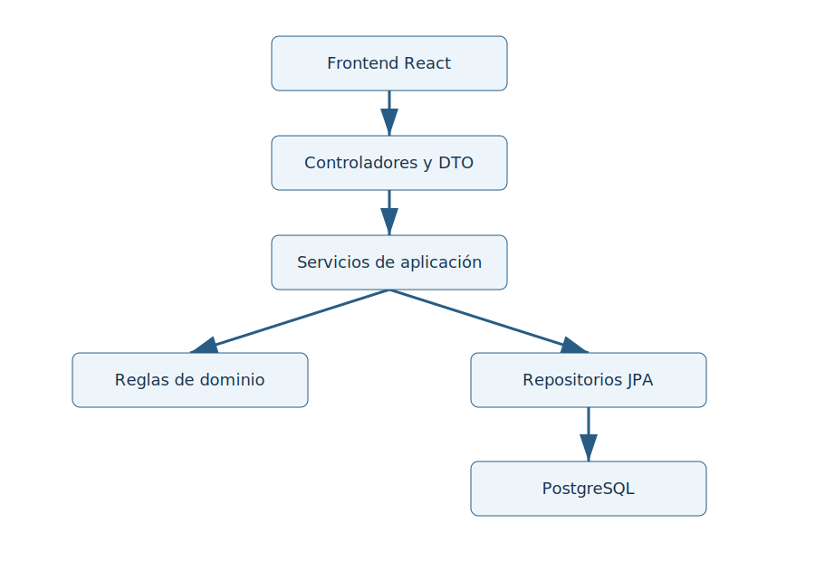
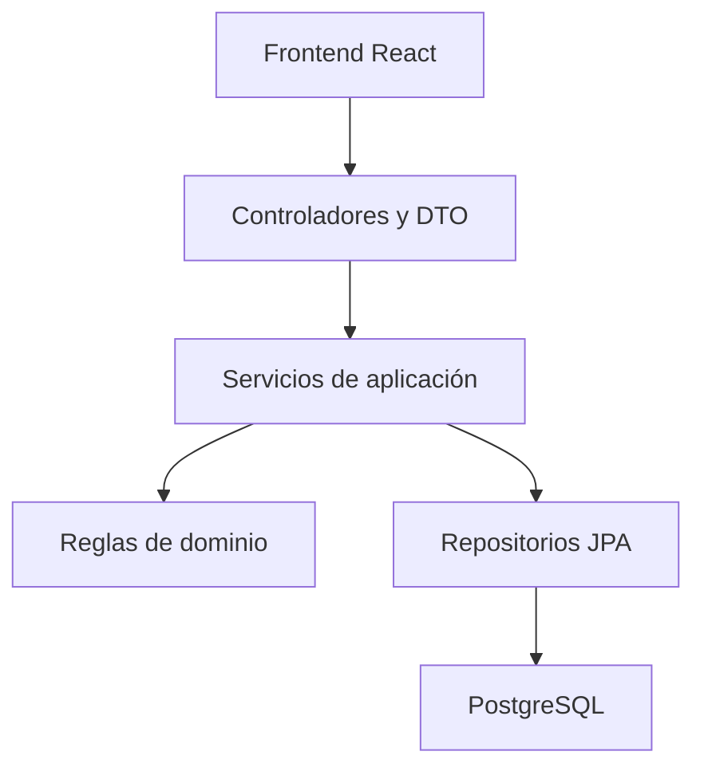

# Arquitectura propuesta

## Estilo y justificación
Monolito modular cliente-servidor con capas cerradas: React → API Spring Boot → servicios de aplicación → persistencia → PostgreSQL. Dos integrantes pueden desarrollar y desplegar una sola API; no se justifican microservicios. Cada módulo expone servicios públicos y mantiene sus repositorios internos. RS-01 exige una consulta sencilla; RS-02 exige registro de consultas y RS-03 obliga a verificar sesión, rol y vínculo en el servidor.

## Vista de componentes

[Fuente SVG editable](arquitectura.svg).

La fuente editable está arriba. La vista establece dependencias permitidas: un controlador no consulta repositorios y un componente visual no accede a la base de datos.

## Realización diseñada de CU-01: consultar progreso académico
Esta es una propuesta para PC3, no código implementado. Se basa en [CU-01](../03-casos-de-uso/CU-01-consultar-progreso-academico.md), RF-02/RF-03 y RS-01/02/03.

| Paso | Capa y elemento propuesto | Responsabilidad |
|---|---|---|
| 1 | Presentación: ProgresoPage y SelectorEstudiante | Seleccionar estudiante y periodo; mostrar carga, ausencia de publicaciones o error. |
| 2 | Hook useProgreso y api/progreso.ts | Solicitar GET /api/v1/estudiantes/{id}/progreso?periodo=...; cancelar solicitudes obsoletas. |
| 3 | Seguridad y ProgresoController (boundary) | Resolver identidad de la sesión, validar parámetros y entregar ProgresoResponse; nunca aceptar un encargadoId del cliente como identidad. |
| 4 | ConsultarProgresoService (control) | En una transacción, verificar cuenta activa, rol y vínculo vigente; obtener solo publicaciones y registrar la consulta autorizada. |
| 5 | VinculoRepository y PublicacionRepository | Consultas acotadas por encargado autenticado, estudiante, periodo y estado publicado. |
| 6 | Persistencia (entity) | VinculoEncargadoEstudiante, Estudiante, Evaluacion, Calificacion y RegistroConsulta. |
| 7 | Tablas propuestas | vinculo_encargado_estudiante, estudiante, evaluacion, calificacion, registro_consulta. Aún no creadas por la migración inicial. |
| 8 | Respuesta y presentación | DTO con perfil autorizado, publicaciones y versión vigente; CalificacionCard indica corrección e historial accesible. |

La transacción no es de solo lectura porque RS-02 registra la consulta. La autorización se repite por solicitud; no se conserva un permiso indefinidamente en el frontend. La revocación confirmada debe impedir la siguiente consulta. Antes de construir se definirá una estrategia de concurrencia para revocaciones simultáneas (bloqueo o control de versión del vínculo).

Flujos negativos: sesión inválida → 401 sin datos; vínculo ausente/revocado → respuesta de acceso denegado sin revelar existencia de estudiantes ajenos; periodo vacío → 200 con lista vacía; corrección → versión vigente y acceso autorizado al historial. El error visible corresponde a los escenarios A01–A05 del CU.

## Estado implementado
El código incluido implementa exclusivamente configuración, migración inicial y GET /api/v1/health. El diseño de CU-01 no implica su construcción. Autenticación, autorización académica y escenarios ejecutables pertenecen a la construcción posterior.
