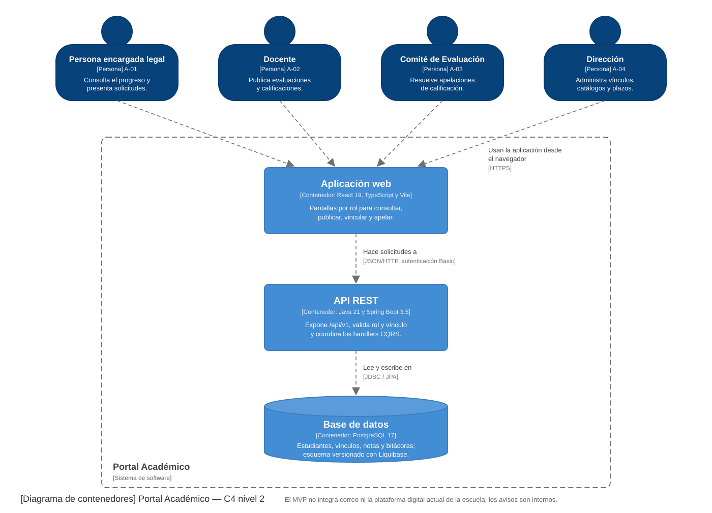
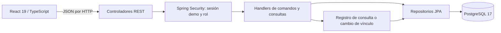

# Arquitectura implementada y propuesta

## C4 nivel 2 — Contenedores

Este diagrama abre la caja negra del [diagrama de contexto (C4 nivel 1)](../01-inicio/diagrama-de-contexto.md) y muestra los tres contenedores que se ejecutan:

| Contenedor | Tecnología | Responsabilidad |
|---|---|---|
| Aplicación web | React 19, TypeScript y Vite | Pantallas por rol (persona encargada, docente, Comité y Dirección). Llama a la API; no decide permisos. |
| API REST | Java 21 y Spring Boot 3.5 | Expone `/api/v1`, autentica con HTTP Basic, autoriza por rol en Spring Security y por vínculo en los handlers, y coordina comandos y consultas. |
| Base de datos | PostgreSQL 17 | Guarda estudiantes, vínculos, evaluaciones, calificaciones y bitácoras. Liquibase versiona el esquema y Hibernate solo lo valida. |

No hay sistemas externos: el MVP no envía correo ni se integra con la plataforma digital actual de la escuela, y los avisos se muestran dentro del Portal. La autenticación Basic con cuentas de demostración es solo para el entorno local.

## Vista interna de la API

El repositorio contiene un monolito modular: React/TypeScript consume una API Spring Boot; handlers CQRS coordinan las operaciones; repositorios JPA acceden a PostgreSQL. La autorización de rol se aplica en Spring Security y la de vínculo se verifica en el handler en cada consulta.

La integración PC3 implementa los 20 casos vigentes mediante un backend Spring Boot, una interfaz React con espacios de trabajo por actor y PostgreSQL. Abajo se detallan CU-01 y CU-02, el núcleo propuesto. No hay microservicios: el alcance del curso no lo requiere y el grupo puede ejecutar la solución localmente.

## CU-01 — Consultar progreso académico

1. `GuardianAcademicController` obtiene el nombre del usuario autenticado; no acepta un identificador de persona encargada del navegador.
2. `GetAcademicProgressQueryImpl` verifica que la cuenta activa tenga rol `GUARDIAN`.
3. Al listar, recupera vínculos `ACTIVE`. Al consultar un estudiante, valida otra vez el vínculo activo para ese estudiante.
4. Recupera solo evaluaciones publicadas del periodo y adjunta la calificación vigente con sus versiones anteriores (`GradeRevisionRepository`).
5. Registra consultas autorizadas, listas y denegadas en `consultation_log`. La respuesta denegada no confirma si el estudiante existe.
6. React presenta el perfil, las publicaciones y los estados vacíos/error.

La respuesta incluye el historial de correcciones que pide el alterno A04 de CU-01: cada calificación trae `previousVersions` con el valor anterior. La corrección la registra la docente en CU-09 (RF-09).

## CU-02 — Administrar vínculos

`DirectorLinkController` permite consultar el catálogo, crear un vínculo activo o pendiente, y suspender o finalizar uno activo. `ManageGuardianLinkHandlerImpl` valida el rol Dirección, que ambas cuentas estén activas, respaldo no vacío y ausencia de otra relación abierta para el mismo par. Un estado pendiente nunca autoriza consulta ni puede coexistir con un vínculo activo, incluso si dos altas llegan simultáneamente. Cada cambio deja responsable, fecha, motivo e historial; un índice único parcial protege esa regla en la base.

## Seguridad y entorno

La autenticación HTTP Basic y las cinco cuentas configuradas (persona encargada, persona encargada sin vínculos, Dirección, docente y Comité) son exclusivamente para demostración local. Se desactiva CSRF porque la API está planteada para cliente no basado en cookies; el despliegue real requiere TLS, administración de cuentas y sesiones institucionales antes de manejar datos reales. No se crean cuentas nuevas desde la UI.

## Alcance y límites de esta construcción

La API organiza los endpoints por rol, y Spring Security exige el rol correspondiente a cada prefijo:

| Prefijo | Rol | Qué cubre | CU |
|---|---|---|---|
| `/api/v1/guardian` | Persona encargada | Progreso, avisos y su lectura, mensajes, quejas, apelaciones y lectura de la resolución | CU-01, CU-05, CU-06, CU-07, CU-12, CU-15 |
| `/api/v1/teacher` | Docente | Evaluaciones, publicación y corrección de calificaciones, mensajes y aportes a apelaciones | CU-03, CU-04, CU-06, CU-09, CU-13 |
| `/api/v1/committee` | Comité de Evaluación | Expedientes, aportes y resolución de apelaciones | CU-13, CU-14 |
| `/api/v1/director` | Dirección | Estudiantes, vínculos, grupos, docentes, inscripciones, quejas, plazos, recordatorios, supervisión y aportes a apelaciones | CU-02, CU-05, CU-08, CU-10, CU-12, CU-13, CU-16 a CU-21 |

Lo que esta construcción **no** incluye:

- **Canales externos:** no envía correo ni SMS y no admite anexos. Avisos y mensajes existen solo dentro del Portal ([B-08](../07-construccion/brechas-de-requerimientos.md)).
- **Recordatorios automáticos:** Dirección procesa los vencimientos con un endpoint manual; no hay tarea programada (B-13).
- **Identidad institucional:** HTTP Basic con cuentas de demostración; no hay proveedor de identidad ni alta de cuentas desde la UI (B-05).
- **Reglas institucionales confirmadas:** la escala 0–100, los plazos de apelación y el modelo de grupos son provisionales (B-02, B-07, B-11).
- **Pruebas completas:** los escenarios `.feature` son especificaciones y no se ejecutan con Cucumber; no hay pruebas de navegador, accesibilidad ni rendimiento.

El detalle por CU está en [estado de implementación](../07-construccion/estado-de-implementacion.md) y las decisiones abiertas en [brechas](../07-construccion/brechas-de-requerimientos.md).
