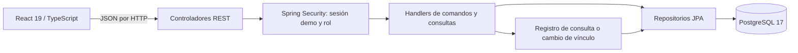

# Arquitectura implementada y propuesta

## Vista

El repositorio contiene un monolito modular: React/TypeScript consume una API Spring Boot; handlers CQRS coordinan las operaciones; repositorios JPA acceden a PostgreSQL. La autorización de rol se aplica en Spring Security y la de vínculo se verifica en el handler en cada consulta.

La integración PC3 implementa los 20 casos vigentes mediante un backend Spring Boot, una interfaz React con espacios de trabajo por actor y PostgreSQL. No hay microservicios: el alcance del curso no lo requiere y el grupo puede ejecutar la solución localmente.

## CU-01 — Consultar progreso académico

1. `GuardianAcademicController` obtiene el nombre del usuario autenticado; no acepta un identificador de persona encargada del navegador.
2. `GetAcademicProgressQueryImpl` verifica que la cuenta activa tenga rol `GUARDIAN`.
3. Al listar, recupera vínculos `ACTIVE`. Al consultar un estudiante, valida otra vez el vínculo activo para ese estudiante.
4. Recupera solo evaluaciones publicadas del periodo y adjunta la calificación existente.
5. Registra consultas autorizadas, listas y denegadas en `consultation_log`. La respuesta denegada no confirma si el estudiante existe.
6. React presenta el perfil, las publicaciones y los estados vacíos/error.

La consulta no incluye el historial de correcciones descrito en el alterno A04 de CU-01; no se afirma que RF-09 esté construido.

## CU-02 — Administrar vínculos

`DirectorLinkController` permite consultar el catálogo, crear un vínculo activo o pendiente, y suspender o finalizar uno activo. `ManageGuardianLinkHandlerImpl` valida el rol Dirección, que ambas cuentas estén activas, respaldo no vacío y ausencia de otra relación abierta para el mismo par. Un estado pendiente nunca autoriza consulta ni puede coexistir con un vínculo activo, incluso si dos altas llegan simultáneamente. Cada cambio deja responsable, fecha, motivo e historial; un índice único parcial protege esa regla en la base.

## Seguridad y entorno

La autenticación HTTP Basic y las cuatro credenciales configuradas son exclusivamente para demostración local. Se desactiva CSRF porque la API está planteada para cliente no basado en cookies; el despliegue real requiere TLS, administración de cuentas y sesiones institucionales antes de manejar datos reales. No se crean cuentas nuevas desde la UI.

## Límites de esta construcción

No están implementados el flujo de publicación por docentes, mensajería, avisos, quejas, expedientes de apelación, vencimientos, notificaciones externas ni supervisión de Dirección fuera de los vínculos. Comité de Evaluación tampoco está habilitado como rol de la API. Véase [estado](../07-construccion/estado-de-implementacion.md) y [brechas](../07-construccion/brechas-de-requerimientos.md).
