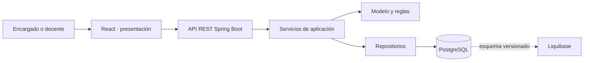

# Arquitectura propuesta

## Estilo

Monolito modular cliente-servidor con capas cerradas. Para el alcance de primaria y el equipo actual permite entregar una sola API y una sola interfaz con despliegue sencillo. La separación por módulos mantiene responsabilidades claras si luego se agregan las funciones académicas. PostgreSQL conserva relaciones e integridad; Liquibase registra los cambios de esquema.

## Dependencias

El navegador conoce contratos HTTP y tipos públicos; no accede a la base de datos. Los controladores reciben y validan transporte, llaman a servicios de aplicación y traducen resultados a HTTP. Los servicios coordinan reglas y transacciones. La persistencia implementa interfaces de repositorio y no decide políticas de acceso. Liquibase es la autoridad del esquema; Hibernate valida el mapeo con `ddl-auto=validate`.

## Realización representativa: consulta de salud

La pantalla de desarrollo solicita `GET /api/v1/health` al módulo tipado `src/api/health.ts`. Spring MVC enruta la solicitud a `HealthController`, que devuelve estado, nombre del servicio y hora UTC. El endpoint verifica transporte e integración de frontend y backend; no pretende implementar UC-01 ni exponer datos académicos. Cuando Josué cierre los CU, se revisará esta realización contra el CU final.

## Decisiones pendientes

El contexto, las relaciones del modelo académico, los permisos funcionales y el caso de uso de negocio representativo dependen de la línea base revisada del PC1. Se completarán junto con las correcciones asignadas a Josué.
