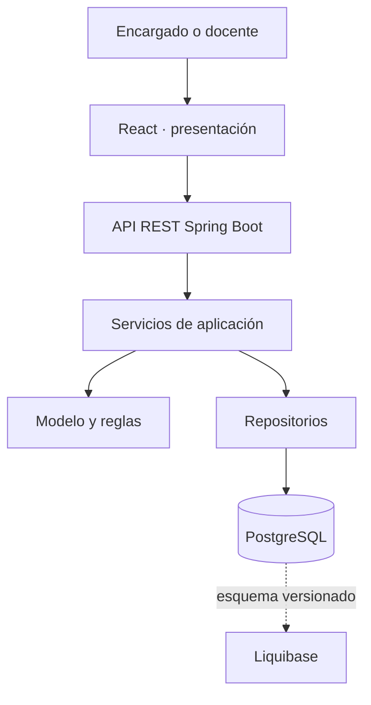

# Arquitectura propuesta

## Estilo

Monolito modular cliente-servidor con capas cerradas. Para el alcance de primaria y el equipo actual permite entregar una sola API y una sola interfaz con despliegue sencillo. La separación por módulos mantiene responsabilidades claras si luego se agregan las funciones académicas. PostgreSQL conserva relaciones e integridad; Liquibase registra los cambios de esquema.

## Dependencias

El navegador conoce contratos HTTP y tipos públicos; no accede a la base de datos. Los controladores reciben y validan transporte, llaman a servicios de aplicación y traducen resultados a HTTP. Los servicios coordinan reglas y transacciones. La persistencia implementa interfaces de repositorio y no decide políticas de acceso. Liquibase es la autoridad del esquema; Hibernate valida el mapeo con `ddl-auto=validate`.

## Realización representativa: consulta de salud

La pantalla de desarrollo solicita `GET /api/v1/health` al módulo tipado `src/api/health.ts`. Spring MVC enruta la solicitud a `HealthController`, que devuelve estado, nombre del servicio y hora UTC. El endpoint verifica transporte e integración de frontend y backend; no pretende implementar CU-01 ni exponer datos académicos. La línea base de análisis propuesta está en [el índice PC2](../README.md); la realización de negocio de CU-01 sigue pendiente.

## Decisiones pendientes

El análisis PC2 ya propone el contexto, los actores y la matriz RF → CU. Falta revisar su aprobación y derivar el modelo de dominio, el esquema relacional, los DTO y la realización de negocio. No reutilizar automáticamente los números RF del PC1: consultar [las equivalencias](../cambios-pc1-pc2.md).

## Seguridad pendiente de implementación

RS-03 exige sesión, rol y vínculo/asignación en cada operación académica. El backend actual no incluye Spring Security ni endpoints académicos. CORS solo controla orígenes del navegador: no autentica ni autoriza. Antes de exponer datos de estudiantes se deben implementar autenticación, autorización por operación y las pruebas positivas y negativas de RS-03. Elegir y configurar el framework es trabajo pendiente; no ocurre automáticamente por usar Spring Boot.
