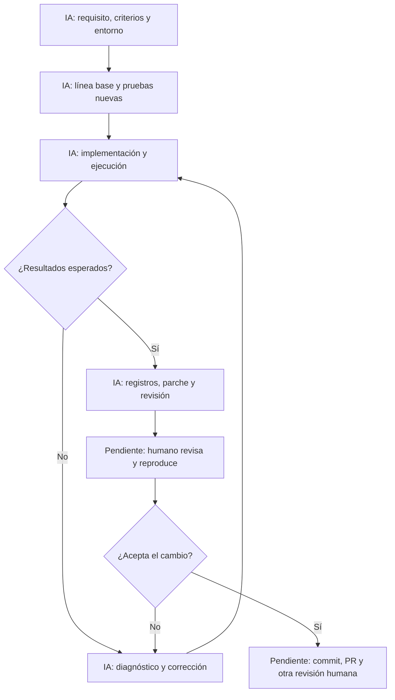

# Agentes de generación de código en el desarrollo de software

**Tema 2 · IF-6100 Análisis y Diseño de Sistemas**

> **Estado: ejecución técnica documentada; revisión humana pendiente.** Codex preparó y probó una regla de RF-04. El backend aprobó 22 pruebas y la consola comprobó seis escenarios. Faltan la validación de los integrantes, la evidencia de modalidad gratuita y la publicación de los PR. No es todavía una entrega cerrada.

| Dato | Información |
| --- | --- |
| Proyecto | Portal Académico |
| Integrante 1 | Sebastián Andrey Cordero Quesada |
| Integrante 2 | Josué Delgado Corrales |
| Integrante 3 | [COMPLETAR: nombre completo o autorización expresa del profesor para trabajar entre dos] |
| Repositorio previsto para la demostración | [agentes-codigo-tema2](https://github.com/JosueDelgadoCorrales/agentes-codigo-tema2); estaba vacío al consultarlo. El paquete local está en [demo-rf04](demo-rf04/README.md). |
| Issue y PR de la demostración | [Issue preparado](demo-rf04/ISSUE.md) y [texto del PR](demo-rf04/PR-demo.md); pendientes de publicación. |
| Repositorio y PR de la entrega | [COMPLETAR: enlaces; pueden ser distintos de los de la demostración] |
| Fecha de la prueba | 4 de noviembre de 2026. Intervalo registrado: 15:17:16–15:28:05, Costa Rica (UTC−6). |

## 1. Glosario

Estas definiciones están redactadas como apoyo para estudiar. Cada integrante debe poder explicarlas con un ejemplo del proyecto y revisar su redacción antes de entregar.

| Término | Definición | Relación con el tema | Fuente |
| --- | --- | --- | --- |
| Modelo de lenguaje grande (LLM) | Modelo entrenado con grandes colecciones de datos que aprende patrones del lenguaje y genera secuencias de tokens. | Aporta la capacidad de interpretar instrucciones y proponer código. Por sí solo no constituye todo el agente. | Zhao et al. (2023) |
| Prompt | Instrucción o entrada con la que se le plantea una tarea al modelo. | Comunica la funcionalidad, el contexto y las restricciones. | Schulhoff et al. (2024) |
| Ventana de contexto | Cantidad limitada de información que el modelo puede considerar en una interacción, medida en tokens. | Condiciona cuánto código, instrucciones y resultados puede considerar a la vez. No equivale a recordar todo el repositorio. | Schulhoff et al. (2024) |
| Alucinación | Contenido generado que parece plausible, pero es incorrecto o carece de respaldo. | Puede aparecer como una API inventada o una dependencia inexistente. | Spracklen et al. (2025) |
| Asistente de código | Herramienta que ayuda a producir, comprender o revisar código. | Es una categoría amplia que puede incluir sugerencias, conversación y funciones de agente. | Wang et al. (2024) |
| Autocompletado | Sugerencias de código que aparecen mientras la persona escribe. | La persona acepta o descarta cada sugerencia. | Cui et al. (2025) |
| Agente de IA | Sistema que combina un modelo con herramientas y un ciclo de acciones, observaciones y decisiones para avanzar hacia una tarea. | Puede inspeccionar archivos, modificar código y reaccionar a los resultados de las pruebas. | Wang et al. (2024) |
| Modo agente | Modalidad que permite a la herramienta actuar sobre un entorno mediante los permisos configurados. | Su autonomía depende del acceso y de los controles que se establezcan, no solo de su nombre. | OpenAI (s. f.-b) |
| Agente en la nube | Agente que ejecuta trabajo en un entorno remoto. | El entorno y el acceso al repositorio deben revisarse por separado de los permisos locales. | OpenAI (s. f.-d) |
| Pull request (PR) | Propuesta de integrar los cambios de una rama a otra, con un espacio para revisarlos. | Permite examinar el resultado antes de incorporarlo al proyecto. | Gousios et al. (2014) |
| Revisión de código | Inspección de cambios para detectar problemas y valorar si cumplen lo esperado. | Una persona distinta del autor revisa los cambios y las pruebas de la demo. | Bacchelli y Bird (2013) |
| Slopsquatting | Publicación de un paquete malicioso usando un nombre de dependencia que los modelos pueden inventar. | Una alucinación puede llevar a instalar software de un tercero malicioso. | Spracklen et al. (2025) |

## 2. Punto de partida del análisis

El análisis toma a **Codex, de OpenAI**, como herramienta para una prueba acotada en Java. Se busca observar cómo participa un agente en el desarrollo de una funcionalidad y qué controles conserva el equipo.

La selección se apoya en la documentación oficial y en la posibilidad de realizar una tarea breve dentro de una modalidad gratuita. La página consultada el **4 de noviembre de 2026** anuncia acceso gratuito en escritorio **sujeto a despliegue**. Esa información no demuestra que las cuentas del grupo ya dispongan del acceso ni que su cuota alcance para la prueba (OpenAI, s. f.-a). La activación efectiva debe comprobarse antes de elegir definitivamente la herramienta.

### Preguntas de investigación

1. ¿Qué distingue al autocompletado, al chat y a un agente que ejecuta acciones?
2. ¿Qué tareas conviene delegar y qué decisiones requieren revisión humana?
3. ¿Cómo se mantienen la trazabilidad y la responsabilidad en ramas, commits y PR?
4. ¿Qué errores y riesgos aparecen durante la prueba, y cómo se detectan?

### Fuentes y alcance

El borrador combina documentación de proveedores, estudios experimentales y encuestas. Cada fuente cumple un propósito: la documentación describe capacidades y permisos; los experimentos aportan medidas bajo condiciones concretas; las encuestas recogen experiencias y asociaciones. No todas tienen el mismo valor para establecer causalidad.

La ejecución técnica se limitó a **una regla de dominio Java del proyecto del curso**, con criterios verificables y un cambio que otra persona puede revisar completo. Las demás herramientas aparecen como contexto, sin una comparación experimental entre productos.

**Funcionalidad elegida:** validación de los campos y fechas de una evaluación, derivada del segundo criterio de RF-04 del Portal Académico. Se eligió porque permite comprobar un comportamiento útil sin base de datos, autenticación ni interfaz web. Se implementó un validador puro; no el registro completo de evaluaciones. La fecha de entrega es opcional y puede coincidir con la asignación, porque el requisito prohíbe fechas anteriores. El [issue](demo-rf04/ISSUE.md) contiene cuatro criterios y el enlace al requisito original.

No se asumirá que un resultado de autocompletado se reproduce con un agente ni que estudios de versiones anteriores describen exactamente el Codex usado en la demo.

## 3. Herramientas utilizadas y su contexto

| Herramienta | Uso efectivo | Condiciones y límites |
| --- | --- | --- |
| Codex en ChatGPT Work, OpenAI | Leyó el requisito, propuso el issue y el plan, generó código y pruebas, ejecutó comandos y ordenó la evidencia. | Entorno remoto Linux. Esta ejecución no comprueba acceso ni cuota de una cuenta gratuita. No se registró una versión de app ni un identificador de modelo verificable por el equipo. |
| Claude Code, Anthropic | El borrador inicial declara apoyo para investigar y redactar. | Cuenta de pago según el borrador; el equipo debe confirmar el alcance de ese uso. No se incluye como herramienta gratuita de la prueba. |
| Java | Compilación y ejecución del código. | Temurin 21.0.13+9; el backend exige Java 21. El entorno tenía Java 17, por lo que se preparó un JDK portable. |
| Maven y JUnit | Construcción y pruebas automatizadas. | Maven 3.9.11 y JUnit Jupiter 5.12.2. Se mantuvieron las dependencias del backend. |
| Git y GitHub | Lectura del requisito, clonación, comparación y preparación del parche. | Git 2.51.1. No hubo nuevos commits, push, PR o merge. La base fue `9515bd6370c090e09bea0dcafc170e632ced7e43`. |

Se conservaron los resultados en [la evidencia técnica](demo-rf04/evidencias/README.md). La cuenta gratuita y las dos computadoras de los integrantes todavía deben comprobarse. No se atribuye a esta sesión una modalidad de acceso que no se verificó.

## 4. Proceso aplicado en la prueba

### 4.1 Alcance y participación real

El usuario autorizó al agente a preparar el trabajo. Codex seleccionó una regla del proyecto, redactó los criterios y avanzó en la ejecución técnica. **No hubo aprobaciones humanas entre pasos.** Esta ejecución se apartó del protocolo inicial de detenerse en V1–V5; esos controles siguen pendientes y no se reconstruyen como si hubieran ocurrido.

La prueba evaluó cuatro criterios: datos completos con entrega igual o posterior, entrega opcional, rechazo de fechas anteriores y detección de todos los campos obligatorios ausentes. Se excluyeron persistencia, endpoints, autorización y asociación de estudiantes. El resultado es un componente de dominio que todavía debe conectarse al flujo de registro cuando se implemente ese flujo.

### 4.2 Secuencia realizada

1. **Contexto:** se inspeccionaron RF-04, el `pom.xml`, la arquitectura y las pruebas existentes de una copia del Portal Académico. Se conservó el commit base.
2. **Preparación:** se configuraron Java 21 y Maven. Fallaron algunos pasos de descarga y acceso a dependencias; se documentaron sus causas y correcciones.
3. **Línea base:** se ejecutaron las cinco pruebas existentes y pasaron (E04).
4. **Pruebas primero:** se escribieron 17 casos JUnit asociados a cuatro criterios. La compilación falló de forma esperada porque faltaban las clases nuevas (E05).
5. **Implementación:** se generaron `DatosEvaluacion`, `ErrorValidacion` y `ValidadorEvaluacion`. El validador devolvió errores por campo y usó únicamente el JDK.
6. **Verificación por el agente:** las 22 pruebas del backend pasaron (E06). La muestra independiente pasó las 17 pruebas nuevas (E07). La consola comprobó seis escenarios (E08).
7. **Revisión y evidencia:** el mismo agente examinó el cambio, comprobó el diff y preparó el parche, la propuesta de PR y la bitácora. El cambio del backend agregó cuatro archivos y 148 líneas, sin modificar archivos existentes ni dependencias.

No se crearon commits ni PR nuevos. La [revisión del agente](demo-rf04/REVISION-AGENTE.md) identifica los límites de integración y no equivale a aprobación independiente.

### 4.3 División de labores ingeniero / IA

| Labor | Ingeniero: participación registrada | IA: trabajo realizado | Estado |
| --- | --- | --- | --- |
| Solicitud y contexto | Proporcionó el borrador, las instrucciones y la autorización general. | Leyó el material y el requisito del repositorio. | Realizado. |
| Selección y criterios | Falta confirmar la interpretación de RF-04. | Redactó el issue y cuatro criterios. | Propuesta lista para revisar. |
| Plan y reglas | No hubo aprobación detallada entre pasos. | Preparó `PLAN.md` y `AGENTS.md`. | V1 pendiente. |
| Código y pruebas | No se registraron ediciones humanas. | Generó los tres archivos de producción y el archivo JUnit. | V2 pendiente. |
| Ejecución | Falta reproducir personalmente los comandos. | Ejecutó línea base, fase roja, suite final y consola. | Resultado técnico disponible; V3 pendiente. |
| Revisión automática | Falta contrastar las observaciones. | Revisó alcance, fechas, nulos, dependencias y pruebas. | V4 pendiente. |
| Commit, PR y aprobación | Corresponden al equipo; sin ejecución registrada. | Preparó el parche y el texto del PR. | Publicación y V5 pendientes. |

El autor y el revisor humano deben ser personas distintas. Los roles operativos no fijan las partes de exposición: todos deben preparar las tres partes para la rifa. La excepción de dos integrantes requiere confirmación del profesor.

### 4.4 Diagrama de lo ejecutado y lo pendiente

### 4.5 Medición y límites

El intervalo documentado fue **10 min 49 s**, desde el inicio del registro de preparación hasta el final de la consola. Los ocho comandos registrados sumaron **56,173 s**. Son medidas distintas: el intervalo incluye preparación y esperas, mientras las duraciones de comandos incluyen arranque y descargas.

La lectura previa del repositorio y la redacción posterior no se cronometraron. La revisión humana todavía no ocurrió. **Estas cifras no son el tiempo total de la tarea ni una medida de ahorro frente a trabajar sin IA.** Los detalles están en la [bitácora](evidencias/bitacora.md).

## 5. Tipos de asistencia y qué conviene delegar

### 5.1 Autonomía y control

| Tipo de asistencia | Acción principal | Control humano |
| --- | --- | --- |
| Autocompletado | Sugiere fragmentos mientras se escribe. | Aceptar o rechazar cada sugerencia. |
| Chat | Explica código y propone soluciones. | Decidir qué incorporar y comprobarlo. |
| Agente local | Usa herramientas sobre archivos y comandos. | Configurar permisos, definir el alcance y revisar cambios. |
| Agente remoto | Ejecuta tareas en un entorno separado. | Delimitar acceso y revisar el resultado antes de integrarlo. |

La ubicación local o remota no determina por sí sola la autonomía. También importan los permisos, las instrucciones, los puntos de revisión y el comportamiento concreto de la herramienta.

### 5.2 Evidencia sobre productividad

| Fuente | Diseño y alcance | Resultado | Límite de interpretación |
| --- | --- | --- | --- |
| Cui et al. (2025) | Tres experimentos de campo, 4.867 desarrolladores, asistencia de autocompletado. | 26,08 % más tareas completadas al combinar los experimentos; mayores beneficios entre menos experimentados. | No mide el Codex de esta demo ni todos los tipos de agente. |
| Becker et al. (2025) | Ensayo aleatorio con 16 desarrolladores y 246 tareas en repositorios que conocían. | 19 % más tiempo con las herramientas evaluadas de principios de 2025; después estimaron que habían sido 20 % más rápidos. | La experiencia, la herramienta y el contexto limitan su generalización. |
| Harvey y DeBellis (2025) | Investigación DORA con encuesta de casi 5.000 profesionales y datos cualitativos. | Asociación positiva con el flujo de entrega y negativa con su estabilidad. | Una asociación de encuesta no demuestra por sí sola causalidad. |

Los resultados justifican medir el trabajo completo, incluida la revisión. No se deben comparar directamente el porcentaje de tareas terminadas y el porcentaje de tiempo empleado, porque son métricas distintas.

### 5.3 Tareas para la prueba

Las recomendaciones de GitHub favorecen tareas delimitadas, criterios completos y orientación sobre el código relevante (GitHub, s. f.). Para este trabajo se seleccionó una regla pequeña, con pruebas unitarias y documentación del comportamiento.

Los cambios de autenticación, autorización, datos sensibles o arquitectura amplia requieren un análisis especializado y más revisión. Su exclusión de esta demo es una decisión de alcance del equipo, no una afirmación de que ningún agente pueda apoyar esas tareas.

## 6. Impacto en el proceso de desarrollo

**Ramas y PR.** El protocolo prevé una rama separada y un PR. En la ejecución registrada se trabajó en una copia local y se preparó un parche; la publicación sigue pendiente. El PR de la demo registra el código y su revisión; el PR de entrega contiene el trabajo académico. Pueden ser diferentes y ambos deben enlazarse cuando corresponda.

**Commits y autoría.** El autor humano revisa y guarda los cambios. Para facilitar la trazabilidad se propone el pie `Generated-by: Codex (OpenAI)`, con versión o modelo cuando se conozca. Apache Software Foundation recomienda identificar la herramienta en contribuciones asistidas por IA; esa práctica no sustituye la responsabilidad del contribuyente ni convierte sus reglas en una obligación universal.

**Tamaño del cambio.** El equipo limita los pasos para que el revisor pueda entenderlos completos. Si el agente amplía el alcance, modifica archivos ajenos o agrega dependencias innecesarias, se detiene el paso y se registra la decisión.

**Revisión.** Una segunda ejecución de pruebas y la lectura del diff son actividades distintas: que las pruebas pasen no asegura que cubran los criterios correctos. El autor debe explicar los cambios, y el revisor debe contrastarlos con el issue.

## 7. Riesgos y controles

| Riesgo | Evidencia o fundamento | Control en la prueba |
| --- | --- | --- |
| Código inseguro | Pearce et al. (2022) encontraron vulnerabilidades en aproximadamente el 40 % de 1.689 programas generados para escenarios de seguridad. Perry et al. (2023) observaron código menos seguro y mayor confianza en el grupo asistido. Son herramientas y condiciones de esos estudios. | Revisión del diff, casos negativos, herramientas de análisis disponibles y revisión humana. |
| Dependencias inventadas | Spracklen et al. (2025) analizaron 576.000 muestras en Python y JavaScript. Reportaron promedios de paquetes alucinados de al menos 5,2 % en modelos comerciales y 21,7 % en modelos abiertos. No son tasas medidas para Java ni para esta demo. | Confirmar existencia, origen, necesidad y licencia antes de incorporar una dependencia. |
| Procedencia y licencias | La guía de Apache mantiene la responsabilidad del contribuyente sobre los materiales incluidos. | Revisar coincidencias conocidas, procedencia y compatibilidad con el proyecto. |
| Exposición de información | Dar acceso al repositorio y a herramientas implica decidir qué información queda disponible para el agente. | Usar datos de prueba y excluir credenciales, tokens y archivos privados ajenos al alcance. |
| Confianza excesiva | En Becker et al. la percepción de rapidez no coincidió con el tiempo medido. | Medir el proceso completo y exigir que el equipo explique y verifique cada cambio. |
| Revisión automática incorrecta | La revisión del agente es otra salida generada por IA. | Confirmar cada hallazgo con código o pruebas antes de aceptarlo. |

Estas son amenazas y controles previstos. Solo se reportarán como **riesgos observados** los que cuenten con evidencia de la prueba.

## 8. Hallazgos, conclusiones y recomendaciones

### 8.1 Hallazgos de la demostración

| Aspecto | Hallazgo | Evidencia |
| --- | --- | --- |
| Criterios | Los cuatro criterios quedaron cubiertos por 17 pruebas nuevas aprobadas, incluidos nulos, igualdad, cambio de año y fecha bisiesta. | Issue, `ValidadorEvaluacionTest.java` y E07. |
| Compatibilidad | Las cinco pruebas previas siguieron pasando: 22 pruebas aprobadas en total. | E04, E06 y XML de Surefire. |
| Demo visible | Seis escenarios de consola mostraron aceptación y mensajes por campo. | E08. |
| Cambio | Cuatro archivos y 148 líneas nuevas en el backend; sin dependencias nuevas. | Parche y `diff-stat.txt`. |
| Preparación | Java 17 y la ausencia de Maven impidieron usar directamente el entorno inicial. El acceso a dependencias requirió configurar la red disponible. | Registro inicial, herramientas y E01–E04. |
| Errores de la IA | Se identificaron dos errores de preparación: intentar usar un manifiesto ausente y reutilizar una configuración temporal de proxy. El primero se reconstruye de la sesión; el segundo tiene diagnóstico en E03. | Índice de evidencia, E03 y corrección antes de E04. |
| Errores funcionales | No se detectaron en los 17 casos nuevos. El fallo de E05 fue intencional por ausencia de implementación; no cuenta como defecto. | E05–E07. |
| Riesgo observado | El mismo agente generó implementación, pruebas y revisión. La ausencia de revisión humana limita la confianza en la cobertura y el significado de los criterios. | División de labores y revisión del agente. |
| Tiempo | Intervalo de 10 min 49 s; comandos: 56,173 s. Revisión humana y trabajo documental no incluidos. | Marcas de tiempo de la bitácora. |
| Acceso gratuito y PR | No comprobado el acceso gratuito; sin nuevos commits ni PR publicados. | Estado declarado, sin evidencia de cierre. |

### 8.2 Conclusiones de esta ejecución

El agente participó en acciones observables: leyó archivos, escribió pruebas y código, ejecutó herramientas y corrigió la preparación del entorno. Esto permite mostrar la diferencia entre una sugerencia de texto y un agente que actúa sobre un proyecto. La tarea acotada facilitó vincular cada comportamiento con una prueba y conservar un cambio pequeño.

La trazabilidad disponible conecta RF-04, cuatro criterios, código, pruebas y registros. Todavía falta completar esa cadena con decisiones humanas y el PR. El éxito de las pruebas no demuestra que el componente esté integrado en una aplicación completa ni que esté libre de defectos. Tampoco permite afirmar que la IA ahorró tiempo, pues no hubo una ejecución comparable sin IA.

### 8.3 Recomendaciones derivadas

Se recomienda comprobar versiones y acceso a dependencias antes de iniciar la medición principal: los primeros fallos ocurrieron en la preparación, no en la regla de negocio. También conviene conservar el issue, la fase roja y los casos límite, porque explican qué se pidió y cómo se comprobó.

El equipo debe revisar tanto la implementación como las pruebas generadas por el mismo agente. Antes de publicar, una persona debe ejecutar los comandos y otra revisar el cambio. Para la entrega, se debe completar una sesión comprobable en la modalidad gratuita permitida, confirmar los integrantes y conservar los enlaces del issue y los PR. Estos pasos pendientes no pueden sustituirse por una declaración de que ocurrieron.

## Declaración de uso de IA

El borrador inicial declara uso de Claude Code para investigación y redacción; el equipo debe confirmar ese alcance. ChatGPT / Codex apoyó la organización documental y la presentación. En la ejecución técnica del 4 de noviembre de 2026, Codex seleccionó una regla de RF-04, redactó el issue y el plan, generó todo el código nuevo y las pruebas, ejecutó los comandos y preparó la evidencia.

La autorización general del usuario está registrada en la conversación. No hubo aprobaciones humanas detalladas entre pasos ni modificaciones de código hechas por los integrantes en esta ejecución. La revisión final, la reproducción en sus equipos, los commits y el PR están pendientes. La sesión no demuestra el uso de un plan gratuito.

| Elemento | Registro |
| --- | --- |
| Herramienta de la ejecución | Codex en ChatGPT Work; versión de app e identificador de modelo no registrados por el equipo. |
| Instrucción y reglas | Autorización general del usuario, [plan](demo-rf04/PLAN.md) y [reglas](demo-rf04/AGENTS.md). No se inventan prompts intermedios humanos. |
| Código y texto generado | Los cuatro archivos del parche, la consola, pruebas, instrucciones y actualización documental. |
| Verificación del agente | E04–E08 y revisión del diff; límites descritos en la sección 8. |
| Revisión humana | [COMPLETAR: responsables, fecha, comandos ejecutados y observaciones]. |
| Sesión gratuita | [COMPLETAR: cuenta/modalidad, herramienta, modelo visible y evidencia de la ejecución]. |

## 9. Referencias

Apache Software Foundation. (2026). *ASF generative tooling guidance*. Consultado el 4 de noviembre de 2026. https://www.apache.org/legal/generative-tooling.html

Bacchelli, A. y Bird, C. (2013). Expectations, outcomes, and challenges of modern code review. En *2013 35th International Conference on Software Engineering* (pp. 712–721). IEEE. https://doi.org/10.1109/ICSE.2013.6606617

Becker, J., Rush, N., Barnes, E. y Rein, D. (2025). *Measuring the impact of early-2025 AI on experienced open-source developer productivity* (arXiv:2507.09089). https://arxiv.org/abs/2507.09089

Cui, Z., Demirer, M., Jaffe, S., Musolff, L., Peng, S. y Salz, T. (2025). *The effects of generative AI on high-skilled work: Evidence from three field experiments with software developers*. Microsoft Research. https://www.microsoft.com/en-us/research/publication/the-effects-of-generative-ai-on-high-skilled-work-evidence-from-three-field-experiments-with-software-developers/

GitHub. (s. f.). *Best practices for using GitHub Copilot to work on tasks*. Consultado el 4 de noviembre de 2026. https://docs.github.com/en/copilot/tutorials/cloud-agent/get-the-best-results

Gousios, G., Pinzger, M. y van Deursen, A. (2014). An exploratory study of the pull-based software development model. En *Proceedings of the 36th International Conference on Software Engineering* (pp. 345–355). ACM. https://doi.org/10.1145/2568225.2568260

Harvey, N. y DeBellis, D. (2025, 23 de septiembre). *Announcing the 2025 DORA report: State of AI-assisted software development*. Google Cloud. https://cloud.google.com/blog/products/ai-machine-learning/announcing-the-2025-dora-report

OpenAI. (s. f.-a). *Pricing*. Consultado el 4 de noviembre de 2026. https://learn.chatgpt.com/docs/pricing

OpenAI. (s. f.-b). *Permissions*. Consultado el 4 de noviembre de 2026. https://learn.chatgpt.com/docs/permission-modes

OpenAI. (s. f.-c). *ChatGPT desktop app for Windows*. Consultado el 4 de noviembre de 2026. https://learn.chatgpt.com/docs/windows/windows-app

OpenAI. (s. f.-d). *Codex Cloud*. Referencia del borrador inicial, pendiente de revisión final del equipo. https://learn.chatgpt.com/docs/cloud

Pearce, H., Ahmad, B., Tan, B., Dolan-Gavitt, B. y Karri, R. (2022). Asleep at the keyboard? Assessing the security of GitHub Copilot's code contributions. En *2022 IEEE Symposium on Security and Privacy*. https://arxiv.org/abs/2108.09293

Perry, N., Srivastava, M., Kumar, D. y Boneh, D. (2023). Do users write more insecure code with AI assistants? En *Proceedings of the 2023 ACM SIGSAC Conference on Computer and Communications Security* (pp. 2785–2799). https://arxiv.org/abs/2211.03622

Schulhoff, S., et al. (2024). *The Prompt Report: A systematic survey of prompt engineering techniques* (arXiv:2406.06608; versión revisada en 2025). https://arxiv.org/abs/2406.06608

Spracklen, J., Wijewickrama, R., Sakib, A. H. M. N., Maiti, A., Viswanath, B. y Jadliwala, M. (2025). We have a package for you! A comprehensive analysis of package hallucinations by code generating LLMs. En *Proceedings of the 34th USENIX Security Symposium* (pp. 3687–3706). https://www.usenix.org/conference/usenixsecurity25/presentation/spracklen

Wang, L., et al. (2024). A survey on large language model based autonomous agents. *Frontiers of Computer Science, 18*, Artículo 186345. https://doi.org/10.1007/s11704-024-40231-1

Zhao, W. X., et al. (2023). *A survey of large language models* (arXiv:2303.18223; versión revisada en 2026). https://arxiv.org/abs/2303.18223

Proyecto Portal Académico. (2026). *RF-04: registrar evaluación asignada* (commit 9515bd6370c090e09bea0dcafc170e632ced7e43). https://github.com/IF-6100-2026/portal-academico-documentacion/blob/9515bd6370c090e09bea0dcafc170e632ced7e43/docs/02-requerimientos/funcionales/RF-04-registrar-evaluacion-asignada.md

**Material complementario:** [Anexo A](anexo-a.md), [índice de evidencia](evidencias/README.md), [bitácora](evidencias/bitacora.md) y [presentación](presentacion.pptx).
